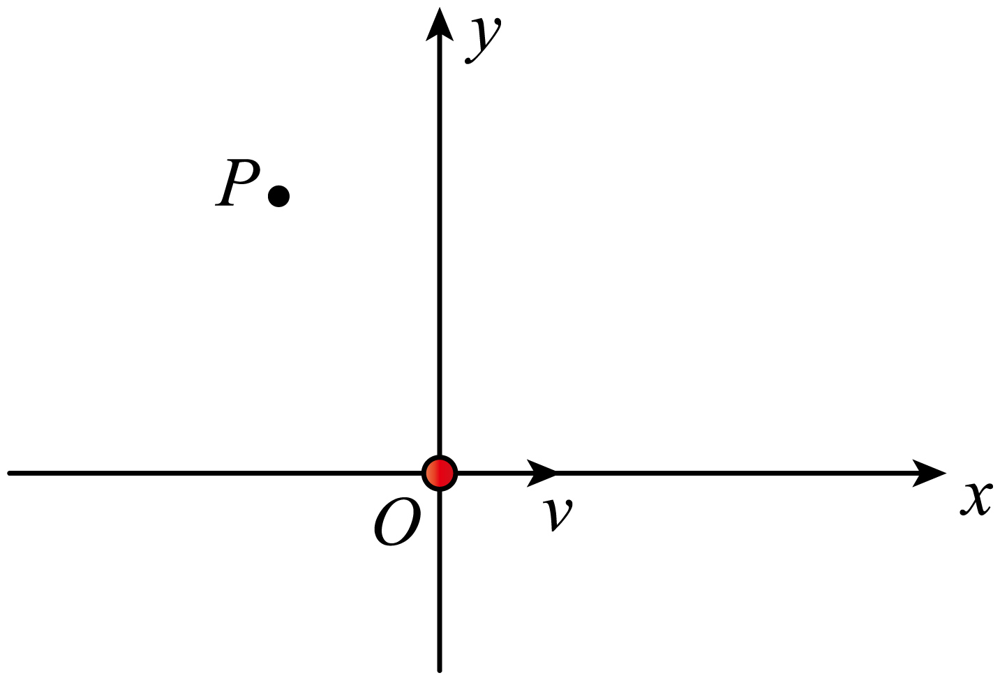

# Physics - 题目 782

**ID**: 51f58399ae474e9e96c4053fdc62a5f7
**年级**: Grade 12
**难度**: Medium-Hard
**题型**: Calculation

## 题目
如图所示，平面直角坐标系  $xOy$  位于竖直平面内，且  $x$轴水平。​​​​​​​‌整个平面内充满竖直方向的匀强电场以及磁感应强度大小为  $B$  、垂直  $xOy$  平面向外的匀强磁场（图中均未画出）。一比荷为  $k$的带负电小球甲 （可视为质点） 以一定速度  $v$  （未知）从坐标原点  $O$  沿  $+x$  方向射出，之后做匀速圆周运动并能经过  $P(-\frac{\sqrt{3}}{2}L，\frac{3}{2}L)$  点。已知重力加速度为  $g$  ，不计空气阻力。（1）求匀强电场的场强  $E$  的大小和方向；（2）求速度  $v$  的大小；（3）若小球甲发射时间  $\Delta t$  后，一与甲比荷相同、可视为质点的带负电小球乙从  $O$  点以大小为  $\sqrt {3}v$  的速度沿  $+y$方向射出，且甲、乙能在  $P$点相遇，不考虑两小球间的相互作用及碰撞，求  $Δt$  的所有可能值。

## 解答

1. （1）题意知负电小球甲做匀速圆周运动，可知小球受到的重力与电场力等大反向，即有 $Eq=mg$
2. 解得 $E=\frac {mg}{q}=\frac {g}{k}$
3. 由于小球甲带负电，则电场强度。
4. （2）设甲的轨迹圆半径为r，轨迹如下
5. 
6. 由几何关系可知 ${[\sqrt{{r}^{2}-{\left(\frac{\sqrt{3}L}{2}\right)^{2}}}+r]}^{2}+{\left(\frac{\sqrt{3}L}{2}\right)^{2}}={\left(\frac{\sqrt{3}L}{2}\right)^{2}}+{\left(\frac{3L}{2}\right)^{2}}$
7. 解得 $r=L$
8. 又因为 $qvB=m\frac {v{^{2}}}{r}$
9. 联立解得 $v=\frac{qBr}{m}=kBL$
10. （3）几何关系可知 $\sin \theta =\frac{\frac{\sqrt{3}}{2}L}{r}=\frac{\sqrt{3}}{2}$
11. 解得 $θ=60{}\degree $
12. 故甲从O运动到P扫过的圆心角为 $α=240{}\degree $
13. 可知甲从O点运动到P点时间 ${t}_{1}=\frac{240°}{360°}×\frac{2\pi m}{qB}=\frac{4\pi }{3kB}$
14. 题意可知乙的轨迹圆半径 $R=\frac{m\sqrt{3}v}{qB}=\sqrt{3}L$
15. 乙粒子轨迹如下
16. 
17. 几何关系可知 $\sin \beta =\frac{\frac{3}{2}L}{R}=\frac{\sqrt{3}}{2}$
18. 解得 $β=60{}\degree $
19. 可知乙从O点运动到P点时间 ${t}_{2}=\frac{60°}{360°}×\frac{2\pi m}{qB}=\frac{\pi }{3kB}$
20. 故 $\Delta t={t}_{1}-{t}_{2}+n{T}_{甲}=\frac{\pi }{kB}+n×\frac{2\pi m}{qB}=\frac{\pi }{kB}+\frac{2n\pi }{kB}(n=0，1，2，3...）$

## 知识点

**中文**:
  - 带电粒子在磁场中做圆周运动的多解问题

**English**:
  - Multi-solution Problems of Circular Motion in Magnetic Fields

---
