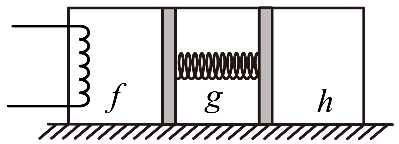
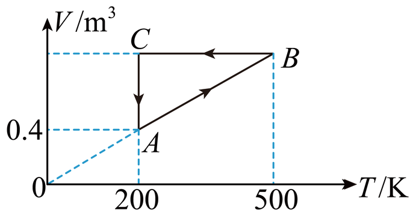

# Physics - 题目 1851

**ID**: 53842282876744408cb7c04affa216a7
**年级**: Grade 12
**难度**: Medium-Hard
**题型**: Calculation

## 题目
科学家在探究完微观粒子后，逐渐开始研究宏观与微观的联系，在高中阶段，最为典型的为气体。​​​​​​​‌如图，一封闭着理想气体的绝热汽缸置于水平地面上，用轻弹簧连接的两绝热活塞将汽缸分为f、g、h三部分，活塞与汽缸壁间没有摩擦。初始时弹簧处于原长，三部分中气体的温度、体积、压强均相等。现通过电阻丝对f中的气体缓慢加热，停止加热并达到稳定。12．能否比较f，g，h中气体的温度与压强的大小关系，如果可以，写出分析过程与结论，如果不能，写出部分可以写出的结论并说明为何无法判断。13．如图所示，一定质量的理想气体从状态A经过状态B、C又回到状态A，下列说法正确的是（      ）

## 解答

1. 12．未加热前，三部分中气体的温度、体积、压强均相等，当电阻丝对f中的气体缓慢加热时，f中的气体内能增大，温度升高，根据理想气体状态方程可知f中的气体压强增大，会缓慢推动左边活塞，可知h的体积也被压缩，压强变大，对活塞受力分析，根据平衡条件可知，弹簧弹力变大，则弹簧被压缩。当系统稳定时，活塞受力平衡，可知弹簧处于压缩状态，对左边活塞分析 $p{{}_{f}}S=F{{}_{弹}}+p{{}_{g}}S$ ，则有 $p{{}_{f}}>p{{}_{g}}$ ，对弹簧、活塞及g中的气体组成的系统分析，根据平衡条件可知，f与h中的气体压强相等，则有 $p{{}_{f}}=p{{}_{h}}$ ，即有 $p{{}_{f}}=p{{}_{h}}>p{{}_{g}}$
2. 13．A．A→B过程中气体温度升高，则气体分子的平均动能增加，根据理想气体状态方程有 $\frac {pV}{T}=C$ ，由于A→B过程， $V-T$ 图像过原点，表明压强一定，由于温度升高，分子运动的平均速率增大，则单位时间内撞击单位面积器壁的分子数减小，A错误；
3. B．状态A与状态C温度相等，内能相等，A→B过程中温度升高，内能增大，气体体积增大，气体对外界做功，气体一定从外界吸收热量，根据热力学第一定律可知，气体吸收的热量等于气体内能的增量与气体对外做功之和，B→C过程中气体温度降低，气体内能减小，气体体积不变，外界对气体做功为0，气体一定向外界放出热量，根据热力学第一定律可知，气体放出的热量等于气体内能减小量，由于A→B过程中与B→C过程中气体温度变化量的大小相等，则内能的变化量大小也相等，则A→B过程中气体吸收的热量大于B→C过程中气体放出的热量，B正确；
4. C．C→A过程，气体体积减小，则气体单位体积内分子数增加，由于C→A过程，温度一定，气体分子运动的平均速率一定，则单位时间内撞击单位面积器壁的分子数增大，C错误；
5. D．根据理想气体状态方程有 $\frac {pV}{T}=C$ ，可知， $V-T$ 图像上某点与原点连线的斜率间接表示压强的倒数，根据图像可知，C→A过程中气体压强小于A→B过程中中气体压强，由于两个过程体积的变化量大小相等，可知，A→B过程中气体对外做的功大于C→A过程中外界对气体做的功，D正确。选BD
6. 14．设当火箭以a=g的加速度竖直向上起飞时，舱内气体压强为 $p{{}_{2}}$ ，以气压计内的水银柱为研究对象，根据牛顿第二定律有 $p{{}_{2}}S-mg=ma$ ，解得 $p{{}_{2}}=\frac {2mg}{S}$ ，设水银密度为 $ρ$ ，此时水银气压计内液柱高度为h，则有 $mg=ρghS$ ，根据题意有 $0.6p{{}_{0}}=ρgh$ ，解得 $p{{}_{2}}=1.2p{{}_{0}}$ ，以舱内气体为研究对象，根据查理定律有 $\frac {p{{}_{0}}}{T{{}_{0}}}=\frac {p{{}_{2}}}{T{{}_{1}}}$ ，解得 $T{{}_{1}}=360{\rm{K}}$
7. 15．A．图甲中，法拉第利用该装置发现了电磁感应现象，A错误；
8. B．图乙中，根据条形磁体的磁感线分布特征可知，线圈穿过磁铁从M运动到L的过程中，穿过线圈的磁通量先增大后减小，B错误；
9. C．图丙中，闭合线框绕垂直于磁场方向的轴转动的过程中，穿过线框额磁通量发生变化，闭合线框中有感应电流产生，C错误；
10. D．图丁中，根据通电直导线的磁感线的分布特征，线框在与通电导线在同一平面内向右平移的过程中，穿过线框的磁通量发生变化，闭合线框中有感应电流产生，D正确。选D。
11. 16．令初始时，正方形边长为L，金属杆单位长度的电阻为 $r{{}_{0}}$ ，分别沿x轴正向和y轴负向以相同大小的速度匀速移动金属杆1、2时，1杆产生的感应电动势为 $E{{}_{1}}=B\left ({L-vt}\right )v$ ， 方向为顺时针，2杆产生的感应电动势为 $E{{}_{2}}=B\left ({L+vt}\right )v$ ， 方向为逆时针，可知，回路总的感应电动势为 $E=E{{}_{2}}-E{{}_{1}}=2Bv{^{2}}t$ ，方向沿逆时针方向，即回路中的感应电流方向为逆时针方向，回路中总电阻为 $R{{}_{总}}=2\left ({L+vt+L-vt}\right )r{{}_{0}}=4Lr{{}_{0}}$ ，则回路中的感应电流 $I=\frac {E}{R{{}_{总}}}=\frac {Bv{^{2}}t}{2Lr{{}_{0}}}$ ，可知，电流与时间成正比。通过金属杆截面的电荷量为 $q=It$ ，解得 $q=\frac {Bv{^{2}}t{^{2}}}{2Lr{{}_{0}}}$ ，可知，电量与时间成二次函数关系。作出图像如图所示
12. 
13. 17．（1）设初始时电容器两端到达电压为 $U{{}_{0}}$ ，由电容公式有 $C=\frac {Q{{}_{0}}}{U{{}_{0}}}$ ，对导体棒，由动量定理有 $B{\overline{I}}L\cdot Δt=m{{}_{1}}v{{}_{1}}-0$ ，导体棒从开始运动到稳定过程，设电容器极板上电荷量变化量为q，导体棒稳定后的电动势为E，有 $\frac {q}{U{{}_{0}}-E}=C$ ，整理有 $q=C\left ({U{{}_{0}}-E}\right )$ ，由电流的公式有 ${\overline{I}}=\frac {q}{Δt}$ ，导体棒切割磁感线的电动势为 $E=BLv{{}_{1}}$ ，解得 $v{{}_{1}}=\frac {8}{5}{\rm{m}}{\rm{/}}{\rm{s}}$
14. （2）由于导体棒恰好能从 $C{{}_{1}}C{{}_{2}}$ 处沿切线进入圆弧轨道，设进入瞬间导体棒的速度为 $v{{}_{2}}$ ，有 $v{{}_{2}}=\frac {v{{}_{1}}}{{\cos}θ}$ ，解得 $v{{}_{2}}=2{\rm{m}}{\rm{/}}{\rm{s}}$ ，设导体棒在与金属框碰撞前的速度为 $v{{}_{3}}$ ，由动能定理有 $m{{}_{1}}gr\left ({1-{\cos}θ}\right )=\frac {1}{2}m{{}_{1}}v{{}_{3}^{2}}-\frac {1}{2}m{{}_{1}}v{{}_{2}^{2}}$ ，解得 $v{{}_{3}}=3{\rm{m}}{\rm{/}}{\rm{s}}$ ，金属棒和线框发生完全非弹性碰撞，设碰后速度为 $v{{}_{共}}$ ，有 $m{{}_{1}}v{{}_{3}}=\left ({m{{}_{1}}+m{{}_{2}}}\right )v{{}_{共}}$ ，解得 $v{{}_{共}}=1{\rm{m}}{\rm{/}}{\rm{s}}$ ，由题意分析可知，线框在进入磁场到出磁场过程中，始终只有一条边切割磁感线，则其电动势为 $E{{}_{1}}=B{{}_{x}}Lv{{}_{共}}$ ，则线框内的电流为 $I=\frac {E{{}_{1}}}{R}$ ，线框进入磁场过程中所受安培力为 $F{{}_{安}}=BIL=\frac {B{{}_{x}^{2}}L{^{2}}v{{}_{共}}}{R}=5x\left ({{\rm{N}}}\right )$ ，线框进入过程所产生的焦耳热与线框克服安培力所做的功相同，为 $Q{{}_{1}}={\overline{F{{}_{安}}}}x$ ，由上述安倍力的表达式可知，安倍力随着进入磁场的距离均匀变化，所以进入过程中，安培力的平均值为 ${\overline{F{{}_{安}}}}=\frac {F{{}_{安初}}+F{{}_{安末}}}{2}\mathrm{=}\frac {0+5\times 0.5}{2}{\rm{N}}\mathrm{=}1\mathrm{.}25\mathrm{Ν}$ ，线框出磁场和进入磁场过程，克服安培力做功的相同，所以整个过程，线框产生的焦耳热为 $Q=2Q{{}_{1}}\mathrm{=}1.25{\rm{J}}$
15. （3）线框进入磁场过程由动量定理有 $-\sum \frac {B{{}_{x}^{2}}L{^{2}}v}{R}\cdot Δt=\left ({m{{}_{1}}+m{{}_{2}}}\right )\left ({v{{}_{4}}-v{{}_{共}}}\right )$ ，整理有 $-\sum 5x\cdot Δx=\left ({m{{}_{1}}+m{{}_{2}}}\right )\left ({v{{}_{4}}-v{{}_{共}}}\right )$ ， $0\mathrm{<}x\mathrm{<}0.5{\rm{m}}$ ，解得 $v{{}_{4}}=\frac {1}{6}{\rm{m}}{\rm{/}}{\rm{s}}<v{{}_{共}}-v{{}_{4}}$ ，所以线框不能完全离开磁场，则有 $-\sum 5x\cdot Δx=-\frac {5}{2}x{^{2}}=0-\left ({m{{}_{1}}+m{{}_{2}}}\right )v{{}_{4}}$ ，解得 $x=\frac {\sqrt {5}}{10}{\rm{m}}$

## 知识点

**中文**:
  - 产生感应电流的条件
  - 电磁感应现象中的功能问题
  - 气体的V-T（V-t）图像问题

**English**:
  - Conditions for Induced Current
  - Work-Energy Problems in EM Induction
  - V-T (V-t) Graph Problems

---
