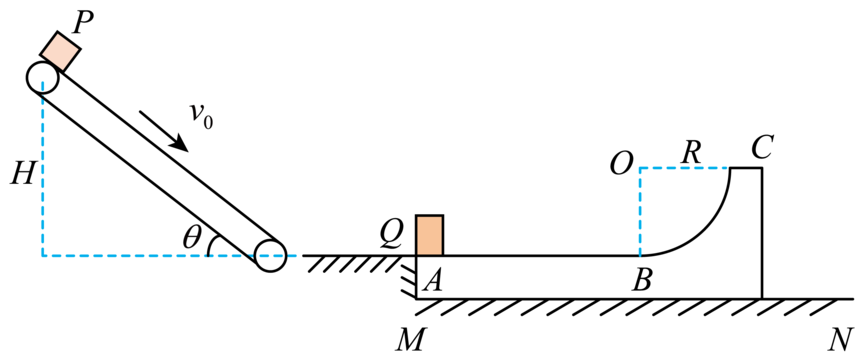

# Physics - 题目 1929

**ID**: 557113426c7249bfb49c2ff795843417
**年级**: Grade 12
**难度**: Medium-Hard
**题型**: Calculation

## 题目
如图所示，倾斜传送带与水平面夹角为 $θ$ ，顺时针运行速度 $v{{}_{0}}=4{\rm{m}}/{\rm{s}}$ ，下端与光滑水平轨道平滑连接。​​​​​​​‌小物块P从传送带顶端由静止释放，当小物块运动至光滑水平轨道末端恰好与静置在长木板左端等高位置的物块Q发生弹性碰撞。长木板水平部分AB粗糙，右端为四分之一光滑圆弧轨道，半径 $R=0.1{\rm{m}}$ 。已知物块Q离开C点后能上升的最大高度 $h=0.2{\rm{m}}$ ，小物块P与传送带间的动摩擦因数 $μ{{}_{1}}=\frac {\sqrt {3}}{5}$ ，物块Q与木板上表面AB间动摩擦因数 $μ{{}_{2}}=0.6$ ，物块P、Q的质量 $m{{}_{1}}=m{{}_{2}}=1.0kg$ ，长木板的质量 $m{{}_{1}}=2.0kg$ ，重力加速度 $g=10{\rm{m}}/{\rm{s}}{^{2}}$ ， $H=3{\rm{m}}$ ， $θ=30{^{\circ }}$ ，水平面MN光滑且足够长，忽略空气阻力。求：(1)物块P运动到传送带底端时的速度大小 $v{{}_{1}}$ ；(2)物块P与传送带间因摩擦产生的热量；(3)若物块Q能停在木板上，求Q最终停在木板上的位置；若不能，求Q离开木板时的速度大小。

## 解答

1. （1）物块P释放后，设加速度为 $a{{}_{1}}$ ，经时间 $t{{}_{1}}$ 速度为 $v{{}_{0}}$ ，位移为 $x{{}_{1}}$ ，有 $m{{}_{1}}g{\rm{s}}{\rm{i}}{\rm{n}}θ+μ{{}_{1}}m{{}_{1}}g{\rm{c}}{\rm{o}}{\rm{s}}θ=m{{}_{1}}a{{}_{1}}$ ，
2. 得 $a{{}_{1}}=8{\rm{m}}{\rm{/}}{\rm{s}}{^{{{2}}}}$ ，
3. 根据 $v{{}_{0}}=a{{}_{1}}t{{}_{1}}$ ，得 $t{{}_{1}}=0{{.}}{{5}}{\rm{s}}$ ，
4. 根据 $x{{}_{1}}=\frac {1}{2}a{{}_{1}}t{{}_{1}^{2}}$ ，得 $x{{}_{1}}=1{\rm{m}}$ ，
5. 设物块P速度达到 $v{{}_{0}}$ 后，加速度为 $a{{}_{2}}$ ，再经时间 $t{{}_{2}}$ 到传送带末端，由 $m{{}_{1}}g{\rm{s}}{\rm{i}}{\rm{n}}θ-μ{{}_{1}}m{{}_{1}}g{\rm{c}}{\rm{o}}{\rm{s}}θ=m{{}_{1}}a{{}_{2}}$ ，
6. 得 $a{{}_{2}}=2{\rm{m}}{\rm{/}}{\rm{s}}{^{{{2}}}}$ ，
7. 根据 $\frac {H}{{\rm{s}}{\rm{i}}{\rm{n}}θ}-x{{}_{1}}=v{{}_{0}}t{{}_{2}}+\frac {1}{2}a{{}_{2}}t{{}_{2}^{2}}$ ，
8. 得 $t{{}_{2}}=1{\rm{s}}$ ，
9. 由 $v{{}_{1}}=v{{}_{0}}+a{{}_{2}}t{{}_{2}}$ ，得 $v{{}_{1}}=6{\rm{m}}{\rm{/}}{\rm{s}}$ 。
10. （2）物块P与传送带间的相对运动路程为 $L{{}_{0}}$ ，根据 $L{{}_{0}}=v{{}_{0}}t{{}_{1}}+\frac {H}{{\rm{s}}{\rm{i}}{\rm{n}}θ}-2x{{}_{1}}-v{{}_{0}}t{{}_{2}}$ ，
11. 得 $L{{}_{0}}=2{\rm{m}}$ ，
12. 设因摩擦产生的热量为Q，则 $Q=μ{{}_{1}}m{{}_{1}}g{\rm{c}}{\rm{o}}{\rm{s}}θ\cdot L{{}_{0}}$ ，
13. 得 $Q=6{\rm{J}}$ 。
14. （3）设P与Q发生弹性碰撞后，速度分别为 $v{{}_{{\rm{P}}}}$ ， $v{{}_{2}}$ 。以 $v{{}_{1}}$ 方向为正方向，由动量守恒定律得 $m{{}_{1}}v{{}_{1}}=m{{}_{1}}v{{}_{{\rm{P}}}}+m{{}_{2}}v{{}_{2}}$ ，
15. 由机械能守恒定律得 $\frac {1}{2}m{{}_{1}}v{{}_{1}^{2}}=\frac {1}{2}m{{}_{1}}v{{}_{{\rm{P}}}^{{{2}}}}+\frac {1}{2}m{{}_{2}}v{{}_{2}^{2}}$ ，
16. 得 $v{{}_{{\rm{P}}}}=0$ , $v{{}_{2}}=6{\rm{m}}{\rm{/}}{\rm{s}}$ ，
17. 设AB间长度为L，Q离开轨道到最高点时速度为v，以 $v{{}_{2}}$ 方向为正方向，由水平方向动量守恒得 $m{{}_{2}}v{{}_{2}}=\left ({m{{}_{2}}+m{{}_{3}}}\right )v$ ，
18. 由能量守恒得 $\frac {1}{2}m{{}_{2}}v{{}_{2}^{2}}=μ{{}_{2}}m{{}_{2}}gL+\frac {1}{2}(m{{}_{2}}+m{{}_{3}})v{^{2}}+m{{}_{2}}g(R+h)$ ，
19. 得 $v=2{\rm{m}}{\rm{/}}{\rm{s}}$ ， $L=1.5{\rm{m}}$ ，
20. 若Q停在木板上距B端x处，有 $\frac {1}{2}m{{}_{2}}v{{}_{2}^{2}}=\frac {1}{2}(m{{}_{2}}+m{{}_{3}})v{^{2}}+μ{{}_{2}}m{{}_{2}}g(L+x)$ ，
21. 得 $x=0.5{\rm{m}}$ ，即物块Q停在木板上距B点 $0.5{\rm{m}}$ 处。

## 知识点

**中文**:
  - 动量和能量的综合应用

**English**:
  - Integration of Momentum and Energy

---
