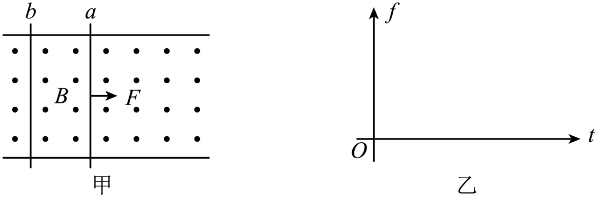

# Physics - 题目 2296

**ID**: 5616c387eb6f4daea75e8ea21e770299
**年级**: Grade 12
**难度**: Medium-Hard
**题型**: Calculation

## 题目
如图所示，水平固定、间距为L的平行金属导轨处于竖直向上的匀强磁场中，磁感应强度的大小为B。​​​​​​​‌与导轨垂直且接触良好的导体棒a、b，质量均为m，电阻均为R。现对a施加水平向右的恒力，使其由静止开始向右运动。当a向右的位移为x时，a的速度达到最大且b刚要滑动。已知两棒与导轨间的动摩擦因数均为 $μ$ ，设最大静摩擦力等于滑动摩擦力，不计导轨电阻，重力加速度为g。（1）导体棒b刚要滑动时，导体棒a的最大速度 $v{{}_{m}}$ ；（2）定性画出导体棒b所受摩擦力f大小随时间t变化的图像；（3）导体棒a发生位移x的过程中，回路中产生的总焦耳热Q；（4）当导体棒a达到最大速度 $v{{}_{{\rm{m}}}}$ 时，给b水平向右的瞬时速度 $v{{}_{0}}\left ({v{{}_{0}}<v{{}_{{\rm{m}}}}}\right )$ 。请分析此后导体棒b的运动情况并求出b的最终速度 $v{{}_{b}}$ 。

## 解答

1. （1）设导体棒 $b$ 刚要滑动时回路中电流为 $I$ ，对导体棒 $b$ 有
2. $BIL={\rm μm}g$ ①
3. 对整个回路
4. $BLv{{}_{{\rm{m}}}}=2IR$ ②
5. 解得
6. $v{{}_{{\rm{m}}}}=\frac {2{\rm μm}gR}{B{^{2}}L{^{2}}}$
7. （2）导体棒 $b$ 未滑动前，所受摩擦力为静摩擦力，大小等于安培力，随着导体棒 $a$ 速度增大，回路中感应电流变大，导体棒 $a$ 所受的安培力变大，则导体棒 $a$ 做加速度逐渐减小的加速运动，电流变化率逐渐变小，则导体棒 $b$ 摩擦力随时间的变化率逐渐变小，导体棒 $b$ 滑动后，为滑动摩擦力，恒定不变，当导体棒b所受摩擦力f大小随时间t变化的图像如图
8. 
9. （3）导体棒 $b$ 刚要滑动时，对导体棒 $a$
10. $F={\rm μm}g+BIL$
11. 整个过程中对系统，由功能关系
12. $Fx={\rm μm}gx+\frac {1}{2}mv{{}_{{\rm{m}}}^{2}}+Q$
13. 解得
14. $Q={\rm μm}gx-\frac {2μ{^{2}}m{^{3}}g{^{2}}R{^{2}}}{B{^{4}}L{^{4}}}$
15. （4）导体棒 $b$ 做初速度为 $v{{}_{0}}$ ，加速度减小的减速运动，当加速度减至0时，匀速，由以上式子可得
16. $F=2{\rm μm}g$
17. 导体棒 $b$ 获得瞬时速度后， $a$ 、 $b$ 系统动量守恒，设最终导体棒 $a$ 的速度为 $v{{}_{a}}$ ，对 $a$ 、 $b$ 系统，由动量守恒
18. $mv{{}_{0}}+mv{{}_{{\rm{m}}}}=mv{{}_{a}}+mv{{}_{b}}$
19. 当导体棒加速度减为0时
20. $I=\frac {BL\left ({v{{}_{α}}-v{{}_{b}}}\right )}{2R}$
21. 联立解得
22. $v{{}_{b}}=\frac {v{{}_{0}}}{2}$

## 知识点

**中文**:
  - 双杆模型

**English**:
  - Double Rod Model

---
