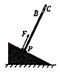

# Physics - 题目 481

**ID**: 56fc37ca3a7b44a28388132a4d4b4776
**年级**: Grade 12
**难度**: Medium-Hard
**题型**: Calculation

## 题目
如图所示，一根均匀圆形直轻杆AC由粗细不同两段AB＝10m和BC＝2m组成，其中，AB段粗糙、BC段光滑，直轻杆AC垂直地固定在一块倾角为37°的楔形弹性斜面体上，弹性斜面体放在粗糙的水平面上，现有一质量为m＝2kg、孔径略大于直杆直径的圆环P，在沿杆向上的恒力F的作用下，从直轻杆AC的底端由静止开始沿杆向上运动，圆环P与杆间的动摩擦因数为0.​​​​​​​‌1，当圆环P刚运动到B点时恒力F突然撤去，圆环刚好能到达顶端C，然后，再沿直轻杆下滑，环在整个运动过程中，弹性斜面体始终静止不动．重力加速度为g＝10m/s^{2}，sin37°＝0.6，cos37°＝0.8．求：（1）在圆环P沿杆AB向上运动的过程中，地面对弹性斜面体的摩擦力；（2）恒力F的最大功率；（3）环从开始运动到第二次碰撞弹性斜面体的过程中，系统产生的热量．

## 解答

1. (1)环与直轻杆之间的滑动摩擦力大小为f_{AB}＝μmgcos53°
2. 环对杆的压力N_{AB}＝mgcos53°
3. 以弹性斜面体为研究对象，在水平方向上有
4. f_{0}＝f_{AB}cos53°+N_{AB}cos37°
5. 由以上两式解得地面对弹性斜面体的摩擦力f_{0}＝10.32N，方向水平向左．
6. (2)在圆环从A→C的过程中，由动能定理得:
7. Fx_{1}-mg(x_{1}+x_{2})sin53°-μmgx_{1}cos53°＝0
8. 在圆环从B→C的过程中，由机械能守恒得:
9. $\frac {1}{2}mv{{}_{B}^{2}}$ ＝mgx_{2}sin53°
10. 恒力F的最大功率P_{m}＝Fv_{B}
11. 联立解得:P_{m}＝81.6 $\sqrt {2}$ W≈115.4W
12. (3)设第一次碰撞前圆环的动能为E_{k}，由动能定理得:
13. Fx_{1}﹣2μmgx_{1}cos53°＝E_{k}
14. 设第一碰撞后向上运动的距离为x，由动能定理得
15. mgxsin53°﹣μmgxcos53°＝0﹣E_{k}
16. 解得:x＝10.47m＞x_{1}＝10m
17. 系统产生的热量
18. Q＝(μmgcos53°)×x_{1}×4
19. 解得:Q＝48J.

## 知识点

**中文**:
  - 动能定理在往返运动中的应用
  - 应用动能定理求解多阶段、多过程问题

**English**:
  - Applications in Reciprocating Motion
  - Multi-stage/Multi-process Problems

---
