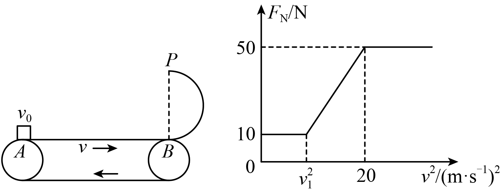

# Physics - 题目 922

**ID**: 5889463f1b8f46bfa7430098efb4bda4
**年级**: Grade 12
**难度**: Medium-Hard
**题型**: Calculation

## 题目
如图所示，竖直平面内的光滑半圆轨道和水平顺时针匀速传动的传送带 $AB$ 恰好相切于B点，传送带 $AB$ 间距 $L=1{\rm{m}}$ 。​​​​​​​‌现有一个质量为 $m=1{\rm{k}}{\rm{g}}$ 的小滑块（可视为质点），以一定的水平初速度 $v{{}_{0}}$ 从A点滑上传送带，若传送带以不同的速度v匀速传动，测得滑块运动至圆轨道最高点P时，对轨道的压力（ $F{{}_{{\rm{N}}}}$ ）与传送带传动速度的平方（ $v{^{2}}$ ）的关系图像如下图所示。重力加速度g取 ${\rm{1}}{\rm{0}}{\rm{m}}{\rm{/}}{\rm{s}}{^{{\rm{2}}}}$ 。求：(1)光滑半圆轨道的半径R；(2)小滑块运动到B点的最小速率；(3)小滑块的水平初速度 $v{{}_{0}}$ 的大小和滑块与传送带间的动摩擦因数 $μ$ ；(4)传送带的速度v取何值时，滑块从A运动到B的过程中与传送带间摩擦生热为 $\sqrt {3}{\rm{J}}$ 。（结果可用分式或根式表示）

## 解答

1. (1)研究滑块B-P过程，由动能定理，得
2. ${\rm{-}}mg2R=\frac {1}{2}mv{{}_{P}^{2}}-\frac {1}{2}mv{{}_{B}^{2}}$
3. 研究滑块在P点，由牛顿第二定律，得
4. $F{{}_{{\rm{N}}}}+mg=m\frac {v{{}_{P}^{2}}}{R}$
5. 将 $v{{}_{2}^{2}}=20{\rm{m}}{^{{\rm{2}}}}{\rm{/}}{\rm{s}}{^{{\rm{2}}}}$ ， $F{{}_{{\rm{N}}}}=50{\rm{N}}$ 代入，得
6. $R=0.2{\rm{m}}$
7. (2)研究滑块在P点，由牛顿第二定律，得
8. $F{{}_{{\rm{N}}1}}+mg=m\frac {v{{}_{P1}^{2}}}{R}$
9. 研究滑块B-P过程，由动能定理，得
10. ${\rm{-}}mg2R=\frac {1}{2}mv{{}_{P1}^{2}}-\frac {1}{2}mv{{}_{1}^{2}}$
11. 将 $R=0.2{\rm{m}},F{{}_{{\rm{N}}1}}=10{\rm{N}}$ 代入，得
12. $v{{}_{1}}=2\sqrt {3}{\rm{m}}{\rm{/}}{\rm{s}}$
13. (3)由题意，得
14. $v{{}_{0}^{2}}-2al=12$
15. $v{{}_{0}^{2}}+2al=20$
16. $a=μg$
17. 联立得
18. $\hspace{-0.5em}\begin{array}{l}v{{}_{0}}=4{\rm{m}}{\rm{/}}{\rm{s}}\\μ=0.2\end{array}\hspace{-0.5em}$
19. (4) 滑块从A运动到B的过程中与传送带间摩擦生热
20. $Q={\rm μm}gs{{}_{相对}}$
21. 可得
22. $s{{}_{相对}}=\frac {\sqrt {3}}{2}{\rm{m}}$
23. 若滑块一直减速，则
24. $s{{}_{相对}}=l-vt{{}_{1}}$
25. $t{{}_{1}}=\frac {v{{}_{1}}-v{{}_{0}}}{-μg}=\frac {2\sqrt {3}-4}{-2}{\rm{s}}=\left ({2-\sqrt {3}}\right ){\rm{s}}$
26. $v{~}=\frac {1}{2}{\rm{m}}{\rm{/}}{\rm{s}}$
27. 若滑块一直加速，则
28. $s{{}_{相对}}=v^{′}t{{}_{2}}-l$
29. $t{{}_{2}}=\frac {v{{}_{2}}-v{{}_{0}}}{μg}=\frac {2\sqrt {5}-4}{2}{\rm{s}}=\left ({\sqrt {5}-2}\right ){\rm{s}}$
30. $v^{′}=\frac {2+\sqrt {3}}{2\left ({\sqrt {5}-2}\right )}{\rm{m}}{\rm{/}}{\rm{s}}=\left ({\frac {\sqrt {15}}{2}+\sqrt {3}+\sqrt {5}+2}\right ){\rm{m}}{\rm{/}}{\rm{s}}$

## 知识点

**中文**:
  - 传送带模型
  - 牛顿运动定律与图像结合问题
  - 绳球模型圆周运动中机械能守恒定律的应用
  - 传送带模型中的能量守恒问题

**English**:
  - Conveyor Belt Model
  - Newton's Laws and Graphs
  - String-Ball Circular Motion Models
  - Energy Conservation in Conveyor Belt Models

---
