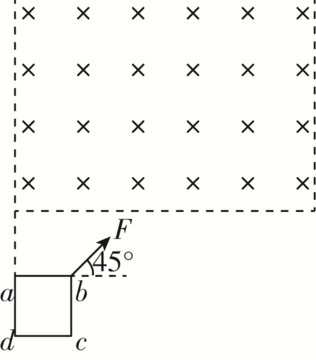

# Physics - 题目 1001

**ID**: 58d73f116f404929bf8fc86565427b2b
**年级**: Grade 12
**难度**: Medium-Hard
**题型**: 解答题：本题共3小题，共40分。

## 题目
(15分)如图所示，高度足够的匀强磁场区域下边界水平、左右边界竖直，磁场方向垂直于纸面向里。​​​​​​​‌正方形单匝线框abcd的边长L＝0.2 m、回路电阻R＝1.6×10^{－3}Ω、质量m＝0.2 kg。线框平面与磁场方向垂直，线框的ad边与磁场左边界平齐，ab边与磁场下边界的距离也为L。现对线框施加与水平向右方向成θ＝45°角、大小为 ${\rm 4}\sqrt{2\mathrm{ }}{\rm N}$ 的恒力F，使其在图示竖直平面内由静止开始运动。从ab边进入磁场开始，在竖直方向线框做匀速运动；dc边进入磁场时，bc边恰好到达磁场右边界。重力加速度大小取g＝10 m/s^{2}，求：(1)ab边进入磁场前，线框在水平方向和竖直方向的加速度大小；(2)磁场的磁感应强度大小和线框进入磁场的整个过程中回路产生的焦耳热；(3)磁场区域的水平宽度。

## 解答

1. (1)进入磁场前，线框在水平方向上向右做匀加速直线运动，在竖直方向上向上做匀加速直线运动。
2. 水平方向有Fcos 45̊＝ma_{x}_{    	}_{    	}_{    	}_{    	}_{    	}_{    	}_{    	}(1分)
3. 竖直方向有Fsin 45̊－mg＝ma_{y}_{    	}_{    	}_{    	}_{    	}_{    	}_{    	}(1分)
4. 解得a_{x}＝20 m/s^{2}，a_{y}＝10 m/s^{2}^{    	}^{    	}^{    	}^{    	}^{    	}^{    	}(2分)
5. (2)线框进入磁场过程中，水平方向继续做匀加速直线运动，竖直方向做匀速直线运动。只考虑ab边在磁场中的切割及ab所受安培力，其余边均对称抵消。
6. 线框ab边刚到磁场边界时，
7. 竖直方向的速度v_{y}满足 ${v}_{y}^{2}{\rm ＝2\mathit{a}\mathit{_{y}}\mathit{L}}$ ，解得v_{y}＝2 m/s    	    	    	    	(2分)
8. 线框在竖直方向做匀速运动有Fsin 45̊ ${\rm ＝\mathit{mg}＋}\frac{{B}^{2}{L}^{2}{v}_{y}}{R}$     	    	    	(2分)
9. 解得B＝0.2 T    	    	    	    	    	    	    	    	    	(1分)
10. 线框在进入磁场过程中，运动的时间 ${\rm \mathit{t}_{2}＝}\frac{L}{{v}_{y}}{\rm ＝0.1}$  s    	    	    	    	(1分)
11. 线框中的电流 ${\rm \mathit{I}＝}\frac{BL{v}_{y}}{R}{\rm ＝50}$  A    	    	    	    	    	    	    	(1分)
12. 则Q＝I^{2}Rt_{2}＝0.4 J    	    	    	    	    	    	    	    	(1分)
13. (3)线框在进入磁场前，运动时间 ${\rm \mathit{t}_{1}＝}\frac{{v}_{y}}{{a}_{y}}{\rm ＝0.2}$  s    	    	    	    	(1分)
14. 线框在水平方向做匀加速直线运动，
15. 位移 ${\rm \mathit{x}＝}\frac{1}{2}{\rm \mathit{a}\mathit{_{x}}(\mathit{t}_{1}＋\mathit{t}_{2})^{2}＝0.9}$  m    	    	    	    	    	    	    	(1分)
16. 磁场区域的水平宽度d＝L＋x＝1.1 m    	    	    	    	    	(1分)

## 知识点

**中文**:
  - 线框模型

**English**:
  - Wire Frame Model

---
