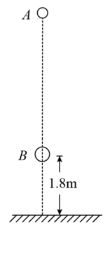

# Physics - 题目 1558

**ID**: 58fe1dfc4d5a4f518682046f20ce7e26
**年级**: Grade 12
**难度**: Medium-Hard
**题型**: Calculation

## 题目
如图所示，质量分别为m_{A}、m_{B}的两个弹性小球A、B静止在地面上方，B球距地面的高度h=1.8 m，A球在B球的正上方，距地面的高度H=4.2 m。​​​​​​​‌同时将两球释放，经过一段时间后两球发生第一次弹性正撞。所有碰撞时间忽略不计，已知m_{B}=3m_{A}，重力加速度g=10 m/s^{2}，忽略空气阻力和球的大小及所有碰撞中的动能损失。求：（1）第一次碰撞点距地面的高度；（2）第一次碰后A球上升的最大距离；（3）两球第二次相碰时距地面的高度（计算中取 $\sqrt {6}\approx 2.45$ ，结果保留两位有效数字）。

## 解答

1. （1）设释放后 $t{{}_{1}}$ 时刻 $B$ 球落地
2. $h=\frac {1}{2}gt{{}_{1}^{2}}$
3. $t{{}_{1}}=\sqrt {\frac {2h}{g}}=0.6{\rm{s}}$
4. $B$ 球速度大小 $v{{}_{1}}$ 与A球速度大小相等
5. $v{{}_{1}}=gt{{}_{1}}$
6. $v{{}_{1}}=6{\rm{m}}/{\rm{s}}$
7. 此时A球距离地面
8. $H{{}_{1}}=H-h=2.4{\rm{m}}$
9. 设 $B$ 球反弹后再经过 $t{{}_{2}}$ 时间相遇，有
10. $v{{}_{1}}t{{}_{2}}-\frac {1}{2}gt{{}_{2}^{2}}+v{{}_{1}}t{{}_{2}}+\frac {1}{2}gt{{}_{2}^{2}}=H{{}_{1}}$
11. 解得
12. $t{{}_{2}}=0.2{\rm{s}}$
13. 相遇点距地面的高度
14. $h{{}_{1}}=v{{}_{1}}t{{}_{2}}-\frac {1}{2}gt{{}_{2}^{2}}$
15. 解得
16. $h{{}_{1}}=1.0{\rm{m}}$
17. （2）碰撞前A球的速度
18. $v{{}_{{\rm A}}}=v{{}_{1}}+gt{{}_{2}}=8{\rm{m}}/{\rm{s}}$
19. $B$ 球的速度大小
20. $v{{}_{{\rm B}}}=v{{}_{1}}-gt{{}_{2}}=4{\rm{m}}/{\rm{s}}$
21. A、B碰撞过程动量守恒，机械能守恒，规定竖直向上为正方向
22. $3mv{{}_{{\rm B}}}-mv{{}_{{\rm A}}}=3mv{{}_{{\rm B}1}^{\prime }}+mv{{}_{{\rm A}{\rm{l}}}^{\prime }}$
23. $\frac {1}{2}\times 3mv{{}_{{\rm B}}^{2}}+\frac {1}{2}mv{{}_{{\rm A}}^{2}}=\frac {1}{2}\times 3mv{{}_{{\rm B}1}^{\prime 2}}+\frac {1}{2}mv{{}_{{\rm A}{\rm{l}}}^{\prime 2}}$
24. 联立得
25. $v{{}_{{\rm B}1}^{\prime }}=-2{\rm{m}}/{\rm{s}}$ ， $v{{}_{{\rm A}1}^{\prime }}=10{\rm{m}}/{\rm{s}}$
26. 球A上升的最大距离
27. $h{^{^{′}}}=\frac {v{{}_{{\rm A}1}^{\prime 2}}}{2g}=5{\rm{m}}$
28. （3）第一次碰后 $B$ 球再经 $t{{}_{3}}$ 时间与地面第二次相碰，碰撞前速度
29. $v{{}_{{\rm B}2}}=\sqrt {v{{}_{{\rm B}1}^{\prime 2}}+2gh{{}_{1}}}=2\sqrt {6}{\rm{m}}/{\rm{s}}=4.9{\rm{m}}/{\rm{s}}$
30. 碰撞后下落时间
31. $t{{}_{3}}=\frac {v{{}_{{\rm B}2}}-v{{}_{{\rm B}1}^{\prime }}}{g}=0.29{\rm{s}}$
32. 碰后经过 $t{{}_{3}^{\prime }}=1{\rm{s}}$ ，A球运动到最高点。 $B$ 球在
33. $t{{}_{3}}+\frac {v{{}_{{\rm B}}}{{}_{2}}}{g}=0.78{\rm{s}}$
34. 末到达最高点，高度为 $1.2{\rm{m}}$ ，在 $1.27{\rm{s}}$ 时刻落地，反弹速度为 $4.9{\rm{m}}/{\rm{s}}$ ，A球从最高点下落 $t{{}_{{\rm A}}}=0.27{\rm{s}}$ 时离地面高度为 $5.636{\rm{m}}$ ，此时速度
35. $v{{}_{{\rm A}2}}=gt{{}_{{\rm A}}}=2.7{\rm{m}}/{\rm{s}}$
36. 设再经时间 $t{{}_{4}}$ 相遇，有
37. $v{{}_{{\rm B}2}}t{{}_{4}}-\frac {1}{2}gt{{}_{4}^{2}}+v{{}_{{\rm A}2}}t{{}_{4}}+\frac {1}{2}gt{{}_{4}^{2}}=5.636{\rm{m}}$
38. 解得
39. $t{{}_{4}}=0.74{\rm{s}}$
40. 相遇相遇点高度为
41. $H{{}_{2}}=v{{}_{{\rm B}2}}t{{}_{4}}-\frac {1}{2}gt{{}_{4}^{2}}$
42. 代入数据解得
43. $H{{}_{2}}=0.89{\rm{m}}$

## 知识点

**中文**:
  - 动量守恒中的多次碰撞问题
  - 自由落体运动和竖直上抛运动的相遇问题
  - 求解弹性碰撞问题

**English**:
  - Multiple Collisions in Momentum Conservation
  - Encounter Problems: Free Fall and Vertical Throw
  - Solving Elastic Collision Problems

---
