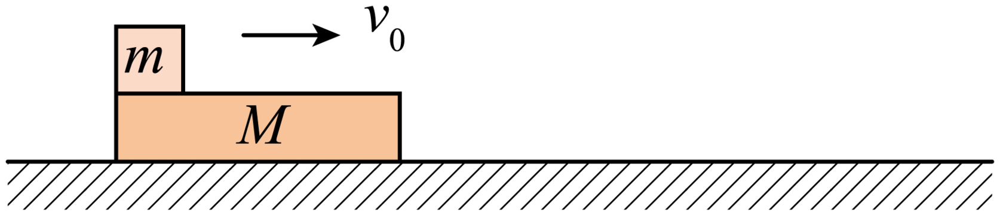

# Physics - 题目 1399

**ID**: 591551d811db47f586ad7731c68c4591
**年级**: Grade 12
**难度**: Medium-Hard
**题型**: Calculation

## 题目
如图所示，质量为 $M$ 且足够长的木板静止在光滑的水平地面上，一质量为 $m$ 的滑块以速度 $v{{}_{0}}$ 从最左端冲上木板，滑块与木板间的动摩擦因数为 $μ$ ，重力加速度大小为 $g$ 。​​​​​​​‌则：（1）经过足够长的时间，求系统产生的热量；（2）若 $M=2m$ ，开始时在离木板右侧 $L$ 处固定一块挡板（图中未画出），木板只与右侧挡板发生2次弹性碰撞（碰撞前后木板的速度大小不变，方向相反），求 $L$ 满足的条件；（3）若 $M=2m$ ，开始时在离木板右侧距离 $L⩾\frac {v{{}_{0}^{2}}}{25μg}$ 的右侧某位置固定一块挡板（图中未画出），木板与右侧挡板发生弹性碰撞后立刻将挡板撤走（碰撞前后木板的速度大小不变，方向相反），求滑块冲上木板之后，经过足够长的时间，系统产生热量的可能取值范围。

## 解答

1. （1）经过足够长的时间，滑块与木板将会达到共同速度v，对滑块与木板组成的系统，以水平向右的方向为正方向，由动量守恒定律得mv_{0}=（m+M）v，
2. 由能量守恒定律得 $\frac {1}{2}mv{{}_{0}^{2}}=\frac {1}{2}(m+M)v{^{2}}+Q$ ，
3. 联立解得 $Q=\frac {1}{2}\cdot \frac {Mm}{M+m}v{{}_{0}^{2}}$ 。
4. （2）如图为两种临界情况示意图：
5. 
6. 物块减到0的时间是固定的，为 $t=\frac {v{{}_{0}}}{μg}$ ，
7. 木块向右加速和向左减速是对称的，段数越多，每段时间就越短，L就越小，加速时，对木板由牛顿第二定律得μmg=Ma，
8. 即 ${\rm \mathit{a}=}\frac {1}{2}{\rm \mathit{μg}\mathit{，}}$
9. 加速时间最长为t，则2t_{1}=t，
10. 对应最长长度为 $L{{}_{{\rm{m}}{\rm{a}}{\rm{x}}}}=\frac {1}{2}\times \frac {1}{2}μg\times t{{}_{1}^{2}}=\frac {v{{}_{0}^{2}}}{16μg}$ ，
11. 加速时间最短为t_{2}，则4t_{2}=t，
12. 对应最短长度为 $L{{}_{{\rm \min }}}=\frac {1}{2}\times \frac {1}{2}μg\times t{{}_{2}^{2}}=\frac {v{{}_{0}^{2}}}{64μg}$ ，
13. 最长长度L_{max}，如果取等号，物块和木板将会共速为零停下，不会有第二次碰撞；不取等号，L比L_{max}略小一点，则当木板速度减为零时，物块还有向右的速度（很小），就会带着木板向右发生第二次碰撞，
14. 综上所述可知，L应满足的条件是： $\frac {v{{}_{0}^{2}}}{64μg}⩽L<\frac {v{{}_{0}^{2}}}{16μg}$ 。
15. （3）木板将要与挡板发生碰撞时，滑块的速度为v_{1}，木板的速度为v_{2}，对滑块与木板组成的系统，以水平向右的方向为正方向，由动量守恒定律得mv_{0}=mv_{1}+Mv_{2}，
16. 木板与挡板发生碰撞后，经过足够长时间滑块与木板共速，对滑块与木板组成的系统，取v_{1}方向为正方向，由动量守恒定律得mv_{1}-Mv_{2}=（m+M）v，
17. 滑块冲上木板至最终滑块与木板共速的整个过程，由能量守恒定律得 $\frac {1}{2}mv{{}_{0}^{2}}=\frac {1}{2}\left ({m+M}\right )v{^{2}}+Q{{}_{1}}$ ，
18. 联立解得 $Q{{}_{1}}=-\frac {8}{3}m{\left({v{{}_{2}}-\frac {1}{4}v{{}_{0}}}\right)^{2}}+\frac {1}{2}mv{{}_{0}^{2}}$ ，
19. v_{2}有取值范围，当其最小时 $v{{}_{2{\rm \min }}^{2}}-0=2\times \frac {1}{2}μg\times \frac {v{{}_{0}^{2}}}{25μg}$ ，
20. 当其最大时，以水平向右的方向为正方向，则mv_{0}=（m+M）v_{2}_{max}，
21. 联立解得v_{2m}_{in}≤v_{2}≤v_{2m}_{ax}，
22. 即 $\frac {v{{}_{0}}}{5}⩽v{{}_{2}}⩽\frac {v{{}_{0}}}{3}$ ，
23. 当 $v{{}_{2}}=\frac {v{{}_{0}}}{5}$ 时， $Q{{}_{{\rm{m}}{\rm{a}}{\rm{x}}}}=\frac {1}{2}mv{{}_{0}^{2}}$ ，
24. 当 $v{{}_{2}}=\frac {v{{}_{0}}}{3}$ 时， $Q{{}_{{\rm{m}}{\rm{i}}{\rm{n}}}}=\frac {13}{27}mv{{}_{0}^{2}}$ ，
25. 综上可知： $\frac {13}{27}mv{{}_{0}^{2}}⩽Q{{}_{1}}⩽\frac {1}{2}mv{{}_{0}^{2}}$ 。

## 知识点

**中文**:
  - 动量守恒与板块模型相结合

**English**:
  - Momentum Conservation with Plate Models

---
