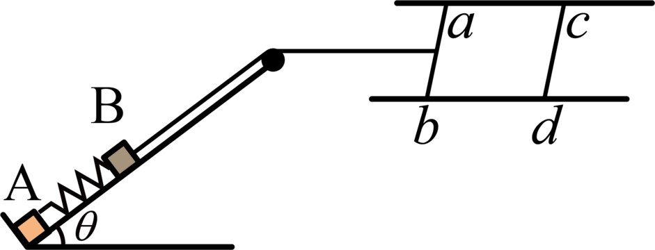

# Physics - 题目 5

**ID**: 5a279e1bf4804cfa890824d618d33ac2
**年级**: Grade 12
**难度**: Medium-Hard
**题型**: Calculation

## 题目
如图所示，质量均为m=1kg的物体A、B之间用劲度系数k=25N/m的轻质弹簧连接，静止于倾角θ=30°的光滑斜面上，物体A与挡板接触而不粘连，物体B用平行于斜面的轻质细线绕过光滑的滑轮与水平导轨上的金属杆ab中点连接，与ab连接的细线则平行于水平导轨。​​​​​​​‌金属杆ab、cd的质量均为M=3kg，电阻均为R=0.4Ω。金属杆长度及导轨的宽度均为L=0.5m，金属杆与导轨的接触良好，水平导轨足够长且光滑，电阻不计，导轨间有垂直于导轨平面向上的匀强磁场B=4T（图中未画出）。开始时整个系统处于静止状态，细线刚好拉直而无作用力。现用恒定的水平力作用于cd杆的中点，使杆cd由静止开始向右运动，最后保持匀速运动，当杆cd开始匀速运动时，物体A恰好与挡板间无弹力。（g=10m/ ${\rm s^{2}，}{\rm{s}}{\rm{i}}{\rm{n}}{{3}}{{0}}{}\degree =\frac {{{1}}}{{{2}}}，{\rm{c}}{\rm{o}}{\rm{s}}30{}\degree =\frac {\sqrt {3}}{2}$ ）求：（1）杆cd匀速运动时，弹簧的形变量x；（2）cd杆匀速运动的速度大小；（3）从cd杆开始运动到开始匀速时，cd杆产生的焦耳热为Q=1J，此过程水平恒力做功W为多大；（4）若cd杆匀速后被外力直接抽离水平导轨，此后物体B的最大加速度大小。

## 解答

1. （1）对A受力分析可知 $mg\sin θ=kx{{}_{0}}$
2. 解得 $x{{}_{0}}=\frac {mg\sin θ}{k}=0.2{\rm{m}}$
3. （2）对ab和B的整体分析可知 $BIL=mg{\rm{s}}{\rm{i}}{\rm{n}}θ+kx{{}_{0}}$
4. 其中 $I=\frac {BLv}{2R}$
5. 得 $v=2{\rm{m}}{\rm{/}}{\rm{s}}$
6. （3）因为弹簧初始形变量也为 $x{{}_{0}}=\frac {mg{\rm{s}}{\rm{i}}{\rm{n}}θ}{k}=0.2{\rm{m}}$
7. 所以弹簧ΔE_{P}=0
8. 根据能量守恒可得 $W=\frac {1}{2}Mv{^{2}}+2Q+mg2x{{}_{0}}{\rm{s}}{\rm{i}}{\rm{n}}θ$
9. 解得W=10J
10. （4）开始时，B与杆的共同加速度为 $a{{}_{0}}=\frac {mg{\rm{s}}{\rm{i}}{\rm{n}}θ+kx{{}_{0}}}{m+M}=2.5{\rm{m}}{\rm{/}}{\rm{s}}{^{{{2}}}}$
11. 当弹簧再次压缩量为x_{0}时，绳子刚好无拉力，B与ab杆分离
12. 根据动能定理可得 $mg\cdot 2x{\rm{s}}{\rm{i}}{\rm{n}}θ=\frac {1}{2}\left ({m+M}\right )v{{}_{1}^{2}}$
13. 得 $v{{}_{1}}=1{\rm{m}}{\rm{/}}{\rm{s}}$
14. 此后物体B以此位置为平衡位置，做简谐运动，至最低点或最高点时加速度最大。假设继续下滑x至最低点，由能量守恒可得 $mgx{\rm{s}}{\rm{i}}{\rm{n}}θ+\frac {1}{2}mv{{}_{1}^{2}}+\frac {1}{2}kx{{}_{0}^{2}}=\frac {1}{2}k{\left({x+x{{}_{0}}}\right)^{2}}$
15. 解得x=0.2m
16. 所以 $a{{}_{m}}=\frac {k\left ({x+x{{}_{0}}}\right )-mg{\rm{s}}{\rm{i}}{\rm{n}}θ}{m}={{5}}{\rm{m}}{\rm{/}}{\rm{s}}{^{{{2}}}}$

## 知识点

**中文**:
  - 双杆模型
  - 电磁感应现象中的功能问题
  - 安培力作用下的运动问题

**English**:
  - Double Rod Model
  - Work-Energy Problems in EM Induction
  - Motion under Ampere Force

---
