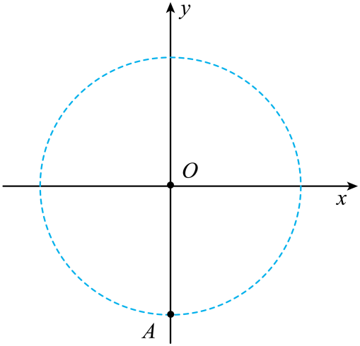

# Physics - 题目 628

**ID**: 5bb66296e40940f9843fb32aaf964802
**年级**: Grade 12
**难度**: Medium-Hard
**题型**: Calculation

## 题目
如图，在以坐标原点O为圆心、半径为R的圆形区域内（包括边界），有相互垂直的匀强电场和匀强磁场，磁感应强度为B，磁场方向垂直于xOy平面向里。​​​​​​​‌一带负电的粒子（不计重力），从A点沿y轴正方向以某一速度射入，粒子恰好做匀速直线运动，经t_{0}时间从圆形区域的边界射出。若仅撤去磁场，相同粒子仍从A点以相同的速度沿y轴正方向射入，经 $\frac {t{{}_{0}}}{2}$ 时间，也从圆形区域的边界射出。（1）求粒子的比荷 $\frac {q}{m}$ ；（2）撤去电场，只改变原磁场区域的大小和位置，相同粒子仍从A点沿y轴的正方向以原来速度的2倍射入磁场并立即偏转，粒子离开现磁场时也恰好离开原圆形磁场区域的边界，求现圆形磁场区域的最小面积。

## 解答

1. （1）设粒子的质量为 $m$ ，电荷量为 $q$ ，初速度为 $v{{}_{0}}$ ，电场强度为 $E$ ；根据左手定则可知粒子受到的洛伦兹力沿 $x$ 轴正方向，则电场强度的方向沿 $x$ 轴正方向，粒子受力平衡，则有 $qE=qv{{}_{0}}B$ ，粒子做匀速直线运动，则有 $2R=v{{}_{0}}t{{}_{0}}$ ，仅有电场时，带电粒子在匀强电场中做类平抛运动，在 $y$ 方向的位移为 $y=v{{}_{0}}\frac {t{{}_{0}}}{2}=R$ ，在 $x$ 方向的位移为 $x=\frac {1}{2}a(\frac {t{{}_{0}}}{2}){^{2}}$ ，由牛顿第二定律可得 $a=\frac {qE}{m}$ ，因射出位置在圆形区域边界上，由几何关系可得 $x=y$ ，联立解得粒子的比荷为 $\frac {q}{m}=\frac {4}{Bt{{}_{0}}}$ 。
2. （2）仅有磁场时，粒子在匀强磁场中做匀速圆周运动，设轨道半径为 $r$ ，由洛伦兹力提供向心力可得 $q\cdot 2v{{}_{0}}B=m\frac {(2v{{}_{0}}){^{2}}}{r}$ ，解得 $r=\frac {2mv{{}_{0}}}{qB}=R$ ，根据题意，粒子在磁场区域中的轨道恰好是半径 $r$ 等于 $R$ 的圆上的 $\frac {1}{4}$ 圆周，这段圆弧应与入射方向的速度（ $y$ 轴正方向）、出射方向的速度（ $x$ 轴正方向）分别相切与A、 $M$ 两点。与 $x$ 、 $y$ 轴均相距 $R$ 的 $O^{′}$ 点就是圆弧 $\overset{\frown}{{AM}}$ 的圆心。A点和 $M$ 点应在所求圆形磁场区域的边界上，在通过A、 $M$ 两点的不同的圆中，最小的一个是以 $AM$ 连线为直径的圆周。如图所示
3. 
4. 则圆形磁场区域的最小半径为 $r{{}_{0}}=\frac {1}{2}AM$ ，直径 $AM=\sqrt {2}r$ ，圆的面积 $S{{}_{{\rm \min }}}={\rm{π}}r{{}_{0}^{2}}$ ，联立解得 $S{{}_{{\rm \min }}}=\frac {{\rm{π}}R{^{2}}}{2}$ 。

## 知识点

**中文**:
  - 带电粒子在有界磁场中运动的临界极值问题

**English**:
  - Critical Extremum Problems in Bounded Magnetic Fields

---
