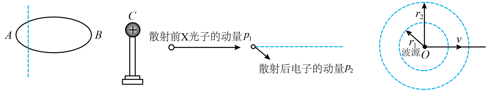

# Physics - 题目 1945

**ID**: 5e5856bf9bfe458ba03e0d81a8f16207
**年级**: Grade 12
**难度**: Medium-Hard
**题型**: Calculation

## 题目
守恒是物理学中的重要思想。​​​​​​​‌请尝试用守恒思想分析下列问题：（1）如图所示将带正电荷Q的导体球C靠近不带电的导体。沿虚线将导体分成A、B两部分，这两部分所带电荷量分别为Q_{A}、Q_{B}判断这两部分电荷量的正负及大小关系，并说明理由。（2）康普顿在研究石墨对X射线的散射时，发现在散射的X射线中，除了与入射波长λ_{0}相同的成分外，还有波长大于λ_{0}的成分，用X光子与静止电子的碰撞模型可以解释这一现象。请在图中通过作图表示出散射后X光子的动量，并简述作图的依据。（3）波是传递能量的一种方式，传播过程能量守恒。简谐波在传播过程中的平均能量密度 $\bar ε$ 表示单位体积内具有的能量： $\bar ε=\frac {1}{2}ρA{^{2}}ω{^{2}}$ ，其中A为简谐波的振幅，  $ω$ 为简谐波的圆频率（波传播过程中不变）， $ρ$ 为介质的密度。能流密度I表示波在单位时间内流过垂直单位面积上的平均能量。a.简谐波沿直线传播的速度为v，证明波的能流密度 $I=\frac {1}{2}ρA{^{2}}ω{^{2}}v$b.球面简谐波是从波源处向空间各个方向传播的简谐波，在均匀介质中传播时振幅会发生变化。忽略传播过程中的能量损失，求波在距波源r_{1}和r_{2}处的振幅之比A_{1}：A_{2}_{。}

## 解答

1. （1）由器电感应，A部分带正电、B部分带负电，由电荷量守恒，A、B两部分电荷量的大小相等，Q_{A}=Q_{B}；
2. （2）设散射后X光子的动量为p_{3}，根据碰撞过程动量守恒和平行四边形定则（或三角形定则），画图如图所示
3. 
4. （3）a．沿传播方向，任取于传播方向垂直的横截面，面积为S。在△t时间内流过S面的能量 $E=\bar εV,V=SL,L=v\vartriangle t$
5. 单位时间内流过垂直单位面积上的平均能量 $I=\frac {E}{\vartriangle tS}$
6. 联立解得
7. $I=\frac {1}{2}ρA{^{2}}ω{^{2}}v{\rm \mathit{b}}$ ．在第二间的基础上，△t时间内流过S_{1}面上的能量 $I{{}_{1}}S{{}_{1}}\vartriangle t=\frac {1}{2}ρA{{}_{1}}{^{2}}ω{^{2}}v\cdot 4πr{{}_{1}^{2}}\vartriangle t$
8. △t时间内流过S_{2}面上的能量 $I{{}_{2}}S{{}_{2}}\vartriangle t=\frac {1}{2}ρA{{}_{2}}{^{2}}ω{^{2}}v\cdot 4πr{{}_{2}^{2}}\vartriangle t$
9. 由能量守恒 $I{{}_{1}}S{{}_{1}}\vartriangle t=I{{}_{2}}S{{}_{2}}\vartriangle t$ ，联立解得 $A{{}_{1}}:A{{}_{2}}=r{{}_{2}}:r{{}_{1}}$

## 知识点

**中文**:
  - 动量守恒的判定与应用
  - 康普顿效应和光子的动量
  - 动量定理及其应用

**English**:
  - Judgment and Application of Momentum Conservation
  - Compton Effect and Photon Momentum
  - Applications of Impulse-Momentum Theorem

---
