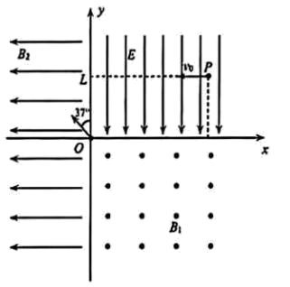

# Physics - 题目 2163

**ID**: 5f325580aa244d35ace973b66ca07ad7
**年级**: Grade 12
**难度**: Medium-Hard
**题型**: Calculation

## 题目
如图所示，在 $xyz$ 直角坐标系中， $z$ 轴垂直纸面向外。​​​​​​​‌在 $x>0$ ， $y>0$ 的区域内充满沿 $y$ 轴负方向的匀强电场；在 $x>0$ ， $y<0$ 的区域内充满垂直 $xOy$ 向外的匀强磁场（磁感应强度 $B{{}_{1}}$ 大小未知）；在 $x<0$ 的区域内充满沿 $x$ 轴负方向、磁感应强度大小为 $B{{}_{2}}$ 的匀强磁场。在 $xOy$ 平面内有一质量为 $m$ ，带电量为 $+q$ 的粒子（重力不计）以初速度 $v{{}_{0}}$ 沿 $x$ 轴负方向从纵坐标为 $L$ 的 $P$ 点开始运动，恰好经坐标原点 $O$ 射入 $x<0$ 的区域，在 $O$ 点的速度方向与 $y$ 轴正方向的夹角为 $37\mathrm{°}$ 。(1)求匀强电场的电场强度 $E$ 的大小；(2)若磁感应强度 $B{{}_{1}}=\frac {16mv{{}_{0}}}{3qL}$ ，求P点横坐标 $x{{}_{p}}$ 的可能值；(3)求粒子在 $x<0$ 的区域内运动时距离 $x$ 轴最远位置的 $x$ 坐标的可能值。

## 解答

1. （1）由于粒子通过坐标原点时，速度方向与y轴正半轴夹角为37^{o}，根据对称性可知从第I象限进入第IV象限时，速度方向与竖直方向夹角也为37^{o}，因此进入第IV象限的速度 $v=\frac {v{{}_{0}}}{\sin 37{^{{\rm{o}}}}}=\frac {5}{3}v{{}_{0}}$ ，根据动能定理 $EqL=\frac {1}{2}mv{^{2}}-\frac {1}{2}mv{{}_{0}^{2}}$ 可得电场强度的大小 $E=\frac {8mv{{}_{0}^{2}}}{9qL}$ 。
2. （2）粒子从抛出到第一次进入第IV象限，做类平抛运动 $L=\frac {1}{2}at{{}_{1}^{2}}$ ， $x{{}_{1}}=v{{}_{0}}t{{}_{1}}$ ，其中 $Eq=ma$ ，
3. 解得 $x{{}_{1}}=\frac {3}{2}L$ ，进入第IV象限后做匀速圆周运动，根据 $qvB{{}_{1}}=\frac {mv{^{2}}}{R{{}_{1}}}$ ，代入数据可得轨道半径
4. $R{{}_{1}}=\frac {5}{16}L$ ，根据周期性可知 $x{{}_{P}}=x{{}_{1}}+2R{{}_{1}}{\cos}37\mathrm{°}+n(2x{{}_{1}}+2R{{}_{1}}{\cos}37\mathrm{°})=\frac {(4+7n)L}{2}$ （n=0,1,2…）。
5. （3）粒子进入 $x<0$ 的区域后，将速度分解为沿磁场方向的速度 $v{{}_{1}}$ 和垂直于磁场方向速度 $v{{}_{2}}$ ，则 $v{{}_{1}}=v\sin 37\mathrm{°}=v{{}_{0}}$ ， $v{{}_{2}}=v{\cos}37\mathrm{°}=\frac {4}{3}v{{}_{0}}$ ，在垂直磁场方向做匀速圆周运动，运动周期
6. $T=\frac {2{\rm{π}}m}{qB{{}_{2}}}$ ，粒子在沿磁场方向做匀速直线运动，第一次经过半个周期，粒子距离x轴最远，以后每经过一个周期，距离x轴最远，因此 $x=-(v{{}_{1}}\cdot \frac {T}{2}+nv{{}_{1}}T)=-\frac {(2n+1){\rm{π}}mv{{}_{0}}}{qB{{}_{2}}}$ (n=0,1,2…)。

## 知识点

**中文**:
  - 带电粒子在磁场中做圆周运动的多解问题

**English**:
  - Multi-solution Problems of Circular Motion in Magnetic Fields

---
