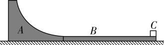

# Physics - 题目 1723

**ID**: 60c5f4f18063446aadc9035c91675721
**年级**: Grade 12
**难度**: Medium-Hard
**题型**: Calculation

## 题目
（16分）如图所示，一斜面体 $A$ ,其右端轻靠着长度 $L=12\mathrm{m}$ 的直木板 $B$ ,连接处等高，刚开始一起静止在光滑的水平地面上,滑块 $C$ 以 ${v}_{0}=10\mathrm{m}/\mathrm{s}$ 的初速度从木板 $B$ 的右端水平向左运动,已知 ${m}_{A}={m}_{B}=1\mathrm{k}\mathrm{g}$ ， ${m}_{C}=2\mathrm{k}\mathrm{g}$ 的滑块 $C$ 与木板 $B$ 间的动摩擦因数 $\mu =0.2$ ,斜面体 $A$ 的上表面是半径 $R=1\mathrm{m}$ 的 $\frac{1}{4}$ 光滑圆弧，取重力加速度大小 $g=10\mathrm{m}/{\mathrm{s}}^{2}$ 。​​​​​​​‌（计算结果可用根号表示）（1） 滑块 $C$ 滑上斜面体 $A$ 的瞬间，求滑块 $C$ 的速度大小 ${v}_{C}$ ;（2） 滑块 $C$ 滑上斜面体 $A$ 的瞬间，求斜面体 $A$ 受到的压力大小 $F$ ;（3） 若 $C$ 从刚滑上 $A$ 到运动到最高点的过程用时 $t=0.5\mathrm{s}$ ，求该过程中 $C$ 对地的水平位移大小 ${x}_{C}$ 。

## 解答

1. （1） 规定向左为正方向，系统动量守恒： ${m}_{C}{v}_{0}={m}_{C}{v}_{C}+({m}_{A}+{m}_{B}){v}_{共}$ （1分）
2. 能量关系： $\frac{1}{2}{m}_{C}{v}_{0}^{2}=\frac{1}{2}{m}_{C}{v}_{C}^{2}+\frac{1}{2}({m}_{A}+{m}_{B}){v}_{共}^{2}+\mu {m}_{C}gL$ （1分）
3. 解得 ${v}_{共}=4\mathrm{m}/\mathrm{s}$ ， ${v}_{C}=6\mathrm{m}/\mathrm{s}$ （2分）
4. （2）  $C$ 刚滑上 $A$ 时，由牛顿第二定律得 ${F}_{\mathrm{N}}-{m}_{C}g={m}_{C}\frac{{\left({v}_{C}-{v}_{共}\right)^{2}}}{R}$ （易错：这里速度应为相对速度）（2分）
5. 由牛顿第三定律得，压力 $F$ 的大小与支持力 ${F}_{\mathrm{N}}$ 的大小相等（1分）
6. 解得 $F=28\mathrm{N}$ （1分）
7. （3） 假设滑块 $C$ 滑到最高点的速度为 $v$ ，有：
8. ${m}_{C}{v}_{C}+{m}_{A}{v}_{共}=({m}_{A}+{m}_{C})v$ （1分）
9. $\frac{1}{2}{m}_{C}{v}_{C}^{2}+\frac{1}{2}{m}_{A}{v}_{共}^{2}=\frac{1}{2}({m}_{A}+{m}_{C}){v}^{2}+{m}_{C}gℎ$ （1分）
10. 得 $ℎ=\frac{1}{15}\mathrm{m}$ （1分）
11. $C$ 相对于 $A$ 的水平位移 $x=\sqrt{{R}^{2}-{\left(R-ℎ\right)^{2}}}=\frac{\sqrt{29}}{15}\mathrm{m}$ （1分）
12. $AC$ 水平方向动量守恒： ${m}_{C}{v}_{C}+{m}_{A}{v}_{共}={m}_{C}{v}_{Cx}+{m}_{A}{v}_{Ax}$ （1分）
13. 设一小段时间 $\mathrm{\Delta }t$ 对时间求和： ${m}_{C}{v}_{C}t+{m}_{A}{v}_{共}t=\sum {m}_{C}{v}_{Cx}\mathrm{\Delta }t+\sum {m}_{A}{v}_{Ax}\mathrm{\Delta }t$ （1分）
14. ${x}_{C}=\sum {v}_{Cx}\mathrm{\Delta }t$ ， ${x}_{A}=\sum {v}_{Ax}\mathrm{\Delta }t$ ，由题可知， $x={x}_{C}-{x}_{A}$ （1分）
15. 联立得 ${x}_{C}=(\frac{8}{3}+\frac{\sqrt{29}}{45})\mathrm{m}$ （1分）

## 知识点

**中文**:
  - 动量和能量的综合应用

**English**:
  - Integration of Momentum and Energy

---
