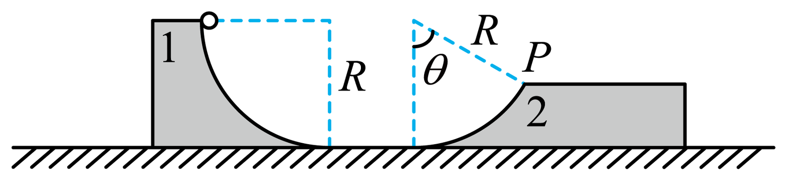

# Physics - 题目 1730

**ID**: 60fa3f889a9e4679a46d5c1d002bd28d
**年级**: Grade 12
**难度**: Medium-Hard
**题型**: Calculation

## 题目
如图所示，在光滑的水平面上固定一半径为R的 $\frac {1}{4}$ 光滑圆弧槽1，可视为质点的小球质量为m，锁定在槽l顶端；光滑圆弧槽2半径也为R，圆心角为 $θ=60{^{\circ }}$ ，圆弧最高点为P，P右侧部分水平，两槽底端切线均水平，重力加速度为g.​​​​​​​‌（1）若槽2固定，释放小球，小球从槽2圆弧的P点冲出后，落在槽2上表面Q处，求P、Q间的距离L；（2）若槽2不固定，释放小球，小球恰能运动到槽2圆弧的P点，求小球和槽2的质量之比 $\frac {m}{M}$ ；（3）接第（2）问，若小球在槽2中上升的时间为t，求小球上升过程槽2的位移大小.

## 解答

1. （1）若槽2固定，设小球到达P点的速度为 $v$ ，对小球从释放到P点的过程，由机械能守恒有 $mgR{\rm{c}}{\rm{o}}{\rm{s}}θ=\frac {1}{2}mv{^{2}}$
2. 解得 $v=\sqrt {2gR{\cos}θ}=\sqrt {gR}$
3. 小球在P点冲出后做斜抛运动，其竖直方向为竖直上抛运动，设在空中运动的总时间为 $t$ ，则有 $v{{}_{y}}=v{\rm{s}}{\rm{i}}{\rm{n}}θ=g\frac {t}{2}$
4. 解得 $t=\frac {2v\sin θ}{g}=\sqrt {\frac {3R}{g}}$
5. 水平方向为匀速直线运动，则有P、Q间的距离为 $L=v{\cos}θ\cdot t=\frac {\sqrt {3}R}{2}$
6. （2）若槽2不固定，设小球到达水平面的速度为 $v{{}_{0}}$ ，则由机械能守恒定律有 $mgR=\frac {1}{2}mv{{}_{0}^{2}}$
7. 解得 $v{{}_{0}}=\sqrt {2gR}$
8. 当小球到达P点时，小球与槽2速度相同，设为 $v{{}_{共}}$ ，由小球在槽2中运动过程系统水平方向动量守恒有 $mv{{}_{0}}=\left ({m+M}\right )v{{}_{共}}$
9. 又因为小球在槽2中运动时系统机械能守恒，则有 $\frac {1}{2}mv{{}_{0}^{2}}=\frac {1}{2}\left ({m+M}\right )v{{}_{共}^{2}}+mgR\left ({1-{\cos}θ}\right )$     解得 $\frac {m}{M}=1$
10. （3）
11. 设两者共速前某一时刻，小球和槽2速度的水平分量分别为 $v{{}_{1x}}$ 、 $v{{}_{2}}$ ，之后经过极短时间 $Δt$ 水平方向位移分别为 $Δx{{}_{1}}$ 、 $Δx{{}_{2}}$ ，上升阶段水平方向发生总位移为 $x{{}_{1}}$ 、 $x{{}_{2}}$ ，则由水平方向动量守恒有 $mv{{}_{0}}=mv{{}_{1x}}+Mv{{}_{2}}$
12. 等式两边同时乘以 $Δt$ ，则有 $mv{{}_{0}}Δt=mv{{}_{1x}}Δt+Mv{{}_{2}}Δt$
13. 可得 $mv{{}_{0}}Δt=mΔx{{}_{1}}+MΔx{{}_{2}}$
14. 经时间t小球到达P点，此过程求和可得 $mv{{}_{0}}t=mx{{}_{1}}+Mx{{}_{2}}$
15. 根据位移关系有 $x{{}_{1}}=x{{}_{2}}+R{\rm{s}}{\rm{i}}{\rm{n}}θ$
16. 联立解得 $x{{}_{2}}=\frac {t\sqrt {2gR}}{2}-\frac {\sqrt {3}R}{4}$

## 知识点

**中文**:
  - 人船模型
  - 斜抛运动
  - 单一物体机械能守恒定律的应用

**English**:
  - Man-Boat Model
  - Oblique Projectile Motion
  - Applications for Single Body

---
