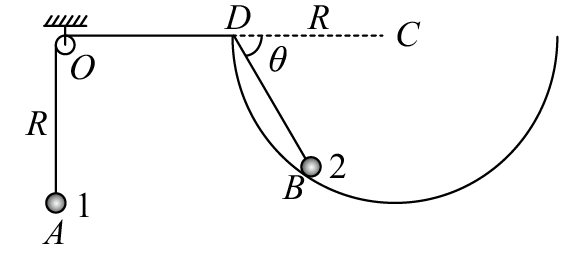

# Physics - 题目 2184

**ID**: 6159b82c7af848569e3719587fcf117d
**年级**: Grade 12
**难度**: Medium-Hard
**题型**: Calculation

## 题目
如图，可视为质点的小球1、2由不可伸长的细绳相连，小球1悬挂在定滑轮O的下方，小球2在半径为R的半球形固定容器内，定滑轮O与容器的边缘D及球心C在同一水平线上．系统静止时，小球1在定滑轮正下方R处的A点，小球2位于B点，BD间的细绳与水平方向的夹角 ${\rm \mathit{θ}=}60{^{\circ }}$ ．已知小球1的质量为m，重力加速度为g，不计一切摩擦，忽略滑轮的质量。​​​​​​​‌(结果用根号表示)(1)试求小球2的质量；(2)现将小球2置于D处由静止释放(小球1未触及地面)，求小球1到达A点时的动能；(3)在第(2)问中，小球2经过B点时，突然剪断细绳，求小球2经过容器最低点时对容器的压力。

## 解答

1. （1）设系统静止时细线中的拉力大小为T，小球受到容器的支持力 $F{{}_{{\rm{R}}}}$ 方向沿BC，
2. 由几何关系知 $\Delta DBC$ 为正三角形，所以
3. $\angle DBC=θ$
4. 对小球1、小球2，根据共点力的平衡条件知
5. $T=mg$
6. $T{\rm{c}}{\rm{o}}{\rm{s}}θ=F{{}_{R}}{\rm{c}}{\rm{o}}{\rm{s}}θ$
7. $T{\rm{s}}{\rm{i}}{\rm{n}}θ+F{{}_{R}}{\rm{s}}{\rm{i}}{\rm{n}}θ=m{{}_{2}}g$
8. 解得
9. $m{{}_{2}}=\sqrt {3}m$
10. （2）设经过图示位置时小球1的速度为 $v{{}_{1}}$ ，小球2的速度为 $v{{}_{2}}$ ， $v{{}_{1}}$ 沿绳竖直向上， $v{{}_{2}}$ 沿圆弧切线斜向下。
11. 由几何关系可知， $v{{}_{2}}$ 与DB延长线的夹角为
12. $90{^{\circ }}-θ$
13. 由运动关系可知， $v{{}_{1}}$ 与 $v{{}_{2}}$ 应满足
14. $v{{}_{2}}{\rm{s}}{\rm{i}}{\rm{n}}θ=v{{}_{1}}$
15. 由几何关系知
16. BD=R
17. 根据机械能守恒定律，得
18. $m{{}_{2}}gR{\rm{s}}{\rm{i}}{\rm{n}}θ-mgR=\frac {1}{2}mv{{}_{1}^{2}}+\frac {1}{2}mv{{}_{2}^{2}}$
19. 此时小球1的动能
20. $E{{}_{{\rm{k}}}}=\frac {1}{2}mv{{}_{1}^{2}}$
21. 整理得
22. $E{{}_{{\rm{k}}}}=\frac {3mgR}{2\left ({3+4\sqrt {3}}\right )}=\frac {4\sqrt {3}-3}{26}mgR$
23. $v{{}_{2}^{2}}=\frac {4gR}{4\sqrt {3}+3}$ ， $v{{}_{1}^{2}}=\frac {3gR}{4\sqrt {3}+3}$
24. （3）细绳剪断后，小球2以 $v{{}_{2}}$ 为初速度，从B点沿圆弧运动到最低点，设经过最低点的速度为 $v{{}_{3}}$ ，根据机械能守恒定律，得
25. $\frac {1}{2}m{{}_{2}}v{{}_{2}^{2}}+m{{}_{2}}g\left ({R-R{\rm{s}}{\rm{i}}{\rm{n}}θ}\right )=\frac {1}{2}m{{}_{2}}v{{}_{3}^{2}}$
26. 设小球2经过容器最低点时受到的支持力为N，根据牛顿第二定律得
27. $N-m{{}_{2}}g=m{{}_{2}}\frac {v{{}_{3}^{2}}}{R}$
28. 整理得
29. $N=\frac {35\sqrt {3}-23}{13}mg$
30. 由牛顿第三定律知，小球2对容器的压力大小也为 $\frac {35\sqrt {3}-23}{13}mg$ 方向向下。

## 知识点

**中文**:
  - 机械能守恒及其判断
  - 正交分解法与三角形定则在平衡问题中的应用

**English**:
  - Judgment of Mechanical Energy Conservation
  - Orthogonal Decomposition and Triangle Rule in Equilibrium

---
