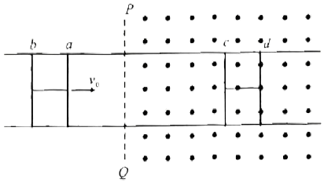

# Physics - 题目 1796

**ID**: 620c77fd0d9b465ca7b5569d22c7bfc2
**年级**: Grade 12
**难度**: Medium-Hard
**题型**: Calculation

## 题目
如图所示，间距为 $L$ 的足够长平行光滑金属导轨固定在绝缘水平面上，垂直于导轨的边界 ${\rm{P}}{\rm{Q}}$ 右侧有垂直于导轨平面向上的匀强磁场，磁感应强度大小为 $B$ ，四根相同的金属棒 $a$ 、 $b$ 、 $c$ 、 $d$ 垂直放在导轨上， $a$ 、 $b$ 之间和 $c$ 、 $d$ 之间均用长为 $\frac {1}{2}L$ 的绝缘轻杆连接， $a$ 、 $b$ 在磁场外， $c$ 、 $d$ 在磁场内。​​​​​​​‌先将金属棒 $c$ 、 $d$ 锁定，给金属棒 $ab$ 一个向右、大小为 $\frac {B{^{2}}L{^{3}}}{4mR}$ 的初速度，当金属棒 $b$ 刚进磁场时立即解除对金属棒 $c$ 、 $d$ 的锁定，最终 $a$ 与 $c$ 不会发生碰撞。已知四根金属棒的质量均为 $m$ ，接入电路的电阻均为 $R$ ，导轨电阻不计，四根金属棒运动过程中始终与导轨垂直并接触良好，求：（1）金属棒 $a$ 刚进磁场时，金属棒 $a$ 的加速度多大；（2）从金属棒 $a$ 刚进磁场至金属棒 $b$ 刚进磁场的过程中，绝缘轻杆对金属棒 $b$ 的冲量多大；（3）金属棒 $c$ 开始的位置离 $PQ$ 的距离至少多大。

## 解答

1. （1）
2. 设金属棒初速度为 $v{{}_{0}}$ ，金属棒 $a$ 刚进入磁场时，金属棒 $a$ 中的感应电动势为 $E=BLv{{}_{0}}$
3. 此时金属棒 $a$ 相当于电源，其他三根金属棒并联相当于用电器，则电路中的总电阻为 $R{{}_{总}}=R+\frac {1}{3}R=\frac {4}{3}R$
4. 则金属棒 $a$ 中的感应电流大小为 $I=\frac {E}{R{{}_{总}}}=\frac {3BLv{{}_{0}}}{4R}$
5. 根据牛顿第二定律有 $BIL=2ma$
6. 其中 $v{{}_{0}}=\frac {B{^{2}}L{^{3}}}{4mR}$
7. 联立，解得 $a=\frac {3B{^{4}}L{^{5}}}{32m{^{2}}R{^{2}}}$
8. （2）从金属棒 $a$ 进入磁场至金属棒 $b$ 刚要进入磁场的过程中，对金属棒 $a$ 、 $b$ 整体研究，根据动量定理 $-B{\overline{I}}Lt=2mv{{}_{1}}-2mv{{}_{0}}$
9. 即 $BLq=2mv{{}_{0}}-2mv{{}_{1}}$
10. 其中 $q={\overline{I}}t$ ， ${\overline{I}}=\frac {{\overline{E}}}{R{{}_{总}}}$ ， ${\overline{E}}=\frac {{\rm{Δ}}Φ}{t}$ ， ${\rm{Δ}}Φ=B{\rm{Δ}}S=B\times \frac {1}{2}L{^{2}}=\frac {1}{2}BL{^{2}}$
11. 解得 $q=\frac {3BL{^{2}}}{8R}$
12. 对金属棒 $b$ 研究，根据动量定理，绝缘轻杆对金属棒 $b$ 的冲量 $I{{}_{b}}=mv{{}_{0}}-mv{{}_{1}}$
13. 联立，解得 $I{{}_{b}}=\frac {3B{^{2}}L{^{3}}}{16R}$
14. （3）由（2）可知，金属棒 $b$ 进入磁场时的速度大小为 $v{{}_{1}}=\frac {B{^{2}}L{^{3}}}{16mR}$
15. 由于 $a$ 与 $c$ 不会发生碰撞，因此四个金属棒最终共速，设共同速度为 $v{{}_{2}}$ ，根据动量守恒 $2mv{{}_{1}}=4mv{{}_{2}}$
16. 解得 $v{{}_{2}}=\frac {B{^{2}}L{^{3}}}{32mR}$
17. 金属棒 $b$ 进入磁场后，设 $a$ 、 $c$ 间减小的距离为 $x$ ，对 $ab$ 整体研究，根据动量定理 $-B{\overline{I^{′}}}Lt=2mv{{}_{2}}-2mv{{}_{1}}$
18. 其中 $q^{′}={\overline{I^{′}}}t$ ， ${\overline{I^{′}}}=\frac {{\overline{E^{′}}}}{R{{}_{总}}}$ ， ${\overline{E^{′}}}=\frac {{\rm{Δ}}Φ^{′}}{t}$ ， ${\rm{Δ}}Φ^{′}=B{\rm{Δ}}S^{′}=B\times \frac {1}{2}Lx=\frac {1}{2}BLx$
19. 解得 $q^{′}=\frac {BLx}{R}$
20. 解得 $x=\frac {1}{16}L$
21. 因此金属棒 $c$ 离 $PQ$ 的距离至少为 $s=x+\frac {1}{2}L=\frac {9}{16}L$

## 知识点

**中文**:
  - 动量守恒的判定与应用
  - 导体切割磁感线产生感应电动势（电流）的分析与计算

**English**:
  - Judgment and Application of Momentum Conservation
  - Analysis and Calculation of Cutting Magnetic Field Lines

---
