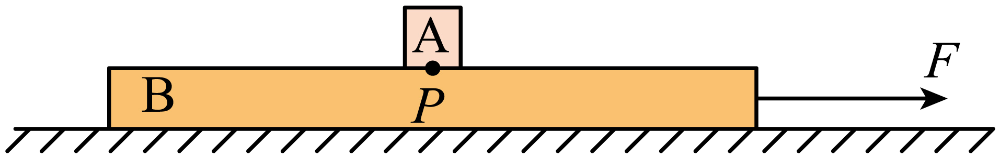

# Physics - 题目 931

**ID**: 665c90941a7e4847988105cc46cc77a9
**年级**: Grade 12
**难度**: Medium-Hard
**题型**: Calculation

## 题目
如图所示，在粗糙的水平地面上有一长为 $L=12{\rm{m}}$ 、质量为 $M=2.0{\rm{k}}{\rm{g}}$ 的长木板B，在长木板的中点P放有一质量为 $m=1.0{\rm{k}}{\rm{g}}($ 可视为质点）的小物块A，开始时A、B均静止。​​​​​​​‌已知A与B、B与地面之间的动摩擦因数分别为 $μ{{}_{1}}=0.10$ 和 $μ{{}_{2}}=0.30$ ，设最大静摩擦力等于滑动摩擦力。现用水平向右的恒力拉长木板B，重力加速度g取 $10{\rm{m}}{\rm{/}}{\rm{s}}{^{{{2}}}}$ 。（1）若水平拉力 $F{{}_{1}}=10.5{\rm{N}}$ ，小物块A所受到的摩擦力大小为多少；（2）若水平拉力 $F{{}_{2}}=24{\rm{N}}$ ，从静止开始要使小物块刚好不滑离长木板，求 $F{{}_{2}}$ 作用时间 $t{{}_{1}}$（3）在满足（2）条件下，A、B最终都停止运动，整个过程中A、B间摩擦生热为 $Q{{}_{1}}{\rm ，B}$ 与地面间摩擦生热为 $Q{{}_{2}}$ ，求 $\frac {Q{{}_{1}}}{Q{{}_{2}}}$ 的值。

## 解答

1. （1）当A与B刚要相对滑动时，A、B之间为最大静摩擦力，对A有 $μ{{}_{1}}mg=ma{{}_{0}}$ ，对A、B，有 $F{{}_{0}}-μ{{}_{2}}(M+m)g=(M+m)a{{}_{0}}$ ，解得 $F{{}_{0}}=12{\rm{N}}$ ，因 $μ{{}_{2}}(M+m)g=9{\rm{N}}{\rm{<}}F{{}_{1}}=10.5{\rm{N}}{\rm{<}}F{{}_{0}}=12{\rm{N}}{\rm ，A}$ 、B一起做匀加速运动。对A、B整体 $F{{}_{1}}-μ{{}_{2}}(M+m)g=(M+m)a{{}_{共}}$ ，解得 $a{{}_{共}}=0.5{\rm{m}}{\rm{/}}{\rm{s}}{^{2}}$ ，对A有 $f=ma=0.5{\rm{N}}$
2. （2）因水平拉力 $F{{}_{2}}=24{\rm{N}}>F{{}_{0}}{\rm ，A}$ 、B相对滑动。对A，有 $a{{}_{1}}=g{{}_{1}}=1{\rm{m}}{\rm{/}}{\rm{s}}{^{2}}$ ，对B，有 $F{{}_{2}}-μ{{}_{2}}(M+m)g-μ{{}_{1}}mg=Ma{{}_{2}}$ ，解得 $a{{}_{2}}=7{\rm{m}}{\rm{/}}{\rm{s}}{^{2}}$ ，设拉力作用时间为时最终小物块刚好没有滑离长木板，则时小物块对应的速度和位移分别为 $v{{}_{1}}=a{{}_{1}}t{{}_{1}}$ ， $x{{}_{1}}=\frac {1}{2}a{{}_{1}}t{{}_{1}^{2}}$ ，则时木板对应的速度和位移为 $v{{}_{2}}=a{{}_{2}}t{{}_{1}}$ ， $x{{}_{2}}=\frac {1}{2}a{{}_{2}}t{{}_{1}^{2}}$ ，则此过程中A相对B向左滑动距离 $Δx{{}_{1}}=\frac {1}{2}a{{}_{2}}t{{}_{1}^{2}}-\frac {1}{2}a{{}_{2}}t{{}_{1}^{2}}$ ，水平拉力撤去后，设再经时间 $t{{}_{2}}{\rm ,A}$ 、B刚好共速。因A继续加速，加速度 $a{{}_{1}}=μ{{}_{1}}g=1{\rm{m}}{\rm{/}}{\rm{s}}{^{2}}{\rm ，B}$ 做减速运动，有 $μ{{}_{2}}(M+m)g+μ{{}_{1}}mg=Ma{{}_{3}}$ ，解得 $a{{}_{3}}=5{\rm{m}}{\rm{/}}{\rm{s}}{^{2}}$ ，则 $v{~}=v{{}_{1}}+a{{}_{1}}t{{}_{2}}=v{{}_{2}}-a{{}_{3}}t{{}_{2}}$ ，此过程中A相对B向左滑动 $Δx{{}_{2}}=\frac {v{{}_{2}}+v{{}_{1}}}{2}t{{}_{2}}-\frac {v{{}_{1}}+v{{}_{5}}}{2}t{{}_{2}}=\frac {v{{}_{2}}-v{{}_{1}}}{2}t{{}_{2}}$ ，因 $μ{{}_{1}}<μ{{}_{2}}$ ，共速后A相对B向右滑动，则此时A刚好滑到B最左端，则 $Δx=Δx{{}_{1}}+Δx{{}_{2}}=\frac {L}{2}=6$ ，联立解得 $v=2{\rm{m}}{\rm{/}}{\rm{s}}$ ， $t{{}_{1}}=t{{}_{2}}=1{\rm{s}}$
3. （2）A、B共速后 $μ{{}_{1}}<μ{{}_{2}}{\rm ，A}$ 、B继续相对滑动，A做减速运动的加速度 $a{{}_{1}}=1{\rm{m}}{\rm{/}}{\rm{s}}{^{2}}{\rm ，B}$ 做减速运动，有 $μ{{}_{2}}\left ({M+m}\right )g-mg{{}_{4}}=Ma{{}_{4}}$ ，解得 $a{{}_{4}}=4{\rm{m}}{\rm{/}}{\rm{s}}{^{2}}{\rm ，A}$ 、B停止时，A相对B向右滑动的距离为 $Δx^{′}=\frac {v{{}_{5}^{2}}}{2a{{}_{1}}}-\frac {v{{}_{3}^{2}}}{2a{{}_{4}}}=1.5{\rm{m}}$ ，则A相对B滑动的距离为 $ΔS{{}_{1}}=Δx+Δx^{′}=7.5{\rm{m}}$ ，则 $Q{{}_{1}}=μ{{}_{1}}mgΔS{{}_{1}}=7.5{\rm{J}}{\rm ，B}$ 对地位移为 $ΔS{{}_{2}}=\frac {1}{2}a{{}_{2}}t{{}_{1}^{2}}+\frac {v{{}_{2}^{2}}-v{{}_{5}^{2}}}{2a{{}_{3}}}+\frac {v{{}_{3}^{2}}}{2a{{}_{4}}}=8.5{\rm{m}}$ ，则B与地摩擦生热 $Q{{}_{2}}=μ{{}_{2}}\left ({m+M}\right )g{\rm{Δ}}S{{}_{2}}=76.5{\rm{J}}$ ， $\frac {Q{{}_{1}}}{Q{{}_{2}}}=\frac {5}{51}\approx 0.10$

## 知识点

**中文**:
  - 板块模型中的能量守恒问题

**English**:
  - Energy Conservation in Plate Models

---
