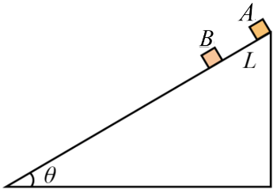

# Physics - 题目 1647

**ID**: 669b5e84c90446999d1a965049c9e862
**年级**: Grade 12
**难度**: Medium-Hard
**题型**: Calculation

## 题目
在倾角 $θ=37{}^\circ $ 的足够长的斜面上，将一质量为m小物块A放在斜面顶端，距A物块L远的位置再放置质量也为m小物块B。​​​​​​​‌物块A与斜面间的动摩擦因数为0，物块B与斜面间的动摩擦因数 $μ=0.25$ 。同时静止释放A、B，此后A如与B发生碰撞，碰撞时间极短且不计动能损失。已知最大静摩擦力等于滑动摩擦力， $\sin 37{}^\circ =0.6$ ，重力加速度为g。求：（1）第一次碰撞后的瞬间A、B的速度；（2）在第一次碰撞后到第二次碰撞前的过程中，A、B之间的最大距离；（3）从释放开始到第三次碰撞前的过程中，A物块的重力做功的大小。

## 解答

1. （1）以A为对象，由牛顿第二定律得，A的加速度大小为 $a{{}_{A}}=\frac {mg\sin 37{}^\circ }{m}=0.6g$ ，由于 ${\tan}37{}^\circ >μ=0.25$ ，以B为对象，由牛顿第二定律得，B的加速度大小为 $a{{}_{B}}=\frac {mg\sin 37{}^\circ -{\rm μm}g{\cos}37{}^\circ }{m}=0.4g$ ，设A、B开始运动到A、B第一次碰撞时间为 $t{{}_{1}}$ ，则有 $\frac {1}{2}a{{}_{A}}t{{}_{1}^{2}}=\frac {1}{2}a{{}_{B}}t{{}_{1}^{2}}+L$ ，解得 $t{{}_{1}}=\sqrt {\frac {10L}{g}}$ ，则碰撞前瞬间A、B的速度分别为 $v{{}_{A1}}=a{{}_{A}}t{{}_{1}}=6\sqrt {\frac {gL}{10}}$ ， $v{{}_{B1}}=a{{}_{B}}t{{}_{1}}=4\sqrt {\frac {gL}{10}}{\rm ，\mathit{A}}$ 、B发生弹性碰撞，根据动量守恒定律和机械能守恒定律可得 $mv{{}_{A1}}+mv{{}_{B1}}=mv^{′}{{{}_{A1}}}+mv^{′}{{{}_{B1}}}$ ， $\frac {1}{2}mv{{}_{A1}^{2}}+\frac {1}{2}mv{{}_{B1}^{2}}=\frac {1}{2}mv^{′}{{{}_{A1}^{2}}}+\frac {1}{2}mv^{′}{{{}_{B1}^{2}}}$ ，解得 $v^{′}{{{}_{A1}}}=v{{}_{B1}}=4\sqrt {\frac {gL}{10}}$ ， $v^{′}{{{}_{B1}}}=v{{}_{A1}}=6\sqrt {\frac {gL}{10}}$ 。
2. （2）第一次碰撞后到第二次碰撞前，A、B共速时相距最远，则有 $v^{′}{{{}_{A1}}}+a{{}_{A}}t=v^{′}{{{}_{B1}}}+a{{}_{B}}t=v$ ，解得 $t=\sqrt {\frac {10L}{g}}$ ， $v=10\sqrt {\frac {gL}{10}}$ ，则有 $d{{}_{{\rm{m}}}}=\frac {v^{′}{{{}_{B1}}}+v}{2}t-\frac {v^{′}{{{}_{A1}}}+v}{2}t$ ，解得 $d{{}_{{\rm{m}}}}=L$ 。
3. （3）第一次碰撞后到第二次碰撞前用时 $t{{}_{2}}$ ，则有 $v^{′}{{{}_{A1}}}t{{}_{2}}+\frac {1}{2}a{{}_{A}}t{{}_{2}^{2}}=v^{′}{{{}_{B1}}}t{{}_{2}}+\frac {1}{2}a{{}_{B}}t{{}_{2}^{2}}$ ，解得 $t{{}_{2}}=2\sqrt {\frac {10L}{g}}$ ，则 $v{{}_{A2}}=v^{′}{{{}_{A1}}}+a{{}_{A}}t{{}_{2}}=16\sqrt {\frac {gL}{10}}$ ， $v{{}_{B2}}=v^{′}{{{}_{B1}}}+a{{}_{B}}t{{}_{2}}=14\sqrt {\frac {gL}{10}}{\rm ，\mathit{A}}$ 、B第二次碰撞后速度交换，则有 $v^{′}{{{}_{A2}}}=14\sqrt {\frac {gL}{10}}$ ， $v^{′}{{{}_{B2}}}=16\sqrt {\frac {gL}{10}}$ ，同理可知：与第二次碰撞后到第三次碰撞前用时 $t{{}_{3}}$ ，则有 $v^{′}{{{}_{A{{2}}}}}t{{}_{3}}+\frac {1}{2}a{{}_{A}}t{{}_{3}^{2}}=v^{′}{{{}_{B{{2}}}}}t{{}_{3}}+\frac {1}{2}a{{}_{B}}t{{}_{3}^{2}}$ ，解得 $t{{}_{3}}=2\sqrt {\frac {10L}{g}}$ ，则 $v{{}_{A3}}=v^{′}{{{}_{A2}}}+a{{}_{A}}t{{}_{3}}=26\sqrt {\frac {gL}{10}}$ ， $v{{}_{B{{3}}}}=v^{′}{{{}_{B{{2}}}}}+a{{}_{B}}t{{}_{3}}=24\sqrt {\frac {gL}{10}}$ ，从释放开始到第三次碰撞前的过程中，A物块的位移为 $s{{}_{A}}=\frac {v{{}_{A1}}}{2}t{{}_{1}}+\frac {v^{′}{{{}_{A1}}}+v{{}_{A{{2}}}}}{2}t{{}_{2}}+\frac {v^{′}{{{}_{A{{2}}}}}+v{{}_{A{{3}}}}}{2}t{{}_{3}}{\rm ，\mathit{A}}$ 物块的重力做功为 $W{{}_{{\rm{G}}}}=mgs{{}_{A}}\sin 37{}^\circ $ ，联立解得 $W{{}_{{\rm{G}}}}=\frac {189}{5}mgL$ 。

## 知识点

**中文**:
  - 动量守恒中的多次碰撞问题

**English**:
  - Multiple Collisions in Momentum Conservation

---
