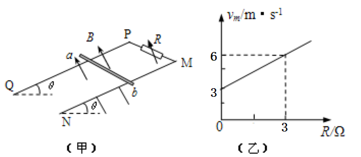

# Physics - 题目 2124

**ID**: 66bd02e550a74ec196c945c5e49264ba
**年级**: Grade 12
**难度**: Medium-Hard
**题型**: Calculation

## 题目
如图甲所示，MN、PQ两条平行的光滑金属轨道与水平面成 $θ{\rm{=}}30^\circ $ 角固定，N、Q之间接电阻箱R，导轨所在空间存在匀强磁场，磁场方向垂直于轨道平面向上，磁感应强度为B=0.5T，质量为m的金属杆ab水平放置在轨道上，其接入电路的电阻位为r。​​​​​​​‌现从静止释放杆ab，测得最大速度为v_{M}，改变电阻箱的阻值R，得到v_{M}与R之间的关系如图乙所示。已知导轨间距为L=2m，重力加速度g=10m/s^{2}，轨道足够长且电阻不计。求：(1)当R=0时，杆ab匀速下滑过程中产生感应电动势E的大小及杆中的电流方向；(2)金属杆的质量m及阻值r；(3)当R=4 $Ω$ 时，回路瞬时电功率每增加1W的过程中合外力对杆做的功W。

## 解答

1. (1)由图可知，当R=0时，杆最终以v=3m/s匀速运动，产生电动势
2. E=BLv=0.5×2×3V=3V
3. 电流方向为由b到a
4. (2)设最大速度为v，杆切割磁感线产生的感应电动势E=BLv，由闭合电路的欧姆定律： $I=\frac {E}{R+r}$
5. 杆达到最大速度时满足
6. $mg{\rm{s}}{\rm{i}}{\rm{n}}θ-BIL=0$
7. 解得
8. $v=\frac {mg(R+r){\sin}θ}{B{^{2}}L{^{2}}}$
9. 由图像可知：斜率为
10. $k=\frac {6-2}{3}{\rm{m}}/({\rm{s}}\cdot {\rm{Ω}})=1{\rm{m}}/({\rm{s}}\cdot {\rm{Ω}})$
11. 纵截距为
12. v_{0}=3m/s
13. 得到：
14. $\frac {mgr{\sin}θ}{B{^{2}}L{^{2}}}=v{{}_{0}}$
15. $\frac {mg{\sin}θ}{B{^{2}}L{^{2}}}=k$
16. 解得
17. m=0.2kg，r=3Ω
18. (3)由题意：E=BLv， $P=\frac {E{^{2}}}{R+r}$ ，得
19. $P=\frac {B{^{2}}L{^{2}}v{^{2}}}{R+r}$
20. 则
21. $ΔP=\frac {B{^{2}}L{^{2}}v{{}_{2}}{^{2}}}{R+r}-\frac {B{^{2}}L{^{2}}v{{}_{1}}{^{2}}}{R+r}$
22. 由动能定理得
23. $W=\frac {1}{2}mv{{}_{2}^{2}}-\frac {1}{2}mv{{}_{1}^{2}}$
24. 联立解得
25. $W=\frac {m(R+r)}{2B{^{2}}L{^{2}}}ΔP$
26. W=0.7J

## 知识点

**中文**:
  - 单杆模型
  - 电磁感应现象中的功能问题
  - 电磁感应定律中的图像问题

**English**:
  - Single Rod Model
  - Work-Energy Problems in EM Induction
  - Graph Problems in EM Induction

---
