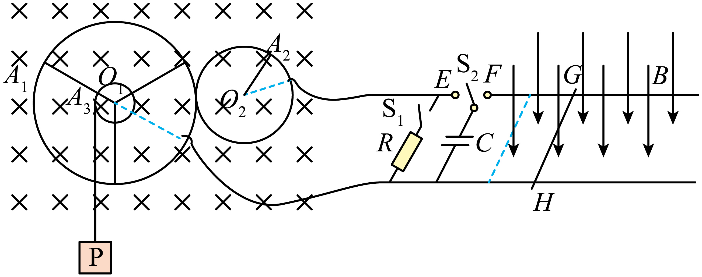

# Physics - 题目 357

**ID**: 6741e4ae93a949a99d4a6f306a53cb72
**年级**: Grade 12
**难度**: Medium-Hard
**题型**: Calculation

## 题目
如图所示，两个金属轮 ${\rm{A}}{{}_{1}}$ 、 ${\rm{A}}{{}_{2}}$ ，可绕各自中心固定的光滑金属细轴 $O{{}_{1}}$ 和 $O{{}_{2}}$ 转动。​​​​​​​‌ ${\rm{A}}{{}_{1}}$ 金属轮由3根金属辐条和金属环组成，每根辐条长均为 $4L$ 、电阻均为 $2R$ 。 ${\rm{A}}{{}_{2}}$ 金属轮由1根金属辐条和金属环组成，辐条长为 $2L$ 、电阻为 $R$ 。半径为 $L$ 的绝缘圆盘 ${\rm{A}}{{}_{3}}$ 与 ${\rm{A}}{{}_{1}}$ 同轴且固定在一起。用轻绳一端固定在 ${\rm{A}}{{}_{3}}$ 边缘上，在 ${\rm{A}}{{}_{3}}$ 上绕足够匝数后（忽略 ${\rm{A}}{{}_{3}}$ 的半径变化），悬挂一质量为 $m$ 的重物 $P$ 。当 $P$ 下落时，通过细绳带动 ${\rm{A}}{{}_{3}}$ 和 ${\rm{A}}{{}_{1}}$ 绕 $O{{}_{1}}$ 轴转动。转动过程中， ${\rm{A}}{{}_{1}}$ 、 ${\rm{A}}{{}_{2}}$ 保持接触且无相对滑动，辐条与各自细轴之间导电良好。整个装置处在磁感应强度为 $B$ 的匀强磁场中，磁场方向垂直金属轮平面向里。 ${\rm{A}}{{}_{1}}$ 轮的轴 $O{{}_{1}}$ 及 ${\rm{A}}{{}_{2}}$ 轮的轴 $O{{}_{2}}$ 分别引出导线与两平行足够长的光滑水平金属导轨连接，导轨 $E$、$F$ 处断开，金属导轨的间距为 $L$ 。两导轨之间 $E$ 的左侧串联了开关 ${\rm{S}}{{}_{1}}$ 与电阻 $R$ ，电容器 ${\rm{C}}$ 与单刀双掷开关 ${\rm{S}}{{}_{2}}$ 串联，可以通过 $E$ 或 $F$ 与导轨相连，虚线右侧存在竖直向下的匀强磁场，磁感应强度大小也为 $B$ ，导轨上有质量为 $M$ ，长度也为 $L$ 、电阻为 $R$ 的金属棒 $GH$ ，除题中所给电阻外不计其他电阻。（1）当 ${\rm{S}}{{}_{1}}$ 、 ${\rm{S}}{{}_{2}}$ 都断开，重物下落时，比较 $O{{}_{2}}$ 与 $O{{}_{1}}$ 哪个点的电势高；（2） ${\rm{S}}{{}_{1}}$ 闭合、 ${\rm{S}}{{}_{2}}$ 断开，重物下落速度为 $v{{}_{0}}$ 时，求 $O{{}_{1}}$ 与 $O{{}_{2}}$ 两点之间电势差；（3） ${\rm{S}}{{}_{1}}$ 闭合、 ${\rm{S}}{{}_{2}}$ 断开，重物下落 $L$ 过程中，通过电阻 $R$ 的电量；（4） ${\rm{S}}{{}_{1}}$ 闭合、 ${\rm{S}}{{}_{2}}$ 先打向 $E$ ，充电稳定后再打向 $F$ ，待金属棒 $GH$ 运动稳定时，求金属棒 $GH$ 的速度 $v{{}_{1}}$ 。

## 解答

1. （1）根据右手定则可知， $O{{}_{1}}$ 点电势高于A_{1}边缘的电势，而A_{2}边缘的电势高于O_{2}点的电势，可知 $O{{}_{1}}$ 点电势高于O_{2}点的电势；
2. （2）由图可知绝缘轮 ${\rm{A}}{{}_{3}}$ 与 ${\rm{A}}{{}_{1}}$ 轮具有相同的角速度，重物P与绝缘轮 ${\rm{A}}{{}_{3}}$ 具有相同的线速度，有 $E{{}_{1}}=\frac {1}{2}·B\cdot 4L\cdot 4v{{}_{0}}=8BLv{{}_{0}}$
3. 电路的总电阻为 $R{{}_{总}}=\frac {2R}{3}+R+R=\frac {8R}{3}$
4. ${\rm{A}}{{}_{2}}$ 金属轮与 ${\rm{A}}{{}_{1}}$ 金属轮具有相同的线速度，则 ${\rm{A}}{{}_{2}}$ 金属轮的线速度为 $v^{′}=v=4v{{}_{0}}$
5. 则 ${\rm{A}}{{}_{2}}$ 金属轮辐条切割磁感应线产生的电动势为 $E{{}_{2}}=\frac {1}{2}·B·2L\cdot v^{′}=4BLv{{}_{0}}$
6. 根据右手定则，可知两个金属轮上每根辐条产生的电流相互增强，两个金属轮产生的总电动势为 $E=E{{}_{1}}+E{{}_{2}}=12BLv{{}_{0}}$
7. 根据闭合电路欧姆定律可得 $U{{}_{O{{}_{1}}O{{}_{2}}}}=\frac {R}{\frac {8}{3}R}E=\frac {3}{8}E=\frac {9}{2}BLv{{}_{0}}$
8. （3）重物下落L时，金属轮 ${\rm{A}}{{}_{1}}$ 及 ${\rm{A}}{{}_{2}}$ 轮边缘某点转过的弧长均为4L，通过R的电量 $q=\frac {{\rm{Δ}}{\rm{Φ}}}{R{{}_{总}}}=\frac {\frac {16BL{^{2}}}{2}+\frac {8BL{^{2}}}{2}}{\frac {8R}{3}}=\frac {9BL{^{2}}}{2R}$
9. （4）充电稳定：重力的功率与产生的热功率相等，设重物的速度为v，则 $mgv=\frac {(12BLv){^{2}}}{\frac {8}{3}R}$
10. 解得 $v=\frac {mgR}{54B{^{2}}L{^{2}}}$
11. 导线切割磁感线产生的电动势为 $E^{′}=12BLv$
12. 稳定时电容器两端的电压 $U{{}_{1}}=\frac {3}{8}E^{′}=\frac {9}{2}BLv=\frac {mgR}{12BL}$
13. 打向F，待金属棒GH运动稳定时，金属棒GH的电动势与电容器电压相等，金属棒GH的速度 $v{{}_{1}}$ 稳定，则有 $CBLv{{}_{1}}=CU^{′},Q=CU{{}_{1}},BLQ=Mv{{}_{1}}$
14. 解得 $v{{}_{1}}=\frac {CmgR}{12\left ({M+CB{^{2}}L{^{2}}}\right )}$

## 知识点

**中文**:
  - 右手定则
  - 导体切割磁感线产生感应电动势（电流）的分析与计算
  - 电磁感应现象中的功能问题

**English**:
  - Right-Hand Rule
  - Analysis and Calculation of Cutting Magnetic Field Lines
  - Work-Energy Problems in EM Induction

---
