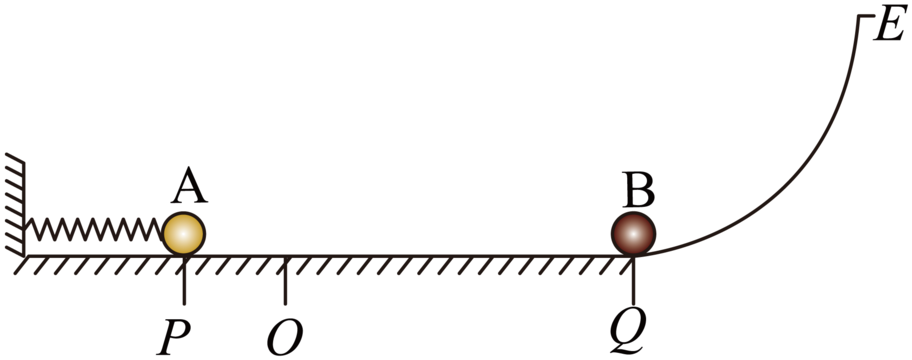

# Physics - 题目 2347

**ID**: 67baaaaf20ff429aa2e4599c4c7e1514
**年级**: Grade 12
**难度**: Medium-Hard
**题型**: Calculation

## 题目
如图所示，粗糙水平轨道与光滑弧形轨道QE相切于Q点，轻质弹簧左端固定，右端放置一个质量m=1.0kg可视为质点的小球A，当弹簧处于原长时，小球A静止于O点。​​​​​​​‌现对小球A施加水平向左的外力F，使它缓慢移动压缩弹簧至P点，在该过程中，外力F与弹簧压缩量x的关系为： $F=kx+2({\rm{N}})$ ，其中k为未知常数。释放小球A，其沿桌面运动与放置于Q点质量也为1.0kg的小球B发生弹性碰撞，撞后小球B沿弧形轨道上升的最大高度为 $h=0.2{\rm{m}}$ 。已知OP的距离为 $x=0.5{\rm{m}}$ ，OQ的距离为 $L=1.0{\rm{m}}$ ，水平轨道阻力一定，重力加速度取 $g=10{\rm{m}}/{\rm{s}}^{2}$ 。求：（1）小球A与小球B第一次碰撞后瞬间小球B的速度大小；（2）在压缩弹簧过程中，弹簧存贮的最大弹性势能；（3）小球A最终静止时的位置。

## 解答

1. （1）小球B在上冲过程中有
2. $\frac {1}{2}mv_{B}^{2}=mgh$
3. 解得
4. $v_{{\rm{B}}}=2{\rm{m}}/{\rm{s}}$
5. （2）小球A和B在碰撞过程有
6. $mv_{0}=mv_{{\rm{A}}}+mv_{{\rm{B}}}$
7. $\frac {1}{2}mv_{0}^{2}=\frac {1}{2}mv_{{\rm{A}}}^{2}+\frac {1}{2}mv_{{\rm{B}}}^{2}$
8. 解得
9. $v_{0}=2{\rm{m}}/{\rm{s}}$
10. $v_{A}=0{\rm{m}}/{\rm{s}}$
11. 由题可知
12. f=2N
13. 物块A由P至Q过程有
14. $E_{p}=f(x+L)+\frac {1}{2}mv_{0}^{2}$
15. 解得
16. $E_{p}=5.0{\rm{J}}$
17. （3）小球B滑下与A碰撞后，B静止，A的速度大小为
18. $v_{A}^{^{′}}=2{\rm{m}}/{\rm{s}}$
19. 小球A在向左滑行过程有
20. $-fs=0-\frac {1}{2}mv_{A}^{^{′}2}$
21. 解得
22. $s=1{\rm{m}}$
23. 故小球A停在O点。

## 知识点

**中文**:
  - 求解弹性碰撞问题

**English**:
  - Solving Elastic Collision Problems

---
