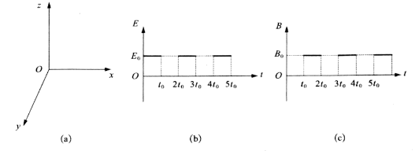

# Physics - 题目 60

**ID**: 6963e762a76c4cfaae4658102a36dd80
**年级**: Grade 12
**难度**: Medium-Hard
**题型**: Calculation

## 题目
如图（a）所示，在xOy平面上方的区域内存在周期性变化的匀强电场和匀强磁场，变化情况如图（b）、图（c）所示。​​​​​​​‌电场的方向及磁场方向均以y轴正方向为正 $。t=0$ 时刻，一质量为m、电荷量为 $+q$ 的带电粒子从坐标原点O开始以速度 $v{{}_{0}}$ 沿x轴正方向运动。粒子重力忽略不计，图b）、图（c）中 $E{{}_{0}}=\frac {3B{{}_{0}}v{{}_{0}}}{4π}$ ， $t{{}_{0}}=\frac {πm}{qB{{}_{0}}}$ ， $B{{}_{0}}$ 已知。（ ${\rm{s}}{\rm{i}}{\rm{n}}37{^{\circ }}=0.6，{\rm{c}}{\rm{o}}{\rm{s}}37{^{\circ }}=0.8$ ）求：(1)在 $t{{}_{0}}$ 时刻粒子的速度方向与x轴正方向的夹角 $θ$ ；(2)在 $2t{{}_{0}}$ 时刻粒子的位置坐标；(3) $0\sim nt{{}_{0}}$ 时间内电场力对粒子做的功 $W$ 。

## 解答

1. （1） $0\sim t{{}_{0}}$ 之间只存在电场，有 $E{{}_{0}}q=ma$ ， $v{{}_{y1}}=at{{}_{0}}$ ， ${\rm{t}}{\rm{a}}{\rm{n}}θ=\frac {v{{}_{y1}}}{v{{}_{0}}}$ ，
2. 得 $t{{}_{0}}$ 时刻粒子的速度方向与x轴正方向的夹角为 $37{^{\circ }}（$ 或夹角的正切值 ${\rm{t}}{\rm{a}}{\rm{n}}θ=\frac {3}{4}$ ）。
3. （2） $t{{}_{0}}$ 时刻在x、y方向的位移分别为 $x{{}_{1}}=v{{}_{0}}t{{}_{0}}$ ， $y{{}_{1}}=\frac {1}{2}at{{}_{0}^{2}}$ ，
4. 得 $x{{}_{1}}=\frac {πmv{{}_{0}}}{qB{{}_{0}}}$ ， $y{{}_{1}}=\frac {3πmv{{}_{0}}}{8qB{{}_{0}}}$ ，
5. 在 $t{{}_{0}}\sim 2t{{}_{0}}$ 之间，粒子在y方向做匀速直线运动，在平行xOz平面做匀速圆周运动，有 $qv{{}_{0}}B{{}_{0}}=m\frac {v{{}_{0}^{2}}}{R}$ ， $T=\frac {2πR}{v{{}_{0}}}$ ，
6. 得 $T=\frac {2πm}{qB{{}_{0}}}=2t{{}_{0}}$ ， $R=\frac {mv{{}_{0}}}{qB{{}_{0}}}$ ，
7. 则在 $t{{}_{0}}\sim 2t{{}_{0}}$ 之间，粒子做了半个周期的匀速圆周运动，
8. 在 $t{{}_{0}}\sim 2t{{}_{0}}$ 之间，在y方向的位移 $y{{}_{2}}=v{{}_{y}}t{{}_{0}}$ ，
9. 在z方向的位移 $z{{}_{2}}=-2R$ ，
10. 在 $2t{{}_{0}}$ 时刻的位置坐标为 $（x{{}_{1}}，y{{}_{1}}+y{{}_{2}}，z{{}_{2}}）$ ，即 $（\frac {πmv{{}_{0}}}{qB{{}_{0}}}，\frac {9πmv{{}_{0}}}{8qB{{}_{0}}}，-\frac {2mv{{}_{0}}}{qB{{}_{0}}}）$ 。
11. （3）在 $0\sim t{{}_{0}}$ 之间，电场力对粒子做的功 $W{{}_{1}}=E{{}_{0}}qy{{}_{1}}$ ，
12. 得 $W{{}_{1}}=\frac {9}{32}mv{{}_{0}^{2}}$ ，
13. 在 $2t{{}_{0}}{\rm ～}$  $3t{{}_{0}}$ 之间，粒子在y方向的位移 $y{{}_{2}}=v{{}_{y1}}t{{}_{0}}+\frac {1}{2}at{{}_{0}^{2}}$ ，
14. 在 $3t{{}_{0}}$ 时，y方向的分速度 $v{{}_{y2}}=v{{}_{y1}}+at{{}_{0}}$ ，
15. 在 $2t{{}_{0}}\sim 3t{{}_{0}}$ 之间，电场力对粒子做的功 $W{{}_{2}}=E{{}_{0}}qy{{}_{2}}$ ，
16. 得 $W{{}_{2}}=\frac {27}{32}mv{{}_{0}^{2}}$ ，
17. 此后按如上规律周期运动，在 $2nt{{}_{0}}\sim （2n+1）t{{}_{0}}$ 时间内电场力做的功 $W{{}_{n+1}}=E{{}_{0}}qy{{}_{n+1}}$ ，
18. 因此，在 $0\sim nt{{}_{0}}$ 内，电场力做的功为： $W=\frac {9}{128}（n+1）{^{2}}mv{{}_{0}^{2}}（n=1，3，5\cdots ）{\rm ,}$ ， $W=\frac {9}{128}n{^{2}}mv{{}_{0}^{2}}（n=2，4，6\cdots ）$ 。

## 知识点

**中文**:
  - 带电粒子在周期性变化的电磁场中的运动

**English**:
  - Motion in Periodically Varying EM Fields

---
