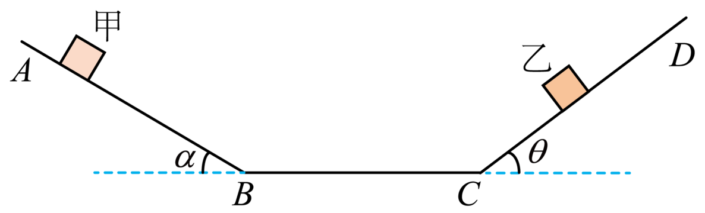

# Physics - 题目 2170

**ID**: 69f70943869541aaab13f5df5abc5746
**年级**: Grade 12
**难度**: Medium-Hard
**题型**: Calculation

## 题目
如图所示，两倾斜的轨道AB、CD分别与足够长的光滑水平轨道平滑连接于B、C两点，其倾角分别为 $α=30{}\degree ,θ=37{}\degree $ ；质量相等的甲、乙两小物块分别从倾斜轨道上由静止释放，在之后的运动过程中，它们总能在水平轨道上发生弹性碰撞，已知甲、乙释放的位置距B、C的距离分别为 $x{{}_{甲}}=16{\rm{m}},x{{}_{乙}}=\frac {10}{3}{\rm{m}}$ ；它们与倾斜轨道间的动摩擦因数分别为 $μ{{}_{甲}}=\frac {\sqrt {3}}{5}$ ， $μ{{}_{乙}}=0.​​​​​​​‌45$ ，不计两物块通过轨道连接处的能量损失，物块均可视为质点，重力加速度， $g=10{\rm{m}}{\rm{/}}{\rm{s}}{^{{{2}}}}$ ， $\sin 37{}\degree =0.6,{\cos}37{}\degree =0.8,$ 求：(1)乙物块从释放到第一次经过C点经历的时间；(2)甲、乙两物块第一次碰撞后各自的速度大小；(3)甲物块在倾斜轨道上通过的总路程．

## 解答

1. （1）乙物块下滑过程中，有 $mg\sin θ-μ{{}_{乙}}mg{\cos}θ=ma{{}_{乙}}$ ， $x{{}_{乙}}=\frac {1}{2}a{{}_{乙}}t{{}_{乙}^{2}}$ ，代入数据解得 $a{{}_{乙}}=2.4{\rm{m}}/{\rm{s}}{^{2}}$ ， $t{{}_{乙}}=\frac {5}{3}{\rm{s}}$
2. （2）乙第一次下滑到水平面时的速度大小 $v{{}_{乙1}}=a{{}_{乙}}t{{}_{乙}}=4{\rm{m}}/{\rm{s}}$ ，甲下滑过程中，有 $mg\sin α-μ{{}_{甲}}mg{\cos}α=ma{{}_{甲}}$ ， $v{{}_{甲1}^{2}}=2a{{}_{甲}}x{{}_{甲}}$ ，代入数据解得 $a{{}_{甲}}=2{\rm{m}}/{\rm{s}}{^{2}},v{{}_{甲1}}=8{\rm{m}}/{\rm{s}}$ ，甲、乙碰撞过程，有 $mv{{}_{甲1}}-mv{{}_{乙1}}=mv{{}_{甲1}}{^{\prime }}+mv{{}_{乙1}}{^{\prime }}$ ， $\frac {1}{2}mv{{}_{甲1}^{2}}+\frac {1}{2}mv{{}_{乙1}}{^{2}}=\frac {1}{2}mv{{}_{甲1}}{^{\prime 2}}+\frac {1}{2}mv{{}_{乙1}}{^{\prime 2}}$ ，可解得 $v{{}_{甲1}}{^{\prime }}=-4{\rm{m}}/{\rm{s}},v{{}_{乙1}}{^{\prime }}=8{\rm{m}}/{\rm{s}}$ ，表明碰后甲、乙交换速度。
3. （3）碰后甲将沿 $AB$ 轨道上升，乙将沿 $CD$ 轨道上升，对甲有 $mg\sin α+μ{{}_{甲}}mg{\cos}α=ma{{}_{甲}}{^{\prime }}$ ，对乙有 $mg\sin θ+μ{{}_{乙}}mg{\cos}θ=ma{{}_{乙}}{^{\prime }}$ ，解得 $a{{}_{甲}}{^{\prime }}=8{\rm{m}}/{\rm{s}}{^{2}},a{{}_{乙}}{^{\prime }}=9.6{\rm{m}}/{\rm{s}}{^{2}}$ ，对甲上滑时有 $v{{}_{甲1}}{^{\prime 2}}=2a{{}_{甲}}{^{\prime }}x{{}_{1}}$ ，下滑时有 $v{{}_{甲2}^{2}}=2a{{}_{甲}}x{{}_{1}}$ ，解得 $x{{}_{1}}=1{\rm{m}}$ ， $v{{}_{甲2}}=2{\rm{m}}/{\rm{s}}=\frac {1}{2}v{{}_{甲1}}{^{\prime }}$ ，对乙上滑时有 $v{{}_{乙1}}{^{\prime 2}}=2a{{}_{乙}}{^{\prime }}x$ ，下滑时有 $v{{}_{乙2}^{2}}=2a{{}_{乙}}x$ ， $v{{}_{乙2}}=\frac {1}{2}v{{}_{乙1}}{^{\prime }}=4{\rm{m}}/{\rm{s}}$ ，同理甲、乙第二次碰后它们仍将交换速度，即 $v{{}_{甲2}}{^{\prime }}=v{{}_{乙2}}=4{\rm{m}}/{\rm{s}}$ ， $v{{}_{乙2}}{^{\prime }}=v{{}_{甲2}}=2{\rm{m}}/{\rm{s}}$ ，依次进行，可知甲、乙两物块运动过程中经过 $B$ 、 $C$ 点时，速度变化规律如下表
4. 第一次
5. 第二次
6. 第三次
7. 第四次
8. 第五次
9. ．．．
10. 上
11. 下
12. 上
13. 下
14. 上
15. 下
16. 上
17. 下
18. 上
19. 下
20. ．．．
21. $v{{}_{甲}}\left ({{\rm{m}}/{\rm{s}}}\right )$
22. 4
23. 2
24. 4
25. 2
26. 1
27. $\frac {1}{2}$
28. 1
29. $\frac {1}{2}$
30. $\frac {1}{4}$
31. $\frac {1}{8}$
32. ．．．
33. $v{{}_{乙}}\left ({\,{\rm{m}}/{\rm{s}}}\right )$
34. 8
35. 4
36. 2
37. 1
38. 2
39. 1
40. $\frac {1}{2}$
41. $\frac {1}{4}$
42. $\frac {1}{2}$
43. $\frac {1}{4}$
44. ．．．
45. 由上表可知，甲物块连续两次以相同的速度沿斜面上升后，又连续两次以另一速度沿斜面上升，且后者的速度总是前者的 $\frac {1}{4}$ ，进而可知，后者沿斜面上升的距离总等于前者的 $\frac {1}{16}$ ，有 $s=x{{}_{甲}}+4\left ({x{{}_{1}}+x{{}_{2}}+x{{}_{3}}+\cdots +x{{}_{n}}}\right )=x{{}_{甲}}+4\left [x{{}_{1}}+\frac {1}{16}x{{}_{1}}+{\left({\frac {1}{16}}\right)^{2}}x{{}_{1}}+\cdots +{\left({\frac {1}{16}}\right)^{n-1}}x{{}_{1}}\right ]$ ，代入数据求得 $s=\frac {304}{15}{\rm{m}}$

## 知识点

**中文**:
  - 运动过程分析、多过程问题

**English**:
  - Analysis of Motion Process and Multi-process Problems

---
