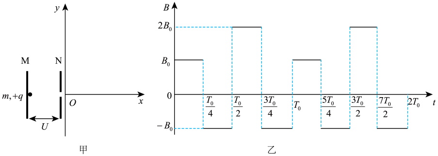

# Physics - 题目 394

**ID**: 71c4e3d3494040b0b854adb8f129f86a
**年级**: Grade 12
**难度**: Medium-Hard
**题型**: Calculation

## 题目
如图甲所示，在y轴左侧有一对竖直放置的平行金属板M、N，两板间的电势差为U，在 $x\geqslant 0$ 区域内存在方向垂直于xOy平面的匀强磁场，该磁场做周期性变化（不考虑磁场变化瞬间对粒子运动的影响），变化规律如图乙所示，规定垂直xOy平面向里的磁场方向为正。​​​​​​​‌一质量为m、电荷量为q的带正电粒子，从贴近M板的位置由静止开始运动，通过N板小孔后在 $t=0$ 时刻从坐标原点O沿x轴正方向垂直射入磁场中。不计粒子重力和空气阻力，图中磁感应强度 $B{{}_{0}}$ 已知。（1）求粒子在磁场中运动时的动量大小p；（2）若 $T{{}_{0}}=\frac {πm}{qB{{}_{0}}}$ ，求 $t=T{{}_{0}}$ 时刻粒子的位置坐标；（3）若 $T{{}_{0}}$ 在 $\left [\frac {πm}{qB{{}_{0}}}{\rm{,}}\frac {2πm}{qB{{}_{0}}}\right ]$ 的范围内取值，问： $T{{}_{0}}$ 取何值时，在 $0\sim 2T{{}_{0}}$ 时间内，粒子击中的γ轴上的点到坐标原点的距离最大，最大距离为多少。

## 解答

1. （1）粒子在电场中运动时，由动能定理得 $qU=\frac {1}{2}mv{^{2}}$ ，粒子在磁场中运动时的动量为 $p=mv$ ，联立解得 $p=\sqrt {2qUm}$
2. （2）当磁感应强度为 $B{{}_{0}}$ 时，带电粒子在磁场中做圆周运动时半径为 $r{{}_{1}}$ ，由 $qvB{{}_{0}}=m\frac {v{^{2}}}{r{{}_{1}}}$ ，可得 $r{{}_{1}}=\frac {1}{B{{}_{0}}}\sqrt {\frac {2Um}{q}}$ ，运动周期为 $T{{}_{1}}=\frac {2πm}{qB{{}_{0}}}$ ，同理可得当磁感应强度为 $2B{{}_{0}}$ 时，带电粒子在磁场中做圆周运动时半径为 $r{{}_{2}}=\frac {1}{2B{{}_{0}}}\sqrt {\frac {2Um}{q}}$ ，运动周期为 $T{{}_{2}}=\frac {πm}{qB{{}_{0}}}$ ，由 $\frac {T{{}_{0}}}{4}=\frac {T{{}_{1}}}{8}=\frac {T{{}_{2}}}{4}$ ，则粒子在 $0\sim T{{}_{0}}$ 内的轨迹如图所示
3. 
4. 由几何关系可得 $x=2r{{}_{1}}{\sin}45{}^\circ +r{{}_{2}}+r{{}_{1}}\left ({1-{\cos}45{}^\circ }\right )=\frac {3+\sqrt {2}}{2B{{}_{0}}}\sqrt {\frac {2Um}{q}}$ ， $y=2r{{}_{1}}\left ({1-{\cos}45{}^\circ }\right )+r{{}_{2}}+r{{}_{1}}{\sin}45{}^\circ =\frac {5-\sqrt {2}}{2B{{}_{0}}}\sqrt {\frac {2Um}{q}}$ ，则粒子的坐标为（ $\frac {3+\sqrt {2}}{2B{{}_{0}}}\sqrt {\frac {2Um}{q}}$ ， $\frac {5-\sqrt {2}}{2B{{}_{0}}}\sqrt {\frac {2Um}{q}}$ ）。
5. （3）经分析可知，当 $\frac {T{{}_{0}}}{4}=\frac {πm}{2qB{{}_{0}}}$ 时，粒子轨迹如图所示
6. 
7. 此时距离最大，由几何关系得粒子击中 $y$ 轴的位置为 $y=4r{{}_{1}}+2r{{}_{2}}$ ，可得粒子能击中 $y$ 轴的点到坐标原点的最大距离为 $y=\frac {5}{B{{}_{0}}}\sqrt {\frac {2Um}{q}}$

## 知识点

**中文**:
  - 带电粒子在周期性变化的电磁场中的运动

**English**:
  - Motion in Periodically Varying EM Fields

---
