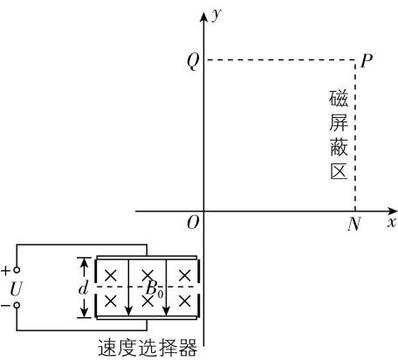

# Physics - 题目 88

**ID**: 728dde80cfe54c1a8e4c22013d6e4aa0
**年级**: Grade 12
**难度**: Medium-Hard
**题型**: Calculation

## 题目
（13分）磁屏蔽技术可以降低外界磁场对屏蔽区域的干扰。​​​​​​​‌如图所示， $x⩾0$ 区域存在垂直 $Oxy$ 平面向里的匀强磁场，其磁感应强度大小为 ${B}_{1}$ （未知）。第一象限内存在边长为 $2L$ 的正方形磁屏蔽区 $ONPQ$ ,经磁屏蔽后，该区域内的匀强磁场方向仍垂直 $Oxy$ 平面向里，其磁感应强度大小为 ${B}_{2}$ （未知）,但满足 $0<{B}_{2}<{B}_{1}$ 。某质量为 $m$ 、电荷量为 $q(q>0)$ 的带电粒子通过速度选择器后，在 $Oxy$ 平面内垂直 $y$ 轴射入 $x⩾0$ 区域，经磁场偏转后刚好从 $ON$ 中点垂直 $ON$ 射入磁屏蔽区域。速度选择器两极板间电压 $U$ 、间距 $d$ 、内部磁感应强度大小 ${B}_{0}$ 已知，不考虑该粒子的重力。（1） 求该粒子通过速度选择器的速率；（2） 求 ${B}_{1}$ 以及 $y$ 轴上可能检测到该粒子的范围；（3） 定义磁屏蔽效率 $\eta =\frac{{B}_{1}-{B}_{2}}{{B}_{1}}×100\mathrm{\%}$ ，若在 $Q$ 处检测到该粒子，则 $\eta $  是多少?

## 解答

1. （1） 由于该粒子在速度选择器中受力平衡，故 $qE=q{v}_{0}{B}_{0}$ （1分）
2. 其中 $E=\frac{U}{d}$ （1分）
3. 则该粒子通过速度选择器的速率为 ${v}_{0}=\frac{U}{{B}_{0}d}$ （1分）
4. （2） 粒子在 $x⩾0$ 区域内做匀速圆周运动，从 $ON$ 的中点垂直 $ON$ 射入磁屏蔽区域，由几何关系可知 ${r}_{1}=L$ （1分）
5. 由洛伦兹力提供向心力有 $q{v}_{0}{B}_{1}=m\frac{{v}_{0}^{2}}{{r}_{1}}$ （1分）
6. 联立可得 ${B}_{1}=\frac{mU}{qd{B}_{0}L}$ （1分）
7. 由于 $0<{B}_{2}<{B}_{1}$ ，在磁屏蔽区内根据洛伦兹力提供向心力有 $q{v}_{0}{B}_{2}=m\frac{{v}_{0}^{2}}{{r}_{2}}$ （1分）
8. 可得 ${r}_{2}>L$ （1分）
9. 当 ${B}_{2}$ 趋近于0时，可认为带电粒子在磁屏蔽区内做竖直方向的匀速直线运动，即从趋近于 $PQ$ 中点（更靠近 $Q$ 点）的位置进入磁感应强度大小为 ${B}_{1}$ 的磁场，
10. 根据上述分析可知，粒子进入磁感应强度大小为 ${B}_{1}$ 的磁场后的轨迹半径为 ${r}_{1}=L$ ，故粒子在 $y$ 轴最大能到达的位置纵坐标 $y<OQ+{r}_{1}=3L$ （1分）
11. 故 $y$ 轴上可能检测到该粒子的范围为 $L<y<3L$ （1分）
12. （3） 若在 $Q$ 处检测到该粒子，粒子的运动轨迹如图所示，
13. 
14. 由几何关系可知 ${r}_{2}^{2}={\left(2L\right)^{2}}+{\left({r}_{2}-L\right)^{2}}$ （1分）
15. 解得 ${r}_{2}=\frac{5}{2}L$ ，
16. 由洛伦兹力提供向心力有 $q{v}_{0}{B}_{2}=m\frac{{v}_{0}^{2}}{{r}_{2}}$ （1分）
17. 联立解得 ${B}_{2}=\frac{2mU}{5q{B}_{0}dL}$ ，
18. 磁屏蔽效率 $\eta =\frac{{B}_{1}-{B}_{2}}{{B}_{1}}×100\mathrm{\%}$ ，其中 ${B}_{1}=\frac{mU}{qd{B}_{0}L}$ ，解得 $\eta =60\mathrm{\%}$ （1分）

## 知识点

**中文**:
  - 带电粒子在匀强磁场中的运动

**English**:
  - Motion of Charged Particles in Uniform Magnetic Field

---
