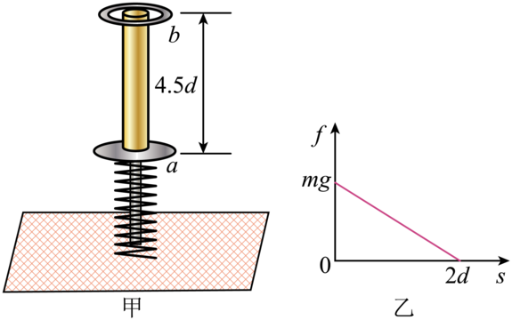

# Physics - 题目 1538

**ID**: 7337afba05304b48aca8806a3262ef10
**年级**: Grade 12
**难度**: Medium-Hard
**题型**: Calculation

## 题目
图甲是一种智能减震装置的示意图，轻弹簧下端固定，上端与质量为m的减震环a连接，并套在固定的竖直杆上，a与杆之间的智能涂层材料可对a施加大小可调节的阻力，当a的速度为零时涂层对其不施加作用力。​​​​​​​‌在某次性能测试中，质量为0.5m的光滑环b从杆顶端被静止释放，之后与a发生正碰；碰撞后，b的速度大小变为碰前的 $λ$ 倍、方向向上，a向下运动2d时速度减为零，此过程中a受到涂层的阻力大小f与下移距离s之间的关系如图乙。已知a静止在弹簧上时，与杆顶端距离为4.5d，弹簧压缩量为2d，重力加速度为g。求：（1）与a碰前瞬间，b的速度大小；${\rm （2）}λ$ 的值；（3）在a第一次向下运动过程中，当b的动能为 $\frac {1}{16}mgd$ 时a的动能。

## 解答

1. （1）小环b下落的过程为自由落体，则 $v{{}_{1}}{^{2}}=2gh{{}_{1}}{\rm ，}$ 解得与a碰前瞬间，b的速度大小为 $v{{}_{1}}=3\sqrt {gd}$ 。
2. （2）ab发生碰撞，设向下为正方向，根据动量守恒定律可知 $0.5mgv{{}_{1}}=-0.5mgλv{{}_{1}}+mgv{{}_{2}}{\rm ，\mathit{a}}$ 向下运动2d时速度减为零的过程中，由动能定理可知 $W{{}_{G}}-W{{}_{f}}-W{{}_{弹}}=mg\cdot 2d-\frac {1}{2}mg\cdot 2d-\frac {(k\cdot 2d+k\cdot 4d)}{2}\cdot 2d=0-\frac {1}{2}mv{{}_{2}^{2}}{\rm ，}$ 由题可知a静止在弹簧上时，弹簧压缩量为2d，根据胡克定律可知 $mg=k\cdot 2d{\rm ，}$ 联立解得 $v{{}_{2}}=2\sqrt {gd}{\rm ，}$  $λ=\frac {1}{3}$ 。
3. （3）当b的动能为 $\frac {1}{16}mgd$ 时，b的速度为 $v{{}_{3}}=\pm \frac {\sqrt {gd}}{2}{\rm ，}$ 根据动量定理可知 $-0.5mgt=0.5mv{{}_{3}}-0.5mλv{{}_{1}}{\rm ，}$ 解得 $t=\frac {1}{2}\sqrt {\frac {d}{g}}或\frac {3}{2}\sqrt {\frac {d}{g}}{\rm ，}$ 在a第一次向下运动过程中，取一段时间 ${\rm{Δ}}t{\rm ，}$ 根据动量定理可知 $I{{}_{G}}-I{{}_{f}}-I{{}_{弹}}=mg\Delta t-(mg-\frac {mg}{2d}\Delta d)\Delta t-\frac {mg}{2d}(2d+\Delta d)\Delta t=mv{{}_{4}}-mv{{}_{2}}{\rm ，}$ 当 ${\rm Δ}t=\frac {1}{2}\sqrt {\frac {d}{g}}$ 时 ${\rm ，}v{{}_{4}}=\frac {3}{2}\sqrt {gd}$ ；当 ${\rm Δ\mathit{t}=}\frac {3}{2}\sqrt {\frac {d}{g}}$ 时 ${\rm ，}v{{}_{4}}=\frac {1}{2}\sqrt {gd}$ 。此时a的动能为 $\frac {1}{2}mv{{}_{4}^{2}}=\frac {9}{8}mgd或\frac {1}{8}mgd$ 。

## 知识点

**中文**:
  - 动量守恒的判定与应用
  - 应用动能定理求解多阶段、多过程问题
  - 动量定理及其应用

**English**:
  - Judgment and Application of Momentum Conservation
  - Multi-stage/Multi-process Problems
  - Applications of Impulse-Momentum Theorem

---
