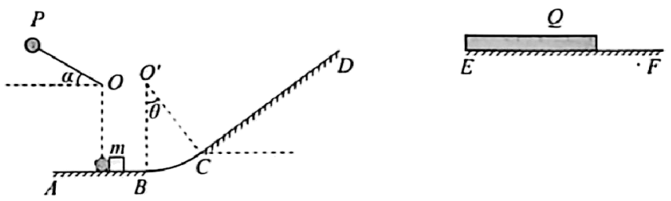

# Physics - 题目 590

**ID**: 7362e70f49404b18b7e75a1e64b0ac5b
**年级**: Grade 12
**难度**: Medium-Hard
**题型**: Calculation

## 题目
如图所示，半径为 $R=1{\rm{m}}$ 的光滑圆弧轨道 $O^{′}BC$ 固定在竖直平面内， $O^{′}$ 为圆心， $B$ 点与光滑水平面 $AB$ 相切。​​​​​​​‌ $C$ 点与倾斜轨道 $CD$ 相切， $\angle BO^{′}C=θ=37{}\degree $ 。质量为 $m=1{\rm{k}}{\rm{g}}$ 的滑块置于水平面 $AB$ 上，用长为 $R$ 的细线系在 $O$ 点的小球P自由悬垂时恰好与滑块、水平面 $AB$ 接触。现将小球移动到 $O$ 点右上方使拉紧的细线与水平方向成 $α=30{}\degree $ 角，由静止释放小球，运动到 $O$ 点正下方时与滑块发生弹性碰撞，碰后滑块经过圆弧 $BC$ 后沿倾斜轨道 $CD$ 上滑，离开 $D$ 点后做斜抛运动，运动到最高点时恰好落到静止在平台 $EF$ 上的长木板 $Q$ 的左端。已知小球的质量为 $4{\rm{k}}{\rm{g}}$ ，木板的质量为 $1{\rm{k}}{\rm{g}}$ ，倾斜轨道 $CD$ 的长度 $l=2.5{\rm{m}}$ ，滑块与倾斜轨道 $CD$ 间的动摩擦因数 $μ{{}_{1}}=0.125$ ，滑块与木板间的动摩擦因数 $μ{{}_{2}}=0.2$ ，木板与平台 $EF$ 间的动摩擦因数 $μ{{}_{3}}=0.075$ ，最后滑块恰好停在木板右端，木板厚度不计，滑块视为质点，重力加速度 $g=10{\rm{m}}/{\rm{s}}{^{2}}$ ， ${\rm{s}}{\rm{i}}{\rm{n}}37{}\degree =0.6$ ， ${\rm{c}}{\rm{o}}{\rm{s}}37{}\degree =0.8$ ，求：（1）小球与滑块碰前细线的弹力大小 $T$ ；（2） $D$ 、 $E$ 两点间的水平距离 $d$ ；（3）木板的长度 $L$ 。

## 解答

1. （1）释放小球后，小球先自由落体 $h=R$ ，此时有 $v{{}_{1}}=\sqrt {2gR}=2\sqrt {5}{\rm{m}}/{\rm{s}}$
2. 绳子拉紧后速度突变为 $v{{}_{2}}=v{{}_{1}}{\cos}30\degree =\sqrt {15}{\rm{m}}/{\rm{s}}$
3. 小球与滑块碰前，有 $\frac {1}{2}m{{}_{1}}v{{}_{2}}{^{2}}+m{{}_{1}}gR\left ({1-{\cos}60\degree }\right )=\frac {1}{2}m{{}_{1}}v{{}_{0}}{^{2}}$
4. 解得小球与滑块碰前的速度为 $v{{}_{0}}=5{\rm{m}}/{\rm{s}}$
5. 根据牛顿第二定律有 $T-m{{}_{1}}g=m{{}_{1}}\frac {v{{}_{0}}{^{2}}}{R}$
6. 解得细线的弹力大小 $T=140{\rm{N}}$
7. （2）小球与滑块发生弹性碰撞，根据动量守恒和机械能守恒有 $m{{}_{1}}v{{}_{0}}=m{{}_{1}}v{{}_{1}}{^{\prime }}+mv{{}_{3}}$ ， $\frac {1}{2}m{{}_{1}}v{{}_{0}^{2}}=\frac {1}{2}m{{}_{1}}v{{}_{1}}{^{\prime }}{^{2}}+\frac {1}{2}mv{{}_{3}}{^{2}}$
8. 解得滑块碰后的速度为 $v{{}_{3}}=8{\rm{m}}/{\rm{s}}$
9. 滑块到倾斜轨道 $CD$ 最高点时 $\frac {1}{2}mv{{}_{3}}{^{2}}=\frac {1}{2}mv{{}_{D}}{^{2}}+mgl\sin θ+μ{{}_{1}}mg{\cos}θl+mgR\left ({1-{\cos}θ}\right )$
10. 解得 $v{{}_{D}}=5{\rm{m}}/{\rm{s}}$
11. 可得滑块在 $D$ 点速度的水平分量为 $v{{}_{Dx}}=v{{}_{D}}{\cos}37\degree =4{\rm{m}}/{\rm{s}}$
12. 竖直分量为 $v{{}_{Dy}}=v{{}_{D}}\sin 37\degree =3{\rm{m}}/{\rm{s}}$
13. 可知 $D$ 点到 $E$ 点的时间为 $t{{}_{DE}}=\frac {v{{}_{Dy}}}{g}=0.3{\rm{s}}$
14. 可知 $D$ 、 $E$ 两点间的水平距离 $d=v{{}_{Dx}}t{{}_{DE}}=1.2{\rm{m}}$
15. （3）对滑块，根据牛顿第二定律可得其加速度大小为 $a{{}_{1}}=μ{{}_{2}}g=2{\rm{m}}/{\rm{s}}{^{{{2}}}}$
16. 对木板，根据牛顿第二定律可得其加速度大小为 $a{{}_{2}}=\frac {μ{{}_{2}}mg-μ{{}_{3}}\left ({m+M}\right )g}{M}=0.5{\rm{m}}/{\rm{s}}{^{{{2}}}}$
17. 设经过时间 $t$ 后二者共速，有 $v{{}_{共}}=v{{}_{Dx}}-a{{}_{1}}t=a{{}_{2}}t$
18. 解得 $t=1.6{\rm{s}}$ ， $v{{}_{共}}=0.8{\rm{m}}/{\rm{s}}$
19. 之后二者一起减速到零，木板的长度 $L=\frac {v{{}_{共}}+v{{}_{Dx}}}{2}t-\frac {v{{}_{共}}}{2}t=3.2{\rm{m}}$

## 知识点

**中文**:
  - 应用动能定理求解连接体问题
  - 求解弹性碰撞问题

**English**:
  - Solving Connected Body Problems
  - Solving Elastic Collision Problems

---
