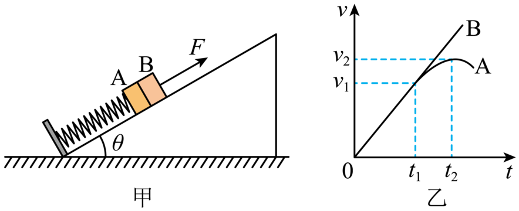

# Physics - 题目 1010

**ID**: 73e9c89850d843fcb1046938b871841d
**年级**: Grade 12
**难度**: Medium-Hard
**题型**: Calculation

## 题目
如图甲所示，平行于光滑斜面的轻弹簧劲度系数为k，一端固定在倾角为θ的斜面底端，另一端与物块A连接；两物块A、B质量均为m，初始时均静止。​​​​​​​‌现用平行于斜面向上的力F拉动物块B，使B做加速度为a（a<gsinθ）的匀加速运动，A、B两物块在开始一段时间内的v-t关系分别对应图乙中A、B图线（t_{1}时刻A、B的图线相切，t_{2}时刻对应A图线的最高点，v_{1}、v_{2}、t_{1}、t_{2}未知），重力加速度为g。（1）求t_{1}时刻弹簧的形变量以及t_{1}；（2）写出0-t_{1}时间内拉力大小F随位移大小x的表达式，并画出示意图；并求出该过程中拉力所做的功；（3）从t_{1}时刻开始，A还需要向上运动多少距离速度再次达到v_{1}。

## 解答

1. （1）A、B两物体在 $t{{}_{1}}$ 时刻分离，故 $a{{}_{{\rm A}}}=a{{}_{{\rm B}}}=a$ 且AB虽接触但没有相互作用力。
2. 对物体A做受力分析，
3. 
4. $kx{{}_{1}}-mg\sin θ=ma$
5. 此时弹簧压缩量为 $x{{}_{1}}=\frac {mg\sin θ+ma}{k}$ ，
6. 最初AB处于静止状态时，弹簧压缩量为 $x{{}_{0}}$ ，合力为0，即 $2mg\sin θ=kx{{}_{0}}$ ，
7. 解得 $x{{}_{0}}=\frac {2mg\sin θ}{k}$ ，
8. 从 $0\sim t{{}_{1}}$ 时间AB一起向上匀加速直线运动 $x=x{{}_{0}}-x{{}_{1}}=\frac {mg\sin θ-ma}{k}=\frac {1}{2}at{{}_{1}^{2}}$ ，
9. 解得 $t{{}_{1}}=\sqrt {\frac {2m(g\sin θ-a)}{ka}}$ ；
10. (2) $0\sim t{{}_{1}}$ 之内，AB处于分离前，具有相同的速度和加速度，
11. 
12. AB看作整体， $F+k(x{{}_{0}}-x)-2mg\sin θ=2ma$ ， $F=2ma+kx$
13. 则 $W{{}_{{\rm F}}}=S{{}_{梯}}=\frac {1}{2}[2ma+(ma+mg\sin θ)]x=\frac {1}{2}(3ma+mg\sin θ)\times \frac {(mg\sin θ-ma)}{k}$ ，
14. 解得 $W{{}_{{\rm F}}}=\frac {m{^{3}}(3a+g\sin θ)(g\sin θ-a)}{2k}$ ，
15. (3) $t{{}_{1}}$ 时刻A物块速度为 $v{{}_{1}}$ ，此时弹簧压缩量 $x{{}_{1}}=\frac {mg\sin θ+ma}{k}$ ，
16. AB分离后，A在斜面上平衡位置处弹簧压缩量为 $x{{}_{2}}=\frac {mg\sin θ}{k}$ （ $F{{}_{{\rm A}合}}=0$ ， $mg\sin θ=kx{{}_{2}}$ ）
17. 所以从 $t{{}_{1}}\to t{{}_{2}}$ 物体位移 $s{{}_{1}}=x{{}_{1}}-x{{}_{2}}=\frac {mg}{k}$
18. 由简谐运动对称性，可得物块A再次达到 $v{{}_{1}}$ 时，总位移 $s=2s{{}_{1}}=\frac {2ma}{k}$

## 知识点

**中文**:
  - 弹簧振子及其运动特点

**English**:
  - Spring Oscillator and Motion Characteristics

---
