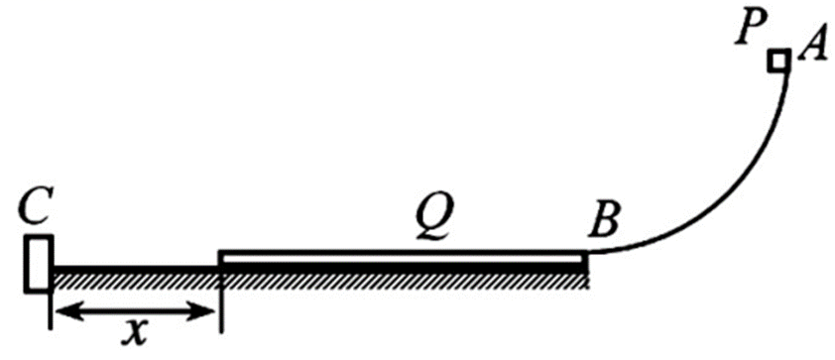

# Physics - 题目 1780

**ID**: 74d12d60d90b49ce9bd0fd01ef4f55f0
**年级**: Grade 12
**难度**: Medium-Hard
**题型**: Calculation

## 题目
如图，质量 $M=2{\rm{k}}{\rm{g}}$ 的长木板Q静止在光滑水平面上，右端紧靠光滑固定曲面 $AB$ 的最低点B，木板上表面与曲面相切于B，水平面的左侧与木板左端相距为x（未知且可调）处有一挡板C。​​​​​​​‌一质量 $m=1{\rm{k}}{\rm{g}}$ 的小滑块P（可视为质点）从曲面上与B的高度差为1.8m处由静止滑下，经B点后滑上木板，最终滑块未滑离木板。已知重力加速度大小为10 ${\rm{m}}{\rm{/}}{\rm{s}}{^{2}}$ ，滑块与木板之间的动摩擦因数为0.3，木板与左挡板C和最低点B的碰撞中没有机械能损失且碰撞时间极短可忽略，则从滑块滑上木板到二者最终都静止的过程中（1）若木板只与C发生了1次碰撞，求木板的运动时间；（2）若木板只与C发生了2次碰撞，求最终P与B点的距离；（3）若木板只与C发生了3次碰撞，求x的值；（4）其他条件不变，若 $m=2{\rm{k}}{\rm{g}}$ 、 $M=1{\rm{k}}{\rm{g}}$ ， $x=\frac {4}{3}{\rm{m}}$ ，求木板通过的总路程。

## 解答

1. （1）滑块P从A到B过程，根据机械能守恒定律
2. $mgh=\frac {1}{2}mv{^{2}}$
3. 代入数据解得
4. $v=6{\rm{m}}{\rm{/}}{\rm{s}}$
5. P在Q上做匀减速运动，Q做匀加速运动，运动过程中二者的动量守恒。若木板只与C发生了一次碰撞，则碰撞后到停止运动的这段过程中二者的动量变化量相等，即碰前P与Q的动量大小相等，则有
6. $mv=mv{{}_{P}}+Mv{{}_{Q}}$
7. $mv{{}_{P}}=Mv{{}_{Q}}$
8. 代入数据解得
9. $v{{}_{Q}}=1.5{\rm{m}}{\rm{/}}{\rm{s}}$
10. 而
11. ${\rm μm}g=Ma{{}_{Q1}}$
12. Q的运动时间
13. $t=2\frac {v{{}_{Q}}}{a{{}_{Q1}}}$
14. 解得
15. $t=2{\rm{s}}$
16. （2）木板与C发生2次碰撞后，最终停止时右端与B刚好接触。此过程中滑块在木板上一直做匀减速运动。
17. $v{^{2}}=2a{{}_{P}}L$
18. ${\rm μm}g=ma{{}_{P}}$
19. 代入数据解得
20. $L=6{\rm{m}}$
21. （3）木板共与C发生了3次碰撞，即第3次碰撞前木板于滑块的动量大小相等。每次碰撞前木板的速度都相等，设为 $v{{}_{Q{{}_{3}}}}$ ，即每次碰撞过程中C对木板的冲量大小为
22. $I{{}_{1}}=2Mv{{}_{Q3}}$
23. 从P滑上Q到最终都静止过程，对P、Q整体根据动量定理得
24. $3I{{}_{1}}=mv$
25. 解得
26. $v{{}_{Q}}=\frac {1}{2}{\rm{m}}/{\rm{s}}$
27. 而
28. $v{{}_{Q3}^{2}}=2a{{}_{Q}}x$
29. 解得
30. $x=\frac {1}{12}{\rm{m}}$
31. （4） $m=2{\rm{k}}{\rm{g}}$ ， $M=1{\rm{k}}{\rm{g}}$ 时，根据牛顿定律
32. ${\rm μm}g=Ma{{}_{Q2}}$
33. $a{{}_{Q2}}=6{\rm{m}}{\rm{/}}{\rm{s}}{^{2}}$
34. 碰撞前木板的速度
35. $v{{}_{Q1}}{^{2}}=2a{{}_{Q2}}X$
36. 解得
37. $v{{}_{Q1}}=4{\rm{m}}{\rm{/}}{\rm{s}}$
38. 根据动量守恒定律
39. $mv=mv{{}_{p1}}+Mv{{}_{Q1}}$
40. 解得
41. $v{{}_{P1}}=4{\rm{m}}{\rm{/}}{\rm{s}}=v{{}_{Q1}}$
42. 碰后木板向右匀减速到速度为零后向左匀加速，滑块一直向左匀减速直到二者速度相等。从第1次碰后到第2次碰前，此过程木板的路程
43. $s{{}_{1}}=2\frac {v{{}_{Q1}^{2}}}{2a{{}_{Q2}}}$
44. 根据动量守恒定律
45. $mv{{}_{P1}}-Mv{{}_{Q1}}=\left ({M+m}\right )v{{}_{Q2}}$
46. $v{{}_{Q2}}=\frac {m-M}{M+m}v{{}_{Q1}}$
47. 第2次碰后到第3次碰前
48. $s{{}_{2}}=2\frac {v{{}_{Q2}^{2}}}{2a{{}_{Q2}}}$
49. 即
50. $s{{}_{2}}={\left({\frac {m-M}{M+m}}\right)^{2}}s{{}_{1}}={\left({\frac {1}{3}}\right)^{2}}s{{}_{1}}=\frac {1}{9}s{{}_{1}}$
51. $mv{{}_{p2}}-Mv{{}_{Q2}}=\left ({M+m}\right )v{{}_{Q3}}$
52. $v{{}_{Q3}}=\frac {M-m}{M+m}v{{}_{Q2}}$
53. $s{{}_{3}}=2\frac {v{{}_{Q3}^{2}}}{2a{{}_{Q2}}}$
54. 即
55. $s{{}_{3}}={\left({\frac {m-M}{m+M}}\right)^{2}}s{{}_{2}}=\frac {1}{9}s{{}_{2}}={\left({\frac {1}{9}}\right)^{2}}s{{}_{1}}$
56. 以此类推
57. $s{{}_{n}}={\left({\frac {1}{9}}\right)^{n-1}}s{{}_{1}}$
58. 木板通过的路程为
59. $s=X+s{{}_{1}}+s{{}_{2}}+s{{}_{3}}+\ldots \ldots s{{}_{n}}+\ldots $
60. 而 $s{{}_{1}}=2X$ ，即
61. $s=X+s{{}_{1}}+\frac {1}{9}s{{}_{1}}+{\left({\frac {1}{9}}\right)^{2}}s{{}_{1}}+{\left({\frac {1}{9}}\right)^{3}}s{{}_{1}}+\cdots =X+s{{}_{1}}\frac {1-{\left({\frac {1}{9}}\right)^{n}}}{1-\frac {1}{9}}$
62. 当 $n\to \propto $ 时， $s=X+\frac {9}{8}s{{}_{1}}$
63. 所以
64. $s=\frac {13}{3}{\rm{m}}$

## 知识点

**中文**:
  - 动量守恒与板块模型相结合
  - 单一物体机械能守恒定律的应用

**English**:
  - Momentum Conservation with Plate Models
  - Applications for Single Body

---
