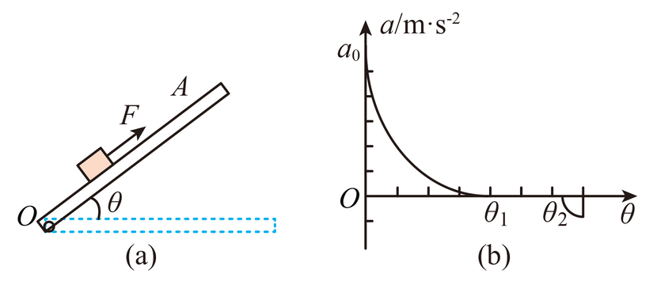

# Physics - 题目 2340

**ID**: 75009c8fbc994d09ac61d91a2a090100
**年级**: Grade 12
**难度**: Medium-Hard
**题型**: Calculation

## 题目
某物理兴趣小组开展赛车轨道设计大赛，设计了如图（a）所示的轨道模型，将一质量为 $m=1{\rm{k}}{\rm{g}}$ 的小车（可看成质点）放置在轨道上，始终受到平行于斜面、大小为8N的力F的作用。​​​​​​​‌轨道OA可绕轴O在竖直平面内转动，同学们发现改变轨道倾角，小车会产生不同的加速度a，已知小车与轨道间的动摩擦因数为 $μ=0.2$ ，假定小车与轨道间的最大静摩擦力等于滑动摩擦力。求：（g取 $10{\rm{m}}/{\rm{s}}{^{2}},{\rm{s}}{\rm{i}}{\rm{n}}37{}\degree =0.6,{\rm{c}}{\rm{o}}{\rm{s}}37{}\degree =0.8$ ）(1)改变轨道倾角，发现小车加速度a与斜面倾角的关系如图（b）图线所示．求图线与纵坐标交点 $a{{}_{0}}$ 的大小；(2)当倾角为 $37{}\degree $ 时，小车在力F的作用下由O点从静止开始运动，2s后撤去F，求斜面足够长时，小车沿斜面向上运动的最大距离；(3)轨道A点有一锁定装置，若小车运动到A点时，触发锁定装置，小车停在A点， $OA=2{\rm{m}}$ ．保持 $F=8{\rm{N}}$ 不变，小车位于轨道底部，给小车一初速度 $v{{}_{0}}=1{\rm{m}}/{\rm{s}}$ ，求轨道倾角 $0\sim 90{}\degree $ 范围内，小车在轨道上运动全过程所受到的摩擦力所做的功。（临界角度列函数关系式即可）

## 解答

1. （1）当轨道水平放置时，小车的加速度为 $a{{}_{0}}$ 此时滑动摩擦力
2. $f=μN={\rm μm}g=0.2\times 1\times 10{\rm{N}}=2{\rm{N}}$
3. 由牛顿第二定律
4. $F-f=ma{{}_{0}}$
5. 求得
6. $a{{}_{0}}=\frac {F-f}{m}=\frac {8-2}{1}{\rm{m}}/{\rm{s}}{^{2}}=6{\rm{m}}/{\rm{s}}{^{2}}$
7. （2）设力 $F$ 作用时小车的加速度为 $a{{}_{1}}$ ，由牛顿第二定律得
8. $a{{}_{1}}=\frac {F-mg\sin 37{}\degree -{\rm μm}g{\cos}37{}\degree }{m}=0.4{\rm{m}}/{\rm{s}}{^{2}}$
9. 撤去力 $F$ 后小车的加速度大小为 $a{{}_{2}}$ ，由牛顿第二定律
10. $a{{}_{2}}=\frac {mg\sin 37{^{\circ }}+{\rm μm}g{\cos}37{}\degree }{m}=7.6{\rm{m}}/{\rm{s}}{^{2}}$
11. 由题意有
12. $L=s{{}_{1}}+s{{}_{2}}=\frac {1}{2}a{{}_{1}}t{^{2}}+\frac {a{{}_{1}^{2}}t{^{2}}}{2a{{}_{2}}}$
13. $L\approx \left ({0.8+0.04}\right ){\rm{m}}=0.84{\rm{m}}$
14. （3）根据 $θ$ 范围，对摩擦力分类讨论，试算小车恰好运动到A点的临界值
15. $FL{{}_{{\rm{O}}{\rm{A}}}}-mgL{{}_{{\rm{O}}{\rm{A}}}}{\rm{s}}{\rm{i}}{\rm{n}}θ^{′}-{\rm μm}gL{{}_{{\rm{O}}{\rm{A}}}}{\rm{c}}{\rm{o}}{\rm{s}}θ^{′}=\frac {1}{2}mv{{}_{0}^{2}}$
16. $31=40{\rm{s}}{\rm{i}}{\rm{n}}θ^{′}+8{\rm{c}}{\rm{o}}{\rm{s}}θ^{′}$
17. ①当 $0<θ⩽θ^{′}$ 时，小车将运动到A点
18. $W{{}_{1}}=-μ{\rm{m}}{\rm{g}}{\rm{c}}{\rm{o}}{\rm{s}}θ\cdot L{{}_{{\rm{O}}{\rm{A}}}}=-4{\cos}θ$
19. ②当 $θ^{′}<θ<90{}\degree $ 时，小车减速至0后反向加速，
20. $W^{′}=-{\rm μm}g{\rm{c}}{\rm{o}}{\rm{s}}θ\times 2L^{′}$
21. $v{{}_{0}}{^{2}}=2\frac {mg{\rm{s}}{\rm{i}}{\rm{n}}θ+{\rm μm}g{\rm{c}}{\rm{o}}{\rm{s}}θ-F}{m}L^{′}$
22. $W^{′}=-2μ{\rm{m}}{\rm{g}}{\rm{c}}{\rm{o}}{\rm{s}}θ\frac {v{{}_{0}}{^{2}}m}{2\left ({{\rm{m}}{\rm{g}}{\rm{s}}{\rm{i}}{\rm{n}}θ+μ{\rm{m}}{\rm{g}}{\rm{c}}{\rm{o}}{\rm{s}}θ-F}\right )}=-\frac {2{\cos}θ}{10\sin θ+2{\cos}θ-8}$

## 知识点

**中文**:
  - 应用动能定理求解与图像相关的动能问题

**English**:
  - Graph-related Kinetic Energy Problems

---
