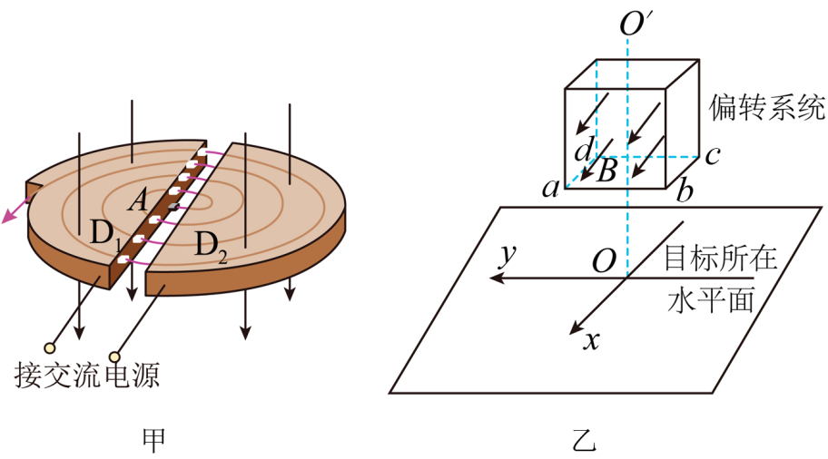

# Physics - 题目 330

**ID**: 75d54cf98457480ea0006a65abc69044
**年级**: Grade 12
**难度**: Medium-Hard
**题型**: Calculation

## 题目
质子重离子治疗技术是利用质子或重离子形成的粒子射线进行疾病治疗的放疗技术，相比传统技术，具有更加精准、杀伤力更强、不良反应更小的优势。​​​​​​​‌其系统设备由离子源、直径较大的环形回旋加速器和偏转系统组成。回旋加速器的原理如图甲所示， ${\rm{D}}{{}_{1}}$ 和 ${\rm{D}}{{}_{2}}$ 是两个中空的半径为R的半圆形金属盒，它们接在电压一定、频率为f的交流电源上，位于 ${\rm{D}}{{}_{1}}$ 圆心附近的质子源A能不断产生质子（初速度可以忽略，重力不计），它们每次经过两盒之间时都能被电场加速， ${\rm{D}}{{}_{1}}$ 、 ${\rm{D}}{{}_{2}}$ 置于与盒面垂直的磁感应强度大小为 $B{{}_{0}}$ 的匀强磁场中（忽略质子在电场中运动的时间，其最大速度远小于光速），质子最后从D形盒的边缘处射出。(1)已知质子电荷量为q，求质子的质量；(2)若质子束从开始加速到从回旋加速器射出的过程中，回旋加速器加速质子的平均功率为P，求此过程质子束的平均等效电流I（用P、 $B{{}_{0}}$ 、R、f表示）；(3)质子从加速器射出后，通过偏转系统控制，到达身体不同的位置。如图乙所示，偏转系统中电场和磁场的分布区域是同一边长为L的正方体，正方体的底面abcd与目标所在水平面平行，间距也为L。当偏转系统不加电场及磁场时，质子恰好沿偏转系统对称轴 $O^{′}O$ 运动，竖直到达O点（图中坐标原点），x轴、y轴分别与bc边和ab边平行。若偏转系统加上方向平行于x轴的匀强磁场，要求质子打在目标平面上 $\left ({0,\frac {L}{100}}\right )$ 处，已知角度α很小时，有 $\sin α\approx {\tan}α\approx α$ ， ${\cos}α\approx 1-\frac {1}{2}α{^{2}}$ 。求偏转系统中所加匀强磁场的磁感应强度的大小B。

## 解答

1. （1）根据题意可知，质子在磁场中的运动周期与交流电源的周期相等，则有 $T=\frac {1}{f}$ ，
2. 质子在磁场中运动时，有 $qvB{{}_{0}}=m\frac {v{^{2}}}{r}$ ，
3. 又有 $T=\frac {2{\rm{π}}r}{v}$ ，
4. 联立解得 $m=\frac {qB{{}_{0}}}{2{\rm{π}}f}$ 。
5. （2）设质子离开加速器时的速度大小为 $v{{}_{{\rm{m}}}}$ ，根据牛顿第二定律，有 $qv{{}_{{\rm{m}}}}B{{}_{0}}=m\frac {v{{}_{{\rm{m}}}^{2}}}{R}$ ，
6. 设在t时间内离开加速器的质子数为N，则此过程中质子束的等效电流 $I=\frac {Nq}{t}$ ，
7. 质子从回旋加速器射出时，有 $Pt=N\times \frac {1}{2}mv{{}_{{\rm{m}}}^{2}}$ ，
8. 联立各式，解得 $I=\frac {P}{{\rm{π}}fB{{}_{0}}R{^{2}}}$ 。
9. （3）由上述分析可知，质子射出加速器的速度大小 $v{{}_{{\rm{m}}}}=2{\rm{π}}Rf$ ，
10. 质子进入偏转系统的磁场后做圆周运动的半径 $R^{′}=\frac {mv{{}_{{\rm{m}}}}}{qB}$ ，
11. 设质子离开偏转系统时速度方向偏转角度为α，有 $\sin α=\frac {L}{R^{′}}$ ，
12. 经过磁场的过程中，质子在y轴方向偏转距离 $y{{}_{1}}=R^{′}{\left ({1-{\cos}α}\right )}\approx \frac {L{^{2}}}{2R^{′}}$ ，
13. 离开磁场后，质子在y轴方向偏移距离 $y{{}_{2}}=L{\tan}α\approx \frac {L{^{2}}}{R^{′}}$ ，
14. 质子打到目标平面时的位置坐标 $y=y{{}_{1}}+y{{}_{2}}=\frac {L}{100}$ ，
15. 联立可得 $B=\frac {B{{}_{0}}R}{150L}$ 。

## 知识点

**中文**:
  - 回旋加速器

**English**:
  - Cyclotron

---
