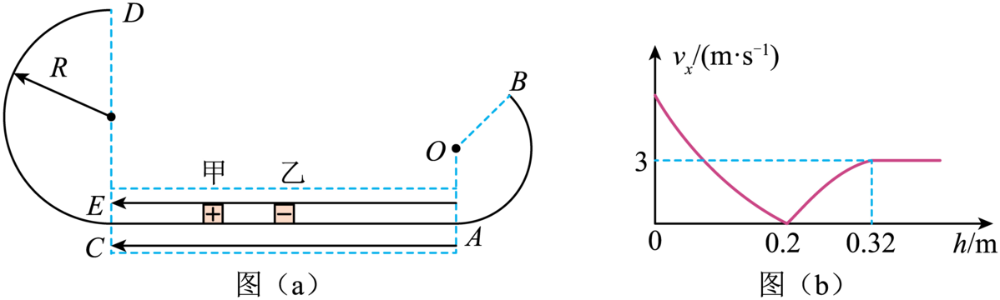

# Physics - 题目 2682

**ID**: 76da89dac9b8428d866c1ac1269ff1a0
**年级**: Grade 12
**难度**: Medium-Hard
**题型**: Calculation

## 题目
如图（a），一粗糙的圆弧轨道 $AB$ 与另一半径为 $R=0.3{\rm{m}}$ 的光滑半圆轨道 $CD$ 均固定在同一竖直平面内，其下端均与粗糙的水平地面相切， $AC$ 间的虚线区域存在水平向左的匀强电场，现将带等量异种电荷的甲、乙两滑块在水平地面上无初速同时释放，释放时甲到C点的距离与乙到A点的距离之和为 $x=0.5{\rm{m}}$ ，它们运动一段时间后同时离开电场，然后分别沿圆弧轨道运动，其中甲经过最高点D时对轨道的压力大小为 $F{{}_{{\rm{N}}}}=1{\rm{N}}$ ；乙从A点运动经B点到最高点（图中未画出）的过程中，其水平速度大小 $v{{}_{x}}$ 与离地面的高度 $h$ 之间的关系如图（b）所示，已知甲、乙质量分别为 $m{{}_{1}}=0.3{\rm{k}}{\rm{g}}$ 、 $m{{}_{2}}=0.2{\rm{k}}{\rm{g}}$ ，它们与水平地面间的动摩擦因数分别为 $μ{{}_{1}}=0.4$ 、 $μ{{}_{2}}=0.6$ ，甲、乙均可视为质点，甲、乙分别运动到C、A点前电荷量均保持不变且电荷间的相互作用力不能忽略，当达到C、A点时电荷均被全部导走，取重力加速度大小 $g=10{\rm{m}}/{\rm{s}}{^{2}}$ 。​​​​​​​‌求：（1）甲离开电场时的速度大小；（2）乙运动过程中最高点离地面的高度；（3）滑块从释放到离开电场的过程中，甲、乙和电场组成的系统减少的电势能。

## 解答

1. （1）设甲离开电场时的速度大小为 $v{{}_{1}}$ ，经过D点时的速度大小为 $v{{}_{D}}$ ，由牛顿第三 定律有 $F{{}_{{\rm{N}}}}+m{{}_{1}}g=m{{}_{1}}\frac {v{{}_{D}^{2}}}{R}$ ，
2. 甲从C到D的过程中根据机械能守恒定律有 $\frac {1}{2}m{{}_{1}}v{{}_{1}^{2}}=m{{}_{1}}g\times 2R+\frac {1}{2}m{{}_{1}}v{{}_{D}^{2}}$ ，
3. 联立解得 $v{{}_{1}}=4{\rm{m}}{\rm{/}}{\rm{s}}$ 。
4. （2）由图（b）可知，圆弧轨道AB的半径r及B点到地面的高度 $h{{}_{0}}$ 分别为 $r=0.2{\rm{m}}，h{{}_{0}}=0.32{\rm{m}}$ ，
5. 设乙经过B点时竖直方向的速度大小为 $v{{}_{y}}$ ，圆心O与B的连线与水平方向的夹角为 $θ$ ，乙运动过程中最高点到地面的高度为h，则有 ${\tan}θ=\frac {v{{}_{x}}}{v{{}_{y}}}，{\tan}θ=\frac {h{{}_{0}}-r}{\sqrt {r{^{2}}-{\left({h{{}_{0}}-r}\right)^{2}}}}，v{{}_{y}^{2}}=2g\left ({h-h{{}_{0}}}\right )$ ，
6. 联立解得 $h=1.1{{2}}{\rm{m}}$ 。
7. （3）由题意可知，甲、乙在水平面上受到的摩擦力大小满足 $μ{{}_{1}}m{{}_{1}}g=μ{{}_{2}}m{{}_{2}}g$ ，
8. 且匀强电场给两电荷的作用力大小相等、方向相反，因此，甲、乙两滑块所受外力的矢量和为零，所以从释放到离开电场的过程中动量守恒，设乙离开电场时的速度大小 $v{{}_{2}}$ ，根据动量守恒定律有 $0=m{{}_{1}}v{{}_{1}}-m{{}_{2}}v{{}_{2}}$ ，
9. 设甲、乙两物体在电场中运动的距离分别为 $x{{}_{1}}、x{{}_{2}}$ ，由题可知 $x{{}_{1}}+x{{}_{2}}=x$ ，
10. 从释放到 离开电场的过程中，设甲、乙和电场组成的系统减少的电势能为 $E{{}_{{\rm{p}}}}$ ，根据能量守恒定律有 $E{{}_{{\rm{p}}}}=\frac {1}{2}m{{}_{2}}v{{}_{2}^{2}}+\frac {1}{2}m{{}_{1}}v{{}_{1}^{2}}+μ{{}_{1}}m{{}_{1}}gx{{}_{1}}+μ{{}_{2}}m{{}_{2}}gx{{}_{2}}$ ，
11. 联立解得 $E{{}_{{\rm{p}}}}=6.6{\rm{J}}$ 。

## 知识点

**中文**:
  - 求解弹性碰撞问题

**English**:
  - Solving Elastic Collision Problems

---
