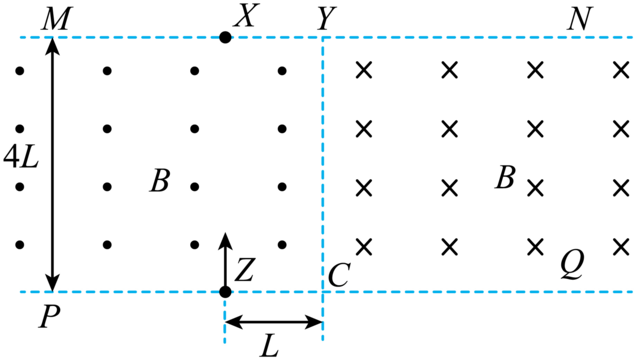

# Physics - 题目 2104

**ID**: 774fd442da514ae59c1834946dc0a6f4
**年级**: Grade 12
**难度**: Medium-Hard
**题型**: Calculation

## 题目
如题图所示，在无限长的水平边界MN和PQ间充满竖直方向的匀强电场（图中未画出），同时该区域左、右部分分别充满方向垂直于MNPQ平面向外和向内的匀强磁场，磁感应强度大小均为 ${\rm{B}}，{\rm{Y}}{\rm{C}}$ 为左右磁场的竖直分界线，在 ${\rm{M}}{\rm{N}}$ 和 ${\rm{P}}{\rm{Q}}$ 边界上，离 ${\rm{Y}}{\rm{C}}$ 距离为 ${\rm L}$ 处分别有 $Z、X$ 两点， $MN$ 和 $PQ$ 间距为 $4{\rm{L}}$ 。​​​​​​​‌质量为 $m$ ，带电荷量为 $+{\rm{q}}$ 的微粒从 ${\rm Z}$ 点垂直于 ${\rm{P}}{\rm{Q}}$ 边界射入该区域，在两边界之间做匀速圆周运动，重力加速度为g。(1)求电场强度的大小和方向；(2)要使微粒不从PQ边界飞出，求微粒入射速度的最小值；(3)若微粒能经过X点从MN边界飞出，求微粒入射速度的所有可能值。

## 解答

1. （1）粒子在磁场中做匀速圆周运动，故只受洛伦兹力，所以电场力平衡重力，则有
2. $qE=mg$
3. 可解得
4. $E=\frac {mg}{q}$
5. 电场力竖直向上，由于粒子带正电，所以电场强度方向向上。
6. （2）保证粒子不从PQ边界射出，即为轨迹与边界相切，根据数学关系，则有
7. ${\cos}α=\frac {R}{2R}=\frac {1}{2}$
8. $R+R{\cos}α=L$
9. 可解得
10. $R=2(2-\sqrt {3})L$
11. 根据洛伦兹力充当向心力，则有
12. $qvB=m\frac {v{^{2}}}{R}$
13. 可解得
14. $v=\frac {2(2-\sqrt {3})qBL}{m}$
15. 
16. （3）如下图所示，粒子可能完成多个这样的过程，则有
17. $4nR{{}_{0}}{\cos}β=4L$  $(n=1,2,3\cdots )$
18. $R{{}_{0}}+R{{}_{0}}\sin β=L$
19. 可解得
20. $R{{}_{0}}=\frac {L}{2n{^{2}}}+\frac {L}{2}$
21. 又因
22. $R{{}_{0}}⩾2(2-\sqrt {3})L$
23. 可解得
24. $n=1,2,3$
25. 所以当 $n=1$ 时，则有
26. $R{{}_{0}}=L$
27. 当 $n\mathrm{=}2$ 时，则有
28. $R{{}_{0}}=\frac {5}{8}L$
29. 当 $n=3$ 时，则有
30. $R{{}_{0}}=\frac {5}{9}L$
31. 根据洛伦兹力充当向心力，则有
32. $qv{{}_{1}}B=m\frac {v{{}_{1}^{2}}}{R{{}_{0}}}$
33. 可解得速度的可能值为
34. $v{{}_{1}}=\frac {qBL}{m}$
35. $v{{}_{1}}=\frac {5qBL}{8m}$
36. $v{{}_{1}}=\frac {5qBL}{9m}$
37. 

## 知识点

**中文**:
  - 带电粒子在磁场中做圆周运动的多解问题

**English**:
  - Multi-solution Problems of Circular Motion in Magnetic Fields

---
