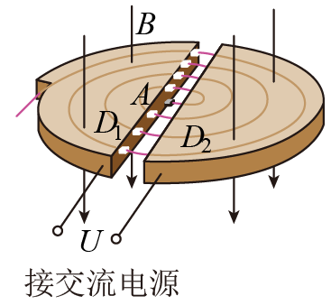

# Physics - 题目 103

**ID**: 7751b9f11fc34b36a3f74d4c253851d2
**年级**: Grade 12
**难度**: Medium-Hard
**题型**: Calculation

## 题目
1932年，劳伦斯和利文斯顿设计出了回旋加速器，回旋加速器的工作原理如图所示，置于高真空中的D形金属盒半径为R，两盒间接交流电源，两盒间的狭缝很小，带电粒子穿过狭缝的时间可以忽略不计，磁感应强度为B的匀强磁场与盒面垂直，A处粒子源产生的质子，质量为m、电荷量为q，（质子初速度很小，可以忽略）在加速器中被加速，加速电压为U，加速过程中不考虑相对论效应和重力作用。​​​​​​​‌求：（1）质子第一次进入磁场中的速度v；（2）要使质子每次经过电场都被加速，则交流电源的周期为多大；（3）质子在电场中最多被加速多少次；（4）在实际装置设计中，可以采取哪些措施尽量减少带电粒子在电场中的运行时间。

## 解答

1. （1）依题意，质子第一次进入磁场中的速度v为 $Uq=\frac {1}{2}mv{^{2}}$
2. 解得 $v=\sqrt {\frac {2Uq}{m}}$
3. （2）质子在磁场中做匀速圆周运动，洛伦兹力提供向心力，则有 $qvB=m\frac {v{^{2}}}{r}$
4. 则有 $r=\frac {mv}{qB}$
5. 周期 $T=\frac {2πr}{v}=\frac {2πm}{Bq}$
6. 所以交流电源的周期为 $T=\frac {2πm}{Bq}$
7. （3）当质子在磁场中做圆周运动的轨道半径 $r=R$ 时，其速率达到最大 $v{{}_{{\rm{m}}}}$ ，则有 $qv{{}_{{\rm{m}}}}B=m\frac {v{{}_{{\rm{m}}}^{2}}}{R}$
8. 得到质子能够达到的最大速率为 $v{{}_{{\rm{m}}}}=\frac {BqR}{m}$
9. 质子的最大动能为 $E{{}_{{\rm{k}}{\rm{m}}}}=\frac {1}{2}mv{{}_{{\rm{m}}}^{2}}=\frac {q{^{2}}B{^{2}}R{^{2}}}{2m}$
10. 设质子被加速的次数为 $N$ ，则有 $NqU=E{{}_{{\rm{k}}{\rm{m}}}}=\frac {q{^{2}}B{^{2}}R{^{2}}}{2m}$
11. 解得 $N=\frac {qB{^{2}}R{^{2}}}{2mU}$
12. （4）依题意，质子在磁场中速度大小不变、只在电场中加速且匀加速度大小不变，假定两D型盒间距为d，则质子在电场中运行的时间为 $t=\frac {v{{}_{{\rm{m}}}}}{a}=\frac {\frac {BqR}{m}}{\frac {Uq}{dm}}=\frac {BRd}{U}$
13. 同理可知在实际装置设计中，可以采取提高加速电压或适当减小两D型盒间距以减少带电粒子在电场中运行的时间。

## 知识点

**中文**:
  - 回旋加速器

**English**:
  - Cyclotron

---
