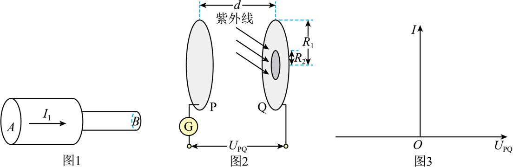

# Physics - 题目 2057

**ID**: 78d7afce56ea4e55970a1e25a85bd37d
**年级**: Grade 12
**难度**: Medium-Hard
**题型**: Calculation

## 题目
电荷的定向移动形成电流。​​​​​​​‌已知电子质量为m，元电荷为e。（1）两个截面不同的均匀铜棒接在电路中通以稳恒电流，已知电子定向移动通过导体横截面A形成的电流为 $I{{}_{1}}$ 。求 $Δt$ 时间内通过导体横截面B的电子数N。（2）真空中一对半径均为 $R{{}_{1}}$ 的圆形金属板P、Q圆心正对平行放置，两板距离为d，Q板中心镀有一层半径为 $R{{}_{2}}\left ({R{{}_{2}}<R{{}_{1}}}\right )$ 的圆形锌金属薄膜。Q板受到紫外线持续照射后，锌薄膜中的电子可吸收光的能量而逸出。现将两金属板P、Q与两端电压 $U{{}_{{\rm{P}}{\rm{Q}}}}$ 可调的电源、灵敏电流计G连接成如图2所示的电路。已知单位时间内从锌薄膜中逸出的光电子数为n、逸出时的最大动能为 $E{{}_{{\rm{k}}{\rm{m}}}}$ ，且光电子逸出的方向各不相同。忽略光电子的重力以及光电子之间的相互作用，不考虑平行板的边缘效应，光照条件保持不变，只有锌金属薄膜发生光电效应。a．调整电源两端电压，使灵敏电流计示数恰好为零，求此时电压 $U{{}_{{\rm{c}}}}$ 。b．实验发现，当 $U{{}_{PQ}}$ 大于或等于某一电压值 $U{{}_{m}}$ 时灵敏电流计示数始终为最大值 $I{{}_{m}}$ ，求 $I{{}_{m}}$ 和 $U{{}_{m}}$ 。c．保持 $R{{}_{2}}$ 不变，仅改变 $R{{}_{1}}$ 的大小，结合（2）a和（2）b的结论，在图3中分别定性画出当 $R{{}_{1}}=2R{{}_{2}}$ 时I随 $U{{}_{{\rm{P}}{\rm{Q}}}}$ 变化的图线①和当 $R{{}_{1}}=4R{{}_{2}}$ 时I随 $U{{}_{PQ}}$ 变化的图线②。

## 解答

1. （1）根据 $I=\frac {ΔQ}{Δt}$
2. 可得单位时间通过导体横截面A的电子数为 $n{{}_{1}}=\frac {I{{}_{1}}}{e}$
3. 因为单位时间通过导体横截面A的电子数与通过导体横截面B的电子数相等
4. 所以时间Δt内通过导体横截面B的电子数为 $N=n{{}_{1}}\Delta t=\frac {I{{}_{1}}}{e}\Delta t$
5. （2）a．以具有最大动能且沿垂直金属板运动的电子为研究对象，若其刚到达P板时速度刚好减小到0，则不会有电子经过灵敏电流计G，此为I为零的临界情况，意味着U_{PQ}<0。
6. 根据动能定理，光电子由Q板到P板的过程中，有 $-eU{{}_{c}}=0-E{{}_{{\rm{k}}m}}$
7. 得 $U{{}_{c}}=\frac {E{{}_{{\rm{k}}m}}}{e}$
8. b．当U_{PQ}＞0时，若从锌膜边缘平行Q板射出的动能最大的光电子做匀变速曲线（类平抛）运动，刚好能到达P板边缘时，则所有电子均能到达P板，此时电源两端电压为U_{m}。设电子的初速度为v、运动时间为t，电流的最大值为I_{m}=ne
9. 根据牛顿第二定律，光电子运动的加速度为 $a=\frac {eU{{}_{m}}}{md}$
10. 平行于金属板方向的运动有 $R{{}_{1}}-R{{}_{2}}=vt$
11. 垂直于金属板方向的运动有 $d=\frac {1}{2}at{^{2}}$
12. 光电子最大动能与初速度关系为 $E{{}_{{\rm{k}}m}}=\frac {1}{2}mv{^{2}}$
13. 联立可得 $U{{}_{m}}=\frac {4d{^{2}}E{{}_{{\rm{k}}m}}}{e(R{{}_{1}}-R{{}_{2}}){^{2}}}$
14. c．结合上述结论，可定性画出I随U_{PQ}变化的图线如答下图所示。
15. 

## 知识点

**中文**:
  - 光电效应方程的图像问题
  - 光电效应规律的综合应用

**English**:
  - Graph Problems of Photoelectric Equation
  - Comprehensive Application of Photoelectric Effect

---
