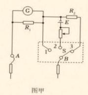
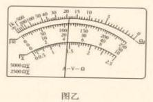
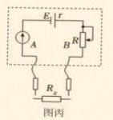

# Physics - 题目 992

**ID**: 7a4ea919ea20466a91005e8e35292280
**年级**: Grade 12
**难度**: Medium-Hard
**题型**: 方程式和重要的演算步骤；有数值计算时，答案中必须明确写出数值和单位。

## 题目
（1）如图甲所示为某同学设计的多用电表的原理示意图。​​​​​​​‌虚线框中 $S$ 为一个单刀多掷开关，通过操作开关，接线柱 $B$ 可以分别与触点1、2、3接通，从而实现使用多用电表测量不同物理量的不同功能。关于此多用电表，下列说法中正确的是。（选填选项前面的字母）

## 解答

1. 解：（1） $A$ .当 $S$ 接触点1时，电阻与表头并联，则多用电表处于测量电流的挡位，其中接线柱 $B$ 接的是黑表笔，故 A 正确;
2. $BC$ .当 $S$ 接触点2时，内部接电源，则多用电表处于测量电阻的挡位，因黑表笔内部接电源的正极，则其中接线柱 $B$ 接的是黑表笔，故 B 错误， $C$ 正确：
3. D．当 $S$ 接触点3时，表头与电阻串联，则多用电表处于测量电压的挡位，其中接线柱 $B$ 接的是黑表笔，故 D 错误：故选： AC  .
4. （2） $a$ .若所选挡位为直流 $50 \mathrm{m}\mathrm{A}$ 挡，则分度值为 $1 \mathrm{m}\mathrm{A}$ ,示数为 $22.0\mathrm{m}\mathrm{A}$ ;
5. b.若所选挡位为电阳 $×10\Omega$ 挡，则示数为 $19×10\Omega =190\Omega$ ;
6. （3）用表盘为图乙所示的多用电表正确测量了一个约 $15\Omega$ 的电阻后，需要继续测量一个阻值约 $2\mathrm{k}\Omega$ 的电阻，则必须要换成 $×10{0}^{\mathrm{\text{'}}\mathrm{\text{'}}}$ 挡，然后两表笔短接调零，其正确步骤是 $BAD$ 。
7. （4）根据闭合电路的欧姆定律可知
8. $I=\frac{E}{R_x+R_{13}}$
9. 则
10. $\frac{1}{I}=\frac{1}{E}R_x+\frac{R_{\mathrm 内}}E$
11. 故 $\mathrm{A}\mathrm{C}$ 正确， $\mathrm{B}\mathrm{D}$ 错误。
12. 故选： $\mathrm{A}\mathrm{C}$ 。
13. （5）由闭合电路的欧姆定律
14. $I_{\mathrm g}=\frac{E}{R_{\mathrm 内}}$
15. 将 $I_{\mathrm g}=100\mu\mathrm A=100\times10^{-6} \mathrm A$ 代入解得
16. $R_{\mathrm 内}=15000\Omega$
17. 结合表盘的中值电阻的意义分析可得，此时欧姆表为电阻 $×1\mathrm{k}$ 挡。
18. 故答案为：（1） $\mathrm{A}\mathrm{C}:{\rm （2）}$  $22.0;190$ ;（3） $\mathrm{B}\mathrm{A}\mathrm{D}$ ;（4） $\mathrm{A}\mathrm{C}$ ;（5） $×1\mathrm{k}$ 。

## 知识点

**中文**:
  - 实验：电表内阻的测量
  - 实验：练习使用多用电表

**English**:
  - Experiment: Measuring Internal Resistance of Meter
  - Experiment: Using a Multimeter

---
