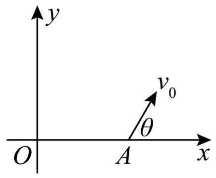

# Physics - 题目 1394

**ID**: 7bfd997d17cf4afc8a0ef12694f71103
**年级**: Grade 12
**难度**: Medium-Hard
**题型**: Calculation

## 题目
直角坐标系xoy位于竖直平面内，在第一象限存 在磁感应强度B=0.1 T、方向垂直于纸面向里、边界为矩形的匀强磁场。​​​​​​​‌现有一束比荷为 $\frac {q}{m}$ = 10^{8}C / kg 带正电的离子，从磁场中的A点（ $\frac {\sqrt {3}}{20}$m，0）沿与x轴正方向成 θ =60°角射入磁场，速度大小v_{0}≤1.0 ×10^{6}m / s，所有离子经磁场偏转后均垂直穿过y轴的正半轴，不计离子的重力和离子间的相互作用。(1)求速度最大的离子在磁场中运动的轨道半径；(2)求矩形有界磁场区域的最小面积；(3)若在x>0区域都存在向里的磁场，离子仍从A点以v_{0}= $\frac {\sqrt {3}}{2}$ × 10^{ 6 }m /s向各个方向均匀发射，求y轴上有离子穿出的区域长度和能打到y轴的离子占所有离子数的百分比。

## 解答

1. (1)根据洛伦兹力提供向心力有
2. ${\rm qvB=m\frac {v{{}_{0}^{2}}}{R}}$
3. 代入数据解得
4. R=0.1m；
5. (2)如图1所示：
6. 
7. 根据几何关系可知，速度最大的离子在磁场中运动的圆心在y轴上的B（0， $\frac {1}{20}$ m）点，离子从C点垂直穿过y轴，所有离子均垂直穿过y轴，即速度偏向角相等，AC连线应该是磁场的边界，满足题意的矩形如图1所示，根据几何关系可得矩形长为
8. ${\rm \frac {OA}{{\rm{c}}{\rm{o}}{\rm{s}}θ}＝\frac {\sqrt {3}}{10}{\rm{m}}}$
9. 宽为
10. R-Rcosθ＝ $\frac {1}{20}$ m
11. 则面积为
12. ${\rm S=\frac {\sqrt {3}}{\hspace{-0.5em}\begin{array}{l}200\end{array}\hspace{-0.5em}}{\rm{m}}{^{{\rm{2}}}}}$
13. (3)根据洛伦兹力提供向心力有
14. ${\rm qvB=m\frac {v{{}_{0}^{2}}}{R}}$
15. 解得
16. ${\rm R=\frac {\sqrt {3}}{20}{\rm{m}}}$
17. 临界1，根据图2可得
18. 
19. 与x轴成30°角射入的离子打在y轴上的B点，AB为直径，所以B点位y轴上有离子经过的最高点，根据几何知识可得
20. OB= $\frac {3}{20}$ m；
21. 临界2：根据图2可得，沿着x轴负方向射入磁场中的离子与y轴相切与C点，所以C点为y轴有离子打到的最低点，根据几何知识有
22. OC= $\frac {\sqrt {3}}{20}$ m
23. 所以y轴上B点至C点之间的区域有离子穿过，且长度为
24. ${\rm BC=\frac {3+\sqrt {3}}{20}{\rm{m}}}$
25. 根据图3可得，
26. 
27. 沿着x轴正方向逆时针转到x轴负方向的离子均可打在y轴上，故打在y轴上的离子占所有离子数的50%。

## 知识点

**中文**:
  - 带电粒子在有界匀强磁场中的运动
  - 带电粒子在有界磁场中运动的临界极值问题

**English**:
  - Motion in Bounded Uniform Magnetic Field
  - Critical Extremum Problems in Bounded Magnetic Fields

---
