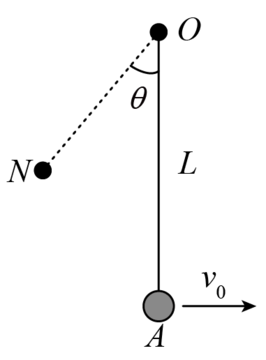

# Physics - 题目 1790

**ID**: 7d6963d0c3784f12ac9ba54331b1fc68
**年级**: Grade 12
**难度**: Medium-Hard
**题型**: Calculation

## 题目
如图所示，不可伸长的轻质细线下方悬挂一可视为质点的小球，另一端固定在竖直光滑墙面上的O点．开始时，小球静止于A点，现给小球一水平向右的初速度，使其恰好能在竖直平面内绕O点做圆周运动．垂直于墙面的钉子N位于过O点竖直线的左侧， ${\overline{ON}}$ 与 ${\overline{OA}}$ 的夹角为 $θ$  $（0<θ<π）$ ，且细线遇到钉子后，小球绕钉子在竖直平面内做圆周运动，当小球运动到钉子正下方时，细线刚好被拉断．已知小球的质量为m，细线的长度为L，细线能够承受的最大拉力为7mg，g为重力加速度大小．（1）求小球初速度的大小 $v{{}_{0}}$ ；​​​​​​​‌（2）求小球绕钉子做圆周运动的半径r与 $θ$ 的关系式；（3）在细线被拉断后，小球继续向前运动，试判断它能否通过A点．若能，请求出细线被拉断时 $θ$ 的值；若不能，请通过计算说明理由．

## 解答

1. (1) 小球恰能完整圆周运动至最高点，设最高点的速度为v，据圆周运动公式： $mg=m\frac {v{^{2}}}{L}$
2. 解得： $v=\sqrt {gL}$
3. 小球释放至最高点，由动能定理： $-mg\cdot 2L=\frac {1}{2}mv{^{2}}-\frac {1}{2}mv{{}_{0}^{2}}$
4. 解得： $v{{}_{0}}=\sqrt {5gL}$
5. (2)小球绕钉子做圆周运动，设碰到钉子时的速度为 $v{{}_{1}}$ ，由释放到碰到钉子时根据动能定理得： $-mgL\left ({1-{\cos}θ}\right )=\frac {1}{2}mv{{}_{1}^{2}}-\frac {1}{2}mv{{}_{0}^{2}}$
6. 碰到钉子到绳子断的过程，由动能定理得： $mg\left ({1-{\cos}θ}\right )r=\frac {1}{2}mv{{}_{2}^{2}}-\frac {1}{2}mv{{}_{1}^{2}}$
7. 绳子断的瞬间： $F{{}_{{\rm{T}}}}=7mg$ ， $F{{}_{{\rm{T}}}}{{-}}{\rm{\;}}mg=m\frac {v{{}_{2}^{2}}}{r}$
8. 联立以上几式，解得： $r=\frac {\left ({3+2{\cos}θ}\right )}{2(2+{\cos}θ)}L$
9. （3）细线被拉断后，小球做平抛运动，设t时间小球运动到与A点同一竖直线上，由几何关系德： $x=(L-r)\sin θ$
10. 平抛运动水平方向列方程得： $x=v{{}_{2}}t$
11. 由（2）可知： $v{{}_{2}}=\sqrt {6gr}$
12. 平抛运动竖直方向列方程得： $y=\frac {1}{2}gt{^{2}}$
13. 带入上面几式可得： $y=\frac {1}{2}gt{^{2}}=\frac {(L-r){^{2}}\sin {^{2}}θ}{12r}$
14. 平抛开始点与A点的高度差h为： $h=L-r-(L-r){\cos}θ=(L-r)(1-{\cos}θ)$
15. 若正好过A点，则 $h=y$ ，解得： $r=\frac {1+{\cos}θ}{13+{\cos}θ}L$
16. 此结论与（2）不相符，所以小球不能通过A点．

## 知识点

**中文**:
  - 应用动能定理求解连接体问题

**English**:
  - Solving Connected Body Problems

---
