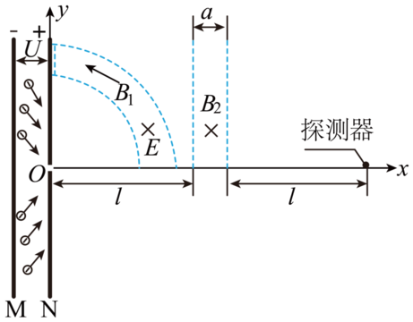

# Physics - 题目 1223

**ID**: 7dcdcb2c73234eb6b5b71fe0de0bb1d0
**年级**: Grade 12
**难度**: Medium-Hard
**题型**: Calculation

## 题目
研究光电效应的装置示意图如图所示，该装置可用于分析光子的信息。​​​​​​​‌在xoy平面（纸面）内，垂直面的金属薄板，M、N与y轴平行放置，板N中间有一小孔0。有一由x轴、y轴和以O为圆心，圆心角为90°的半径不同的两条圆弧所围的区域I，整个区域I内存在大小可调，方向垂直纸面向里的匀强电场和磁感应强度大小恒为B_{1}、磁感线与圆弧平行且逆时针方向的磁场。区域I右侧还有一个边界与y轴平行且左边界与O点相距为l、下界与x轴重合的匀强磁场区域Ⅱ，其宽度为a，长度足够长，磁场方向垂直纸面向里，磁感应强度大小可调。光电子从板M逸出后经极板板间电压U加速（板间电场视为匀强电场），从小孔O射出，并沿各个可能的方向射入板N的右侧空间，调节区域I的电场强度和区域Ⅱ的磁感应强度。使具有某速度并沿某方向运动的电子恰好打在坐标为（a+2l，0）的点上，被置于该处的探测器接收。已知电子质量为m，电荷量为e，板M的逸出功为W_{0}，普朗克常量为h。忽略电子的重力及电子间的作用力。当频率为v的光照射M板时有光电子逸出。求：（1）光电子从O点射出时的速度v_{0}的大小范围；（2）为了使从O点以各种大小和方向的速度财向区域I的电子都能被探测到，需要调节区域I的电场强度E和区城Ⅱ的磁感应强度B_{2}，求E的最大值和B_{2}的最大值。

## 解答

1. （1）根据光电效应方程可得，逸出光电子的最大初动能为
2. $E{{}_{{\rm{k}}m}}=hν-W{{}_{0}}$
3. 即有
4. $\frac {1}{2}mv{{}_{0}^{2}}=E{{}_{{\rm{k}}}}+eU$  $(0\leqslant E{{}_{{\rm{k}}}}\leqslant W{{}_{0}})$
5. $\sqrt {\frac {2eU}{m}}\leqslant v{{}_{0}}\leqslant \sqrt {\frac {2\left ({hν+eU-W{{}_{0}}}\right )}{m}}$
6. （2）速度选择器
7. $ev{{}_{0}}B{{}_{1}}=eE$
8. $v{{}_{0}}=\frac {E}{B{{}_{1}}}=\sqrt {\frac {3eU}{m}}$
9. $\frac {1}{2}mv{{}_{0}^{2}}-\frac {1}{2}mv{{}_{M}^{2}}=eU$
10. $v{{}_{M}}=\sqrt {\frac {eU}{m}}$
11. 如图所示，几何关系
12. $\frac {mv{{}_{0}}}{eB{{}_{2}}}{\sin}α=\frac {a}{2}$
13. 
14. 由上述表达式可得
15. $E{{}_{{\rm \max }}}=B{{}_{1}}\sqrt {\frac {2(hν+eU-W{{}_{0}})}{m}}$
16. 由
17. $\frac {mv{{}_{0}}}{eB{{}_{2}}}{\sin}α=\frac {a}{2}$
18. 可得
19. $v{{}_{0}}{\sin}α\leqslant B{{}_{1}}\sqrt {\frac {2(hν-W{{}_{0}})}{m}}$
20. 可得
21. $B{{}_{2}}=\frac {2\sqrt {2m\left ({hν-W{{}_{0}}}\right )}}{ea}$

## 知识点

**中文**:
  - 速度选择器

**English**:
  - Velocity Selector

---
