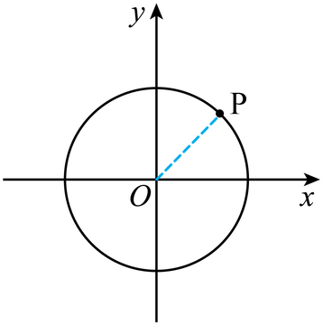

# Physics - 题目 119

**ID**: 7fafe659e35e4f9894d572489f3ecddb
**年级**: Grade 12
**难度**: Medium-Hard
**题型**: Calculation

## 题目
1610年，伽利略用他制作的望远镜发现了木星的四颗主要卫星。​​​​​​​‌根据观察，他将其中一颗卫星 ${\rm{P}}$ 的运动视为一个振幅为 $\mathrm{A}$ 、周期为 $T$ 的简谐运动，并据此推测，他观察到的卫星振动是卫星圆运动在某方向上的投影。如图所示，是伽利略推测的卫星 ${\rm{P}}$ 运动的示意图，在 $xOy$ 平面内，质量为 $m$ 的卫星 ${\rm{P}}$ 绕坐标原点 $O$ 做匀速圆周运动。已知引力常量为 $G$ ，不考虑各卫星之间的相互作用。(1)若认为木星位于坐标原点 $O$ ，根据伽利略的观察和推测结果：①求木星的质量 $M$ 。②物体做简谐运动时，回复力应该满足 $F=-kx$ 。请据此证明：卫星 ${\rm{P}}$ 绕木星做匀速圆周运动在 $x$ 轴上的投影是简谐运动。(2)若将木星与卫星 ${\rm{P}}$ 视为双星系统，彼此围绕其连线上的某一点做匀速圆周运动，计算出的木星质量为 $M^{′}$ 。请分析比较（1）②中得出的质量 $M$ 与 $M^{′}$ 的大小关系。

## 解答

1. （1）①卫星P做圆周运动的向心力大小F的表达式 $F=m{{}_{{\rm{P}}}}\frac {4π{^{2}}}{T{^{2}}}r=m{{}_{{\rm{P}}}}\frac {4π{^{2}}}{T{^{2}}}A$
2. 根据万有引力提供向心力则有 $\frac {GMm{{}_{{\rm{P}}}}}{A{^{2}}}=m{{}_{{\rm{P}}}}\frac {4π{^{2}}}{T{^{2}}}A$
3. 解得木星的质量 $M=\frac {4π{^{2}}A{^{3}}}{GT{^{2}}}$
4. ②如图
5. 
6. 取向右为正方向 $F{{}_{回复}}=-m{{}_{{\rm{P}}}}\frac {4π{^{2}}}{T{^{2}}}r{\cos}θ=-m{{}_{{\rm{P}}}}\frac {4π{^{2}}}{T{^{2}}}x=-kx$
7. 故卫星 ${\rm{P}}$ 绕木星做匀速圆周运动在 $x$ 轴上的投影是简谐运动。
8. （2）对卫星P，则有 $\frac {GM^{′}m{{}_{{\rm{P}}}}}{L{^{2}}}=m{{}_{{\rm{P}}}}\frac {4π{^{2}}}{T{^{2}}}A$
9. 得 $M^{′}=\frac {4π{^{2}}L{^{2}}A}{GT{^{2}}}$
10. 由于 $A<L$
11. 综合以上可知 $M<M^{′}$ 。

## 知识点

**中文**:
  - 天体质量的计算

**English**:
  - Calculation of Celestial Mass

---
