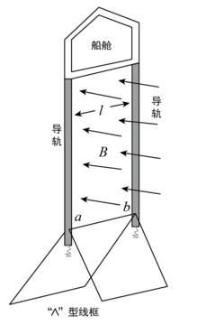

# Physics - 题目 2592

**ID**: 7fb839dadbf1496582c7c71d3ba1a628
**年级**: Grade 12
**难度**: Medium-Hard
**题型**: Calculation

## 题目
嫦娥五号成功实现月球着陆和返回，鼓舞人心。​​​​​​​‌小明知道月球上没有空气，无法靠降落伞减速降落，于是设计了一种新型着陆装置。如图所示，该装置由船舱、间距为l的平行导轨、产生垂直船舱导轨平面的磁感应强度大小为B的匀强磁场的磁体和“∧”型刚性线框组成，“∧”型线框ab边可沿导轨滑动并接触良好。船舱、导轨和磁体固定在一起，总质量为m_{1}整个装置竖直着陆到月球表面前瞬间的速度大小为v_{0}，接触月球表面后线框速度立即变为零。经过减速，在导轨下方缓冲弹簧接触月球表面前船舱已可视为匀速。已知船舱电阻为3r，“∧”型线框的质量为m_{2}，其7条边的边长均为l，电阻均为r；月球表面的重力加速度为g/6。整个运动过程中只有ab边在磁场中，线框与月球表面绝缘，不计导轨电阻和摩擦阻力。(1)求着陆装置接触到月球表面后瞬间线框ab边产生的电动势E；(2)通过画等效电路图，求着陆装置接触到月球表面后瞬间流过ab型线框的电流I_{0}；(3)求船舱匀速运动时的速度大小v；(4)同桌小张认为在磁场上方、两导轨之间连接一个电容为C的电容器，在着陆减速过程中还可以回收部分能量，在其他条件均不变的情況下，求船舱匀速运动时的速度大小 $v^{′}$ 和此时电容器所带电荷量q。

## 解答

1. (1)导体切割磁感线，电动势
2. $E{{}_{0}}=Blv{{}_{0}}$
3. (2)等效电路图如图
4. 
5. 并联总电阻
6. $R=2r$
7. 电流
8. $I{{}_{0}}=\frac {E{{}_{0}}}{R}=\frac {Blv{{}_{0}}}{2r}$
9. (3)匀速运动时线框受到安培力
10. $F{{}_{{\rm{A}}}}=\frac {B{^{2}}l{^{2}}v}{2r}$
11. 根据牛顿第三定律，质量为m_{1}的部分受力F=F_{A}，方向竖直向上，匀速条件
12. $F=\frac {m{{}_{1}}g}{6}$
13. 得
14. $v=\frac {m{{}_{1}}gr}{3B{^{2}}l{^{2}}}$
15. (4)匀速运动时电容器不充放电，满足
16. $v{^{\prime }}=v=\frac {m{{}_{1}}gr}{3B{^{2}}l{^{2}}}$
17. 电容器两端电压为
18. $U{{}_{C}}{\rm{=}}\frac {1}{3}I\times 3r=\frac {m{{}_{1}}gr}{6Bl}$
19. 电荷量为
20. $q=CU{{}_{C}}=\frac {m{{}_{1}}grC}{6Bl}$

## 知识点

**中文**:
  - 电容器与力学知识的综合
  - 线框模型

**English**:
  - Integration of Capacitors and Mechanics
  - Wire Frame Model

---
