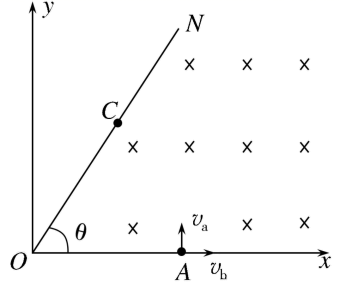

# Physics - 题目 16

**ID**: 7ff59e47f99b4d1793070280cdc1f4fd
**年级**: Grade 12
**难度**: Medium-Hard
**题型**: Calculation

## 题目
如图所示，在直角坐标系xOy平面内，x轴与射线ON之间存在垂直纸面向里的匀强磁场，它们之间的夹角θ＝60°，质量为m_{a}、电荷量为＋q的a粒子，以速率v_{a}垂直x轴从A点进入磁场，经C点垂直ON射出磁场；质量为m_{b}、电荷量为＋q的b粒子，以速率v_{b}沿x轴正方向从A点进入磁场，其轨迹恰好与射线ON相切于C点，若b粒子从A点第一次运动到C点经历的时间等于a粒子从A点运动到C点经历的时间，不计粒子的重力，求：（1）a、b粒子质量之比；（2）a、b粒子速率之比。​​​​​​​‌

## 解答

1. （1）画出两粒子运动的轨迹，如图所示：
2. 
3. 带电粒子在磁场中运动周期
4. T＝ $\frac {2πm}{Bq}$
5. 根据几何知识知a粒子转过的角度为60°，运动时间为
6. $t{{}_{a}}＝\frac {1}{6}T{{}_{a}}＝\frac {πm{{}_{a}}}{3qB}$
7. b转过角度为240°，运动时间为
8. $t{{}_{b}}＝\frac {2}{3}T{{}_{b}}＝\frac {4πm{{}_{b}}}{3qB}$
9. 根据t_{a}＝t_{b}
10. 联立解得
11. $\frac {m{{}_{a}}}{m{{}_{b}}}=4$
12. （2）设a轨道半径为r_{a}，根据几何知识知b的轨道半径r_{b}＝r_{a}tan30°
13. 洛伦兹力充当向心力
14. $Bqv＝m\frac {v{^{2}}}{r}$
15. 联立以上各式解得
16. $\frac {v{{}_{a}}}{v{{}_{b}}}=\frac {\sqrt {3}}{4}$

## 知识点

**中文**:
  - 带电粒子在有界匀强磁场中的运动

**English**:
  - Motion in Bounded Uniform Magnetic Field

---
