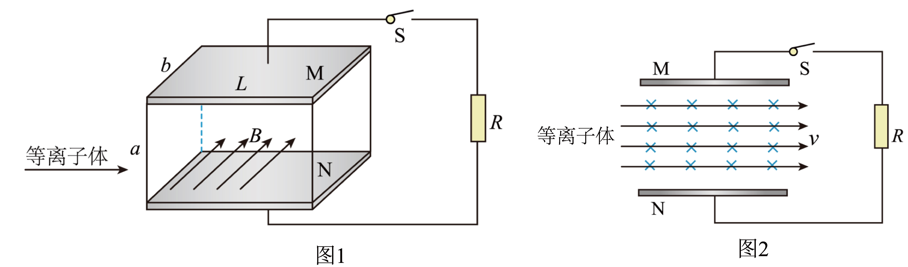
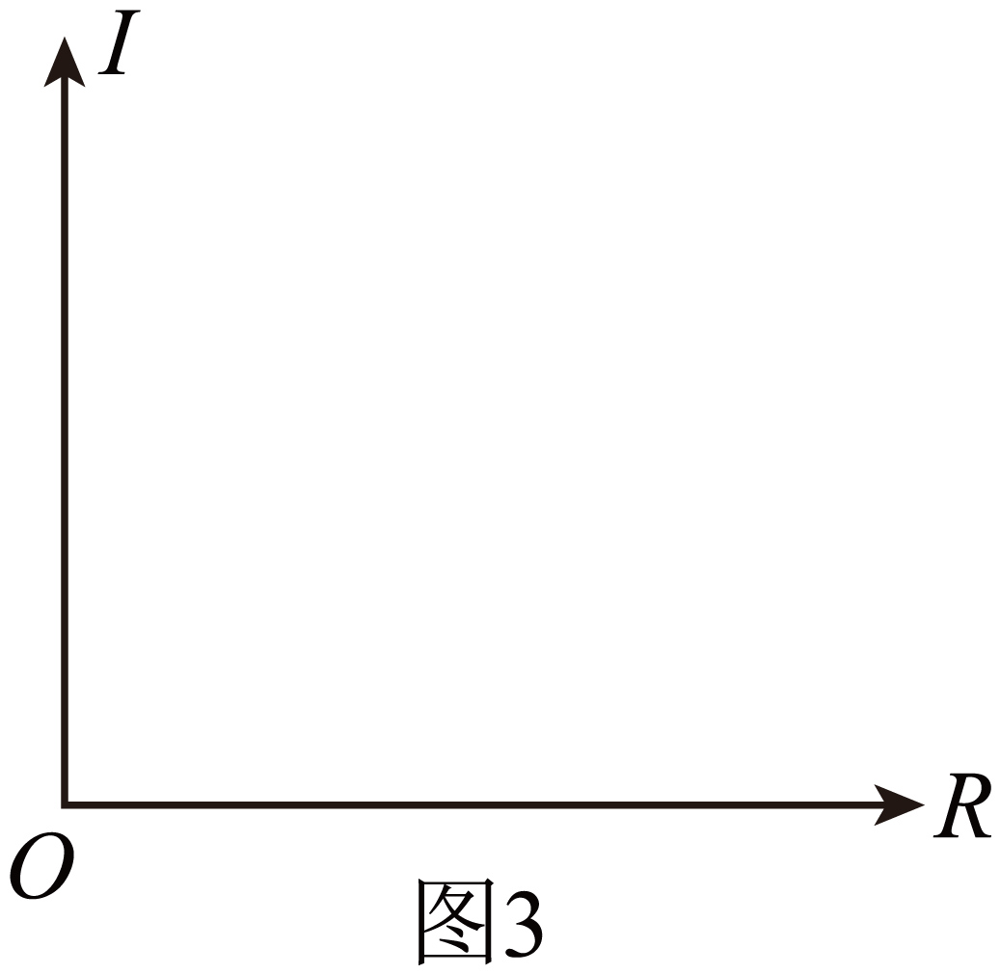

# Physics - 题目 332

**ID**: 8081b667ed6241feb2b69b11f1d15e88
**年级**: Grade 12
**难度**: Medium-Hard
**题型**: Calculation

## 题目
磁流体发电机是一种将内能直接转换为电能的新型发电装置，具有发电效率高、环境污染小、结构简单等特点，具有广泛的应用前景。​​​​​​​‌如图所示为该装置的导流通道，其主要结构如图1所示，通道的上下平行金属板M、N之间有很强的磁场，将等离子体（即高温下电离的气体，含有大量正、负带电粒子）从左侧不断高速喷入整个通道中，M、N两板间便产生了电压，其简化示意图如图2所示。M、N两金属板相距为a，板宽为b，板间匀强磁场的磁感应强度为B，速度为v的等离子体自左向右穿过两板后速度大小仍为v，截面积前后保持不变。设两板之间单位体积内等离子的数目为n，每个离子的电量为q，板间部分的等离子体等效内阻为r，外电路电阻为R。(1)金属板M、N哪一个是电源的正极，求这个发电机的电动势E；(2)开关S接通后，设等离子体在板间受到阻力恒为f，请从受力或能量转化与守恒的角度，求等离子体进出磁场前后的压强差Δp；(3)假设上下金属板M、N足够大，若R阻值可以改变，试讨论R中电流的变化情况，求出其最大值I_{m}。并在图3中坐标上定性画出I随R变化的图线，并指出横、纵轴关键点坐标值的大小。

## 解答

1. （1）由左手定则可知，正离子向上偏转，则M板为正极。
2. S断开时，M、N两板间电压的最大值，等于此发电机的电动势，根据 $q\frac {U}{a}=qvB$
3. 得 $E=U=Bva$
4. （2）方法一：根据能量转化与守恒
5. 外电路闭合后，有： $ΔpSv=EI+fv$
6. 即： $Δpabv=\frac {E{^{2}}}{R+r}+fv$
7. 得： ${\rm{Δ}}p=\frac {B{^{2}}av}{b\left ({R+r}\right )}+\frac {f}{ab}$
8. 方法二：根据平衡角度分析：
9. 外电路闭合后，有 $I=\frac {E}{R+r}=\frac {Bva}{R+r}$
10. 等离子体横向受力平衡，则 $ΔpS=BIa+f$
11. 解得 ${\rm{Δ}}p=\frac {B{^{2}}av}{b\left ({R+r}\right )}+\frac {f}{ab}$
12. （3）若R可调，由（2）知I随R减小而增大。当所有进入通道的离子全部偏转到极板上形成电流时，电流达到最大值，即饱和电流I_{m}。
13. $I{{}_{m}}=\frac {Q}{t}=\frac {Svtnq}{t}=nqabv$
14. 当I<I_{m}时，由（2）可得： $R>\frac {B}{nqb}-r$
15. 解得：当 $R>\frac {B}{nqb}-r$ 时， $I=\frac {Bva}{R+r}$
16. I随R的增大而减小，
17. 当 $R⩽\frac {B}{nqb}-r$ 时， $I=I{{}_{m}}=nqabv$
18. 电流饱和保持不变。
19. 由上分析：可定性画出如图所示的I-R图像（图中 $R{{}_{0}}=\frac {B}{nqb}-r$ ， $I{{}_{m}}=nqabv$ ）。
20. 

## 知识点

**中文**:
  - 磁流体发电机

**English**:
  - MHD Generator

---
