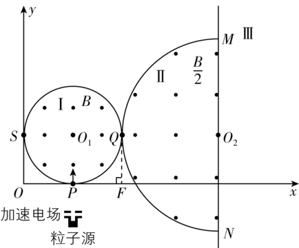

# Physics - 题目 1957

**ID**: 81a07b567b3f432d8caded3cebe2a9f0
**年级**: Grade 12
**难度**: Medium-Hard
**题型**: Calculation

## 题目
如图，在xOy坐标系中有三个区域，圆形区域Ⅰ分别与x轴和y轴相切于P点和S点。​​​​​​​‌半圆形区域Ⅱ的半径是区域Ⅰ半径的2倍。区域Ⅰ、Ⅱ的圆心O_{1}、O_{2}连线与x轴平行，半圆与圆相切于Q点，QF垂直于x轴，半圆的直径MN所在的直线右侧为区域Ⅲ。区域Ⅰ、Ⅱ分别有磁感应强度大小为B、 $\frac{B}{2}$ 的匀强磁场，磁场方向均垂直纸面向外。区域Ⅰ下方有一粒子源和加速电场组成的发射器，可将质量为m、电荷量为+q的粒子由电场加速到速度v_{0}。改变发射器的位置，使带电粒子在OF范围内都沿着y轴正方向以相同的速度v_{0}沿纸面射入区域Ⅰ。已知某粒子从P点射入区域Ⅰ，并从Q点射入区域Ⅱ（不计粒子的重力和粒子之间的影响）。（1）求加速电场两板间的电压U和区域Ⅰ的半径R；（2）在能射入区域Ⅱ的粒子中，某粒子在区域Ⅱ中运动的时间最短，求该粒子在区域Ⅰ和区域Ⅱ中运动的总时间t；（3）在区域Ⅲ加入匀强磁场和匀强电场，磁感应强度大小为B，方向垂直纸面向里，电场强度大小E=Bv_{0}，方向沿x轴正方向。此后，粒子源中某粒子经区域Ⅰ、Ⅱ射入区域Ⅲ，进入区域Ⅲ时速度方向与y轴负方向的夹角成74°角。当粒子动能最大时，求粒子的速度大小和所在的位置到y轴的距离 $(\sin 37°=\frac{3}{5}，\sin 53°=\frac{4}{5})$ 。

## 解答

1. （1）根据动能定理得
2. ${\rm \mathit{qU}=}\frac{1}{2}{\rm \mathit{m}}$  ${v}_{0}^{2}$     	（1分）
3. 解得 ${\rm \mathit{U}=}\frac{m{v}_{0}^{2}}{2q}$     	（1分）
4. 粒子进入区域Ⅰ做匀速圆周运动，粒子从P点射入区域Ⅰ，并从Q点射入区域Ⅱ，可知此粒子的运动轨迹半径与区域Ⅰ的半径R相等，粒子在磁场中运动，洛伦兹力提供向心力，有
5. ${\rm \mathit{Bqv}_{0}=\mathit{m}}\frac{{v}_{0}^{2}}{R}$     	（1分）
6. 解得 ${\rm \mathit{R}=}\frac{m{v}_{0}}{\mathrm{B}\mathrm{q}}$     	（1分）
7. （2）带电粒子在OF范围内都沿着y轴正方向以相同的速度v_{0}沿纸面射入区域Ⅰ，由（1）可得，粒子均在磁场中做匀速圆周运动，轨迹半径均为R，因为区域Ⅰ的半径和轨迹半径相等，粒子射入点、区域Ⅰ圆心O_{1}、轨迹圆心O'、粒子出射点四点构成一个菱形，由几何关系可知，区域Ⅰ圆心O_{1}和粒子出射点连线平行于粒子射入点与轨迹圆心O'连线，则区域Ⅰ圆心O_{1}和粒子出射点连线水平，可知粒子都从Q点射出，粒子射入区域Ⅱ，仍做匀速圆周运动，洛伦兹力提供向心力
8. ${\rm \mathit{q}}\frac{B}{2}{\rm \mathit{v}_{0}=\mathit{m}}$  $\frac{{v}_{0}^{2}}{R\text{'}}$     	（1分）
9. 解得R'=2R（1分）
10. 如图（a）所示，要使粒子在区域Ⅱ中运动的时间最短，轨迹所对应的圆心角应最小，则在区域Ⅱ中运动的圆弧所对的弦长最短，即此时最短弦长为区域Ⅱ的磁场圆半径2R，根据几何知识可知，此时粒子在区域Ⅱ和区域Ⅰ中运动的轨迹所对应的圆心角都为60°，粒子在两区域中运动周期分别为
11. ${\rm \mathit{T}_{1}=}\frac{2\mathrm{\pi }R}{{v}_{0}}{\rm =}$  $\frac{2\mathrm{\pi }m}{\mathrm{B}\mathrm{q}}$     	（1分）
12. ${\rm \mathit{T}_{2}=}\frac{2\mathrm{\pi }·2R}{{v}_{0}}{\rm =}$  $\frac{4\mathrm{\pi }m}{\mathrm{B}\mathrm{q}}$     	（1分）
13. 可得该粒子在区域Ⅰ和区域Ⅱ中运动的总时间为
14. ${\rm \mathit{t}=}\frac{60°}{360°}{\rm \mathit{T}_{1}+}$  $\frac{60°}{360°}{\rm \mathit{T}_{2}=}$  $\frac{\mathrm{\pi }m}{\mathrm{B}\mathrm{q}}$     	（2分）
15. 
16. 图（a）
17. （3）如图（b）所示，将速度v_{0}分解为沿y轴正方向的速度v_{1}（v_{1}=v_{0}）及速度v'，
18. 因为E=Bv_{0}（1分）
19. 则Eq=Bqv_{0}（1分）
20. 故沿y轴正方向的速度v_{1}产生的洛伦兹力与电场力平衡，粒子同时受到另一方向的洛伦兹力Bqv'，故粒子沿y轴正方向做旋进运动，根据几何关系可知
21. v'=2v_{0}sin 53°=1.6v_{0}（1分）
22. 当v'方向为沿y轴正方向时，此时粒子速度最大，即最大速度为
23. v_{m}=v_{1}+v'=v_{0}+1.6v_{0}=2.6v_{0}（1分）
24. 设粒子做匀速圆周运动的轨迹半径为R_{1}，由
25. ${\rm \mathit{qv'B}=\mathit{m}}\frac{v{\text{'}}^{2}}{{R}_{1}}$
26. 解得R_{1}=1.6R（1分）
27. 根据几何关系可知此时粒子所在的位置到y轴的距离为
28. L=R_{1}+R_{1}sin  ${\rm 53\mathit{°}+2\mathit{R}+2\mathit{R}=6\mathit{.}88\mathit{R}=}\frac{172m{v}_{0}}{25\mathrm{B}\mathrm{q}}$     	（1分）
29. 
30. 图（b）

## 知识点

**中文**:
  - 带电粒子在叠加场中的运动
  - 带电粒子在有界匀强磁场中的运动

**English**:
  - Motion in Superimposed Fields
  - Motion in Bounded Uniform Magnetic Field

---
