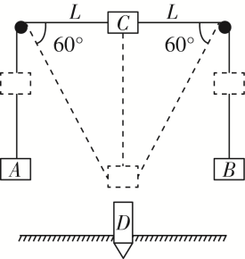

# Physics - 题目 900

**ID**: 81cccd4628b44783b702d63ea6b0225e
**年级**: Grade 12
**难度**: Medium-Hard
**题型**: 解答题：本题共3小题，共40分。

## 题目
(16分)打桩机是基建常用工具。​​​​​​​‌某种简易打桩机模型如图所示，重物A、B和C通过不可伸长的轻质长绳跨过两个光滑的等高小定滑轮连接，C与滑轮等高(图中实线位置)时，C到两定滑轮的距离均为L。重物A和B的质量均为m，系统可以在如图虚线位置保持静止，此时连接C的绳与水平方向的夹角为60°。某次打桩时，用外力将C拉到图中实线位置，然后由静止释放。设C的下落速度为 $\sqrt{\frac{3gL}{5}}$ 时，与正下方质量为2m的静止桩D正碰，碰撞时间极短，碰撞后C的速度为零，D竖直向下运动 $\frac{L}{10}$ 距离后静止(不考虑C、D再次相碰)。A、B、C、D均可视为质点。(1)求C的质量；(2)若D在运动过程中受到的阻力F可视为恒力，求F的大小；(3)撤掉桩D，将C再次拉到图中实线位置，然后由静止释放，求A、B、C的总动能最大时C的动能。

## 解答

1. (1)设系统在题图虚线位置保持静止时绳上拉力大小为T，由受力平衡有2Tsin 60̊＝m_{C}g(2分)
2. 其中T＝mg(1分)
3. 解得 ${\rm \mathit{m}\mathit{_{C}}＝}\sqrt{3}$m(1分)
4. (2)C和D发生碰撞时，动量守恒，设 ${\rm \mathit{v}_{0}＝}\sqrt{\frac{3}{5}gL}$ ，
5. 有m_{C}v_{0}＝2mv(2分)
6. 对D向下运动过程，由动能定理有
7. ${\rm －\mathit{F}·}\frac{1}{10}{\rm \mathit{L}＋2\mathit{mg}·}$  $\frac{1}{10}{\rm \mathit{L}＝0－}$  $\frac{1}{2}$ ·2mv^{2}^{    	}^{    	}^{    	}^{    	}^{    	}^{    	}(2分)
8. 解得 ${\rm \mathit{F}＝}\frac{13}{2}$mg(1分)
9. (3)当重物C下降的距离为x，由系统机械能守恒有
10. $\sqrt{3}$mgx－2mg( $\sqrt{{L}^{2}+{x}^{2}}$ －L)＝E_{k}_{    	}_{    	}_{    	}_{    	}_{    	}_{    	}(1分)
11. 令 ${\rm \mathit{f}(\mathit{x})＝}\sqrt{3}$mgx－2mg( $\sqrt{{L}^{2}+{x}^{2}}$ －L)，
12. 则 ${\rm \mathit{f~'}(\mathit{x})＝}\sqrt{3}{\rm \mathit{mg}－2\mathit{mg}·}$  $\frac{1}{2}{\rm ·}$  $\frac{2x}{\sqrt{{L}^{2}+{x}^{2}}}$ ，
13. 当f'(x)＝0，即 ${\rm \mathit{x}＝}\sqrt{3}{\rm \mathit{L}}$ 时，f(x)有最大值，系统总动能最大，
14. 此时连接C的绳和水平方向夹角为60°    	    	    	    	    	(2分)
15. 沿绳方向速度相等，有v_{C}sin 60̊＝v_{A}_{    	}_{    	}_{    	}_{    	}_{    	}_{    	}(1分)
16. 当 ${\rm \mathit{x}＝}\sqrt{3}{\rm \mathit{L}}$ 时，解得系统最大动能E_{km}＝mgL(1分)
17. 又A的动能和B的动能相等，有
18. ${\rm \mathit{E}_{km}＝}\frac{1}{2}{\rm \mathit{m}\mathit{_{C}}}$  ${v}_{C}^{2}{\rm ＋}$  $\frac{1}{2}{\rm \mathit{m}}$  ${v}_{A}^{2}{\rm ×2}$     	    	    	    	    	    	    	    	(1分)
19. 解得 ${\rm \mathit{E}_{k}\mathit{_{C}}＝}\frac{1}{2}{\rm \mathit{m}\mathit{_{C}}}$  ${v}_{C}^{2}$ ＝(4－2  $\sqrt{3}$ )mgL(1分)

## 知识点

**中文**:
  - 机械能守恒及其判断

**English**:
  - Judgment of Mechanical Energy Conservation

---
