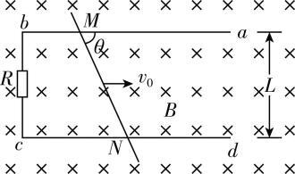

# Physics - 题目 2404

**ID**: 82b87993b8d541ea87bddcbf6f45b34b
**年级**: Grade 12
**难度**: Medium-Hard
**题型**: Calculation

## 题目
（16分）如图, $ab$ 、 $cd$ 为相距 $L$ 的平行导轨（电阻不计）, $b$ 、 $c$ 间接有一固定电阻,阻值为 $R$ ,长直细导体杆可以按任意夹角 $\theta $  架在平行导轨上,细导体杆与导轨接触良好，接触点为 $M$ 、 $N$ 。​​​​​​​‌导体杆以平行于导轨的速度 ${v}_{0}$ 匀速滑动,已知导体杆单位长度的电阻为 $R$ 。整个空间充满垂直于导轨平面的匀强磁场,磁感应强度为 $B$ 。求:（1） 当 $\theta ={90}^{\circ }$  时, $M$ 、 $N$ 哪端电势高, $M$ 、 $N$ 两点间的电压 ${U}_{MN}$ 为多少;（2） 当 $\theta ={90}^{\circ }$  时,经过 $t$ 时间电阻 $R$ 上产生的焦耳热 $Q$ ;（3） 当 $\theta $  取多少时, $MN$ 段电阻消耗的电功率最大,最大电功率为多少。

## 解答

1. （1） 当 $\theta ={90}^{\circ }$  时，导体杆以速度 ${v}_{0}$ 匀速运动,切割磁感线产生感应电动势,根据右手定则可得 $M$ 端电势高（1分）
2. 感应电动势 $E=BL{v}_{0}$ （1分）
3. 导体杆接入电路的电阻 $r=LR$ （1分）
4. 根据闭合电路欧姆定律有 $I=\frac{E}{R+r}$ （1分）
5. 则$M$、$N$两点间的电压${U}_{MN}=\frac{R}{(L+1)R}E=\frac{BL{v}_{0}}{L+1}$ （易错： $M$ 、 $N$ 两点间的电压为路端电压，不是导体杆分得的电压）（1分）
6. （2） 导体杆匀速运动,电路中的电流恒定,根据焦耳定律可知时间 $t$ 内电阻 $R$ 上产生的焦耳热 $Q={I}^{2}Rt$ （1分）
7. 代入数据可得 $Q=\frac{{B}^{2}{L}^{2}{v}_{0}^{2}}{{\left(L+1\right)^{2}}R}t$ （2分）
8. （3） 当 $MN$ 与导轨夹角为 $\theta $  时,导体杆切割磁感线产生的感应电动势为 $E=BL{v}_{0}$ ，此时导体杆接入电路的电阻 $r\prime =\frac{LR}{\sin \theta }$ （1分）
9. 电路中的总电阻为 ${R}_{总}=\frac{LR}{\sin \theta }+R$ （1分）
10. 此时电路中的电流 $I\prime =\frac{E}{{R}_{总}}=\frac{BL{v}_{0}}{(\frac{L}{\sin \theta }+1)R}$ （1分）
11. MN段电阻消耗的电功率可以表示为 ${P}_{r}=\frac{{B}^{2}{L}^{2}{v}_{0}^{2}}{{\left(\frac{L}{\sin \theta }+1\right)^{2}}{R}^{2}}\cdot \frac{L}{\sin \theta }R$ （1分）
12. 进一步化简可以得到 ${P}_{r}=\frac{{B}^{2}{L}^{2}{v}_{0}^{2}}{R}\cdot \frac{1}{\frac{L}{\sin \theta }+2+\frac{\sin \theta }{L}}$ （1分）
13. 当 $\frac{L}{\sin \theta }=\frac{\sin \theta }{L}$ 时， ${P}_{r}$ 最大（1分）
14. 因为 $0⩽\sin \theta ⩽1$ ，当 $0<L<1$ ， $\sin \theta =L$ 时,最大电功率为
15. ${P}_{r}=\frac{{B}^{2}{L}^{2}{v}_{0}^{2}}{4R}$ （1分）
16. 当 $L⩾1$ 时， $\theta ={90}^{\circ }$  时 $MN$ 段电阻消耗的电功率最大，此时最大电功率为 ${P}_{r}=\frac{{B}^{2}{L}^{3}{v}_{0}^{2}}{{\left(L+1\right)^{2}}R}$ （1分）
17. 【试题解构】（3）
18. 
19. $\mathrm{a}$ .电动势分析：当导体杆与导轨夹角为 $\theta $  时，有效切割长度为 $L$ ，所以感应电动势为 $E=BL{v}_{0}$
20. $\mathrm{b}$ .电阻分析：导体杆接入电路的长度为 $\frac{L}{\sin \theta }$ ，所以导体杆接入电路的电阻为 $\frac{LR}{\sin \theta }$
21. $\mathrm{c}$ .电流分析：电路的总电阻为 $\frac{LR}{\sin \theta }+R$ ，电路中的电流为 $\frac{E}{{R}_{总}}=\frac{BL{v}_{0}}{(\frac{L}{\sin \theta }+1)R}$

## 知识点

**中文**:
  - 电磁感应现象中的功能问题

**English**:
  - Work-Energy Problems in EM Induction

---
