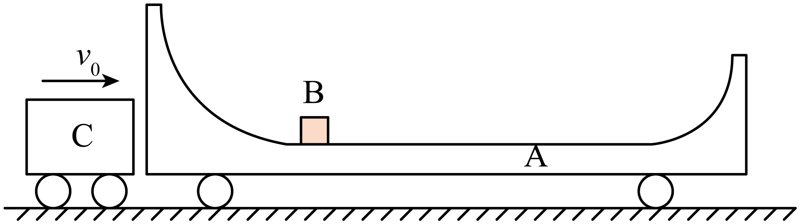

# Physics - 题目 535

**ID**: 84503dbd45f84e9db132930aa86ddf52
**年级**: Grade 12
**难度**: Medium-Hard
**题型**: Calculation

## 题目
如图所示，一实验小车A静止在光滑水平面上，其水平轨道部分表面粗糙、长为L，小车两端均有光滑的四分之一圆弧轨道，与水平轨道均相切于圆弧轨道最低点。​​​​​​​‌一可视为质点的滑块B静止于左侧圆弧轨道的最低点，另一小车C从左侧以初速度 $v{{}_{0}}$ 与小车A左端发生正碰，碰撞时间极短，碰后一起运动但不粘连，整个过程中滑块B未从左侧圆弧轨道上端滑出，小车A与小车C未发生第二次碰撞。已知小车A的质量为2m，滑块B与小车C的质量均为m，重力加速度为g。（1）求滑块B到达左侧圆弧轨道的最大高度；（2）求小车C与小车A分离时，小车C的速度大小；（3）若滑块B向右滑到圆弧轨道后恰好未滑出轨道，且返回到水平轨道中点时恰好与小车A保持相对静止，求滑块B与小车A水平轨道间的动摩擦因数和右侧圆弧轨道的半径。

## 解答

1. （1）设小车C与小车A碰后瞬间的速度大小为 $v{{}_{1}}$ ，对小车A与小车C系统根据动量守恒定律有 $mv{{}_{0}}=\left ({2m+m}\right )v{{}_{1}}$ ，
2. 解得 $v{{}_{1}}=\frac {1}{3}v{{}_{0}}$ ，
3. 由题可知，小车A、滑块B与小车C的速度相等时滑块B达到最大高度，设此时的速度大小为 $v{{}_{2}}$ ，由动量守恒定律有 $mv{{}_{0}}=\left ({3m+m}\right )v{{}_{2}}$ ，
4. 解得 $v{{}_{2}}=\frac {1}{4}v{{}_{0}}$ ，
5. 小车C与小车A碰后到三者共速，根据机械能守恒定律有 $\frac {1}{2}\times 3mv{{}_{1}^{2}}=mgH+\frac {1}{2}\times 4mv{{}_{2}^{2}}$ ，
6. 解得 $H=\frac {v{{}_{0}^{2}}}{24g}$ 。
7. （2）小车C与小车A碰撞直到滑块B返回最低点的过程中小车A与小车C一直未分离，当滑块B返回水平轨道后小车A开始做加速运动，小车A与小车C分离，此后小车C的速度不变，以水平向右为正方向，设小车A与小车C分离时滑块B的速度为 $v{{}_{3}}$ ，小车A与小车C的速度为 $v{{}_{4}}$ ，小车C与小车A碰撞到二者分离，根据动量守恒定律有 $3mv{{}_{1}}=mv{{}_{3}}+3mv{{}_{4}}$ ，
8. 根据机械能守恒定律有 $\frac {1}{2}\times 3mv{{}_{1}^{2}}=\frac {1}{2}mv{{}_{2}^{2}}+\frac {1}{2}\times 3mv{{}_{4}^{2}}$ ，
9. 解得 $v{{}_{3}}=\frac {1}{2}v{{}_{0}}$ ， $v{{}_{4}}=\frac {1}{6}v{{}_{0}}$ 。
10. （3）滑块B到达右侧圆弧轨道最高点时小车A与滑块B的速度相同，从小车A与小车C分离到小车A与滑块B共速，根据动量守恒定律有 $mv{{}_{3}}+2mv{{}_{4}}=3mv{{}_{5}}$ ，
11. 解得 $v{{}_{5}}=\frac {5}{18}v{{}_{0}}$ ，
12. 整个过程中小车A与滑块B组成的系统能量守恒，根据能量守恒定律有 ${\rm }{\rm μm}gL+mgR=\frac {1}{2}mv{{}_{3}^{2}}+\frac {1}{2}\times 2mv{{}_{4}^{2}}-\frac {1}{2}\times 3mv{{}_{5}^{2}}{\rm }$ ，
13. 根据动量守恒定律可知，当滑块B滑回水平轨道中点时，小车A与滑块B的速度也为 $v{{}_{5}}$ ，此过程中，根据能量守恒定律有 ${\rm μm}g\cdot \frac {1}{2}L=mgR$ ，
14. 解得 $μ=\frac {2v{{}_{0}^{2}}}{81gL}$ ， $R=\frac {v{{}_{0}^{2}}}{81g}$ 。

## 知识点

**中文**:
  - 人船模型

**English**:
  - Man-Boat Model

---
