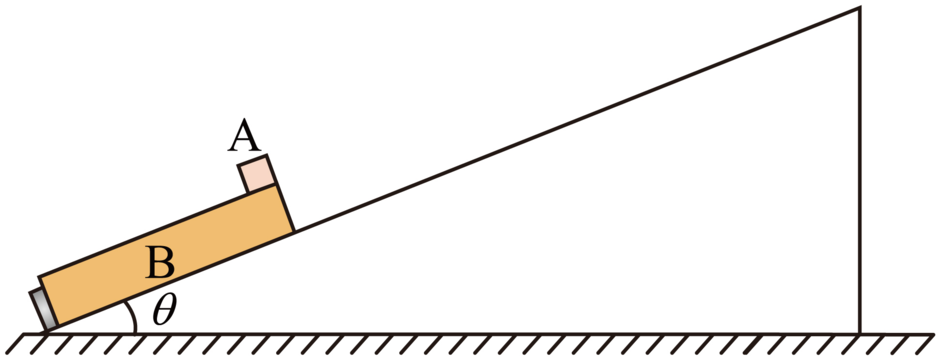

# Physics - 题目 1985

**ID**: 85279d61b007492b9d2e522f67789501
**年级**: Grade 12
**难度**: Medium-Hard
**题型**: Calculation

## 题目
如图所示，固定在水平面上的光滑斜面，倾角 $θ=30{}\degree $ ，底端固定弹性挡板，长木板B放在斜面上，小物块A放在B的上端，沿斜面向上敲击B，使B立即获得初速度 $v{{}_{0}}=3.0{\rm{m}}/{\rm{s}}$ ，此后B和挡板发生碰撞，碰撞前后速度大小不变，方向相反，A始终不脱离B且与挡板不发生碰撞，已知A、B的质量均为 $m=1.0{\rm{k}}{\rm{g}}{\rm ，A}$ 、B间的动摩擦因数 $μ=\frac {\sqrt {3}}{2}$ ，最大静摩擦力等于滑动摩擦力，取重力加速度 $g=10{\rm{m}}/{\rm{s}}{^{2}}$ 。​​​​​​​‌求：（1）敲击B后的瞬间，A、B的加速度大小 $a{{}_{{\rm{A}}}}$ 、 $a{{}_{{\rm{B}}}}$ ；（2）B上升的最大距离s；（3）B的最小长度L。

## 解答

1. （1）敲击B后的瞬间，A受到向上的滑动摩擦力，
2. 对A由牛顿第二定律有 ${\rm }{\rm μm}{{}_{{\rm{A}}}}g{\cos}30{}\degree -m{{}_{{\rm{A}}}}g\sin 30{}\degree =m{{}_{{\rm{A}}}}a{{}_{{\rm{A}}}}{\rm }$ ，
3. 解得 $a{{}_{{\rm{A}}}}=2.5{\rm{m}}/{\rm{s}}{^{2}}$ ，
4. 对B由牛顿第二定律有 ${\rm }{\rm μm}{{}_{{\rm{A}}}}g{\cos}30{}\degree +m{{}_{{\rm{B}}}}g\sin 30{}\degree =m{{}_{{\rm{B}}}}a{{}_{{\rm{B}}}}{\rm }$ ，
5. 解得 $a{{}_{{\rm{B}}}}=12.5{\rm{m}}/{\rm{s}}{^{2}}$ 。
6. （2）设A、B向上运动，经过时间t后共速有 $v{{}_{0}}-a{{}_{{\rm{B}}}}t=a{{}_{{\rm{A}}}}t$ ，
7. 共速后A、B一起以加速度a向上减速，对A、B分析，有 $(m{{}_{{\rm{A}}}}+m{{}_{{\rm{B}}}})g\sin 30{}\degree =(m{{}_{{\rm{A}}}}+m{{}_{{\rm{B}}}})a$ ，
8. $s=\left ({v{{}_{0}}t-\frac {1}{2}a{{}_{{\rm{B}}}}t{^{2}}}\right )+\frac {{\left({v{{}_{0}}-a{{}_{{\rm{B}}}}t}\right)^{2}}}{2a}$ ，
9. 解得 $s=0.375{\rm{m}}$ 。
10. （3）最终A、B均停在挡板处，此时B的长度最小，由能量守恒定律得 $\frac {1}{2}m{{}_{{\rm{B}}}}v{{}_{0}^{2}}+m{{}_{{\rm{A}}}}gL\sin 30{}\degree ={\rm μm}{{}_{{\rm{A}}}}g{\cos}30{}\degree \cdot L$ ，
11. 解得 $L=1.8{\rm{m}}$ 。

## 知识点

**中文**:
  - 动量守恒与板块模型相结合

**English**:
  - Momentum Conservation with Plate Models

---
