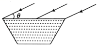

# Physics - 题目 2566

**ID**: 854ca878b8db4371be70ab5bfa91bb1c
**年级**: Grade 12
**难度**: Medium-Hard
**题型**: Calculation

## 题目
图示为一横截面为等腰梯形的容器，容器内装满了水。​​​​​​​‌当一束平行单色光斜射到水面上且与水面的夹角 $θ=37{}^\circ $ 时，恰好可以照射到整个底部，已知容器内水深 $h=0.2{\rm{m}}$ ，水面宽 $d{{}_{0}}=0.5{\rm{m}}$ ，水的折射率为 $\frac {4}{3}$ ，取 ${\sin}37{}^\circ =0.6$ ， ${\cos}37{}^\circ =0.8$ ，光在真空中的传播速度 $c=3\times 10{^{8}}{\rm m}/{\rm s}$ 。求：（1）容器底部的宽度；（2）光从水面折射后直接射到容器底部的时间（结果保留两位有效数字）。

## 解答

1. （1）根据折射定律有 $n=\frac {{\sin}i}{{\sin}r}$ ，其中入射角为
2. $i=90{}^\circ -37{}^\circ =53{}^\circ $
3. 解得折射角为
4. $r=37{}^\circ $
5. 光恰好照射到整个底部，根据几何关系可知，容器侧面与水平方向的夹角为 $53{}^\circ $ ，则
6. ${\tan}53{}^\circ =\frac {h}{x}$
7. 解得
8. $x=0.15{\rm{m}}$
9. 容器底部宽度
10. $d=d{{}_{0}}-2x=0.2{\rm{m}}$ ；
11. （2）根据几何关系可知，光从水面射到底部通过的距离等于侧面的长度 $l$ ，则有
12. $t=\frac {l}{v}$
13. 其中
14. $l=\frac {h}{{\cos}37{}^\circ }$
15. 且光在水里的传播速度为
16. $v=\frac {c}{n}$
17. 联立解得
18. $t=1.1\times 10{^{-9}}{\rm{s}}$

## 知识点

**中文**:
  - 光的折射定律及其应用

**English**:
  - Law of Refraction and Applications

---
